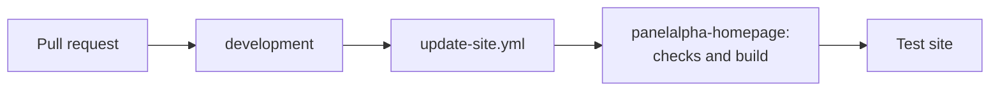

<div align="center">

<p align="center"><picture><source media="(prefers-color-scheme: dark)" srcset=".github/assets/panelalpha-documentation.svg"></picture></p>

<h3>
The source of the PanelAlpha documentation.<br>
Markdown pages and their images, published at panelalpha.com/documentation.
</h3>

<p>
<a href="#products"><b>Products</b></a> ·
<a href="#how-a-change-reaches-the-site"><b>Publishing</b></a> ·
<a href="CONTRIBUTING.md"><b>Writing pages</b></a>
</p>

<p>
<a href="https://github.com/panelalpha/panelalpha-documentation/actions/workflows/update-site.yml"></a>


</p>

</div>

This repo holds only the pages and their images. The site itself is built by
[panelalpha-homepage](https://github.com/panelalpha/panelalpha-homepage), which reads this repo on
every build. The sidebar, search and the documentation home page come from the files here, so a
merged page needs no other change.

## Products

One folder per product. A new product is a new folder.

| Product | Folder | What it covers |
|---|---|---|
| Single Server Edition | [`single-server/`](single-server/index.md) | The web hosting panel you install on your own VPS |
| Multi Server Edition | [`multi-server/`](multi-server/index.md) | PanelAlpha across many servers, with billing systems and integrations |
| Troubleshooting Center | [`troubleshooting-center/`](troubleshooting-center/index.md) | Known problems and fixes, shown under Multi Server on the site |
| PanelAlpha Engine | [`panelalpha-engine/`](panelalpha-engine/index.md) | Engine 2.x, with Engine 1.x in [`v1/`](panelalpha-engine/v1/index.md) |

```
index.md          documentation home page: texts, external cards, community links
assets/           images used by the pages
<product>/        pages; index.md is the product start page and holds its sidebar settings
```

A page at `multi-server/billing/stripe.md` is published at
`/documentation/multi-server/billing/stripe`.

## How a change reaches the site



1. A merge or push to `development` runs `.github/workflows/update-site.yml`.
2. That workflow starts the deploy of panelalpha-homepage on its own `development` branch.
3. panelalpha-homepage checks every page, builds the site and deploys it. This takes about
   5 minutes. The result is in the Actions tab of panelalpha-homepage.

**A broken link, a missing image or a page without a title stops the build**, and the site keeps
the last good version.

| Branch | Site |
|---|---|
| `development` | test site |
| `main` | panelalpha.com (not connected yet) |

## Contributing

Work in your own branch and open a pull request to `development`. The page format, the sidebar
settings and how to preview a page on your computer: [Writing pages](CONTRIBUTING.md).
