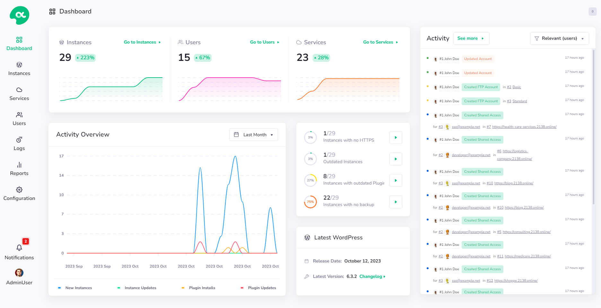
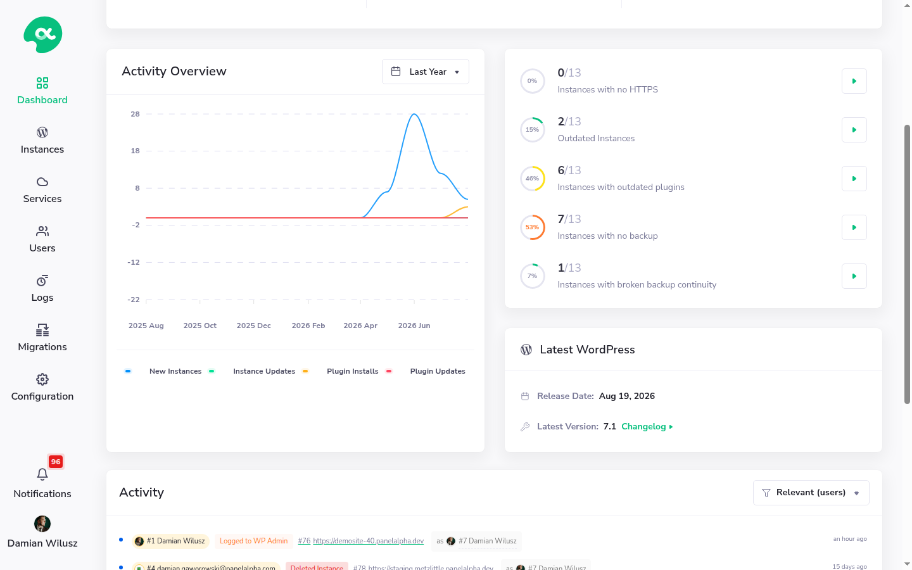

# Dashboard

The application dashboard is a central hub that provides users with an overview of important information and access to various features. It consists of several components designed to enhance the user experience.

## Widgets

The dashboard includes several widgets with key data that can be filtered:

- **Instances, Users & Services** - a quick summary of the number of items created, with up/down percentage values.
- **Activity Overview** - a line graph showing new and updated instances, plugin installations, and updates; filtered by year, month, or week.
- **Instances Summary** - the percentage of instances of each type relative to the total:
  - number of instances with no HTTPS
  - number of outdated instances
  - number of instances with outdated plugins
  - number of instances with no backups
- **Automatic backup health** — **Instances with broken backup continuity**: scheduled backups that stopped arriving on time. Open the list from the dashboard. The existing "no backups at all" summary is unchanged.

- **Latest WordPress** - information on the latest released version, release date, and a link to the official changelog.
- **Activity** - a summary of activity logs with the most crucial data highlighted. You can filter the displayed data and sort by "Most Relevant" by default. Log categories include:
  - Most Relevant
  - Instances
  - Plugins
  - Backups
  - Themes
  - Hosting
  - Users
  - Subusers
  - Sharing access
  - Log-ins
  - Admins
  - Config

## Side Menu

Quick access to all sections in the admin area:

- Dashboard
- [Instances](instances.md)
- [Services](services.md)
- [Users](users.md)
- [Logs](logs.md)
- Reports
- [Configuration](../system-configuration/general-configuration.md)
- Notifications
- Your profile details
