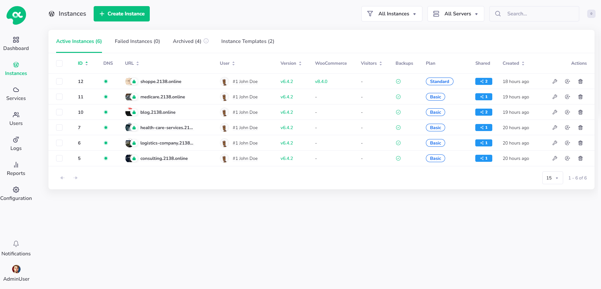
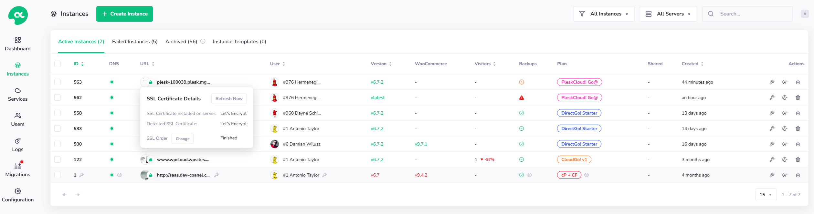
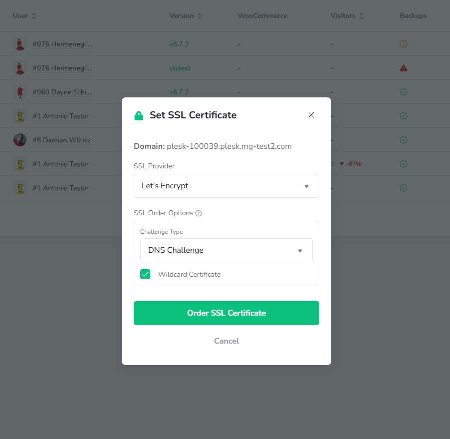
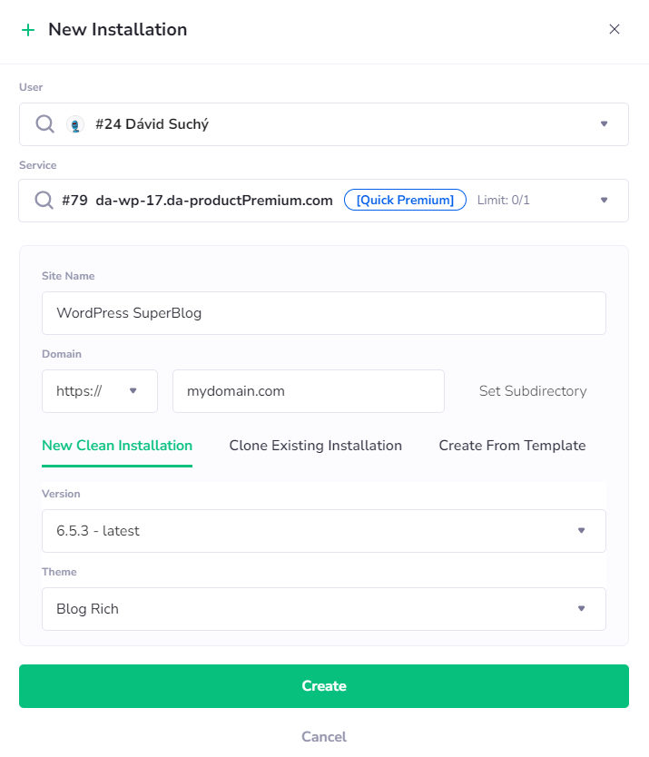
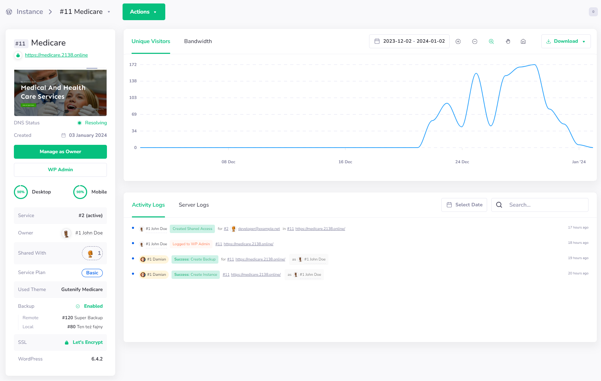
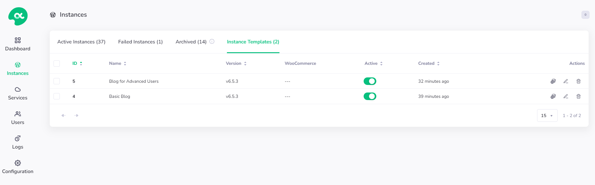

# Instances

This section provides detailed information about instances within the PanelAlpha platform. Instances are websites created by end users and hosted by administrators. In the admin area, you can access the list of all client instances and quickly create a new instance, assigning it to a single user.

## Instances List

The **Instances** section includes the following tabs:

- **Active** - list of active instances with the following information:
  - ID number - click to be redirected to the instance details
  - DNS status
  - URL - domain with its SSL status
  - User - assigned user
  - Version - WordPress version of the instance
  - WooCommerce version - if applicable
  - Number of visitors to the website in the last 30 days, with a trend compared to the 30 days before. The count ends with yesterday, so it does not drop to zero at the start of a month. For AWStats, the number is an estimate.
  - Current backup information
  - Plan on which the instance was created
  - Shared access users, visible on hover
  - Date of creation
  - Allowed actions:
    - Manage the instance from the admin level
    - View the instance in the client area (logged in as that user)
    - Delete the instance
- **Trial** - list of trial instances.
- **Failed** - list of instances where installation failed; you can retry installation or remove the failed instance permanently.
- **Archived** - archived instances list. From this tab, you can remove archived instances permanently.
- **[Instance Templates](instances.md#instance-templates)** - list of templates that can be used as a base for creating new WordPress installations.

## SSL Certificate Details

The SSL Certificate Details feature provides administrators with quick access to certificate information and management options. This information is accessible by hovering over the lock icon in the URL column.

The SSL Certificate Details popup displays two primary sections:

- **SSL Certificate installed on server** - details about the certificate currently installed on the server.
- **Detected SSL Certificate** - information about the certificate detected for the domain. It shows **Detected from:** with the IP address the certificate was fetched from. If the domain currently resolves to a different IP than this server, a warning tells you that the domain resolves elsewhere and that DNS may still be propagating.

#### Managing SSL Orders

Within the SSL Certificate Details popup, administrators can modify SSL order settings using the **Change** button.

Clicking the **Change** button allows administrators to choose the **Certificate Source**:

1. **Order from SSL Provider** — select an **SSL Provider**, choose the **Challenge Type** for domain validation, and optionally include a wildcard.
2. **Custom Certificate** — paste the **Certificate (CRT)**, **Private Key (KEY)**, and optional **Certificate Authority Bundle (CABUNDLE)**, then install the certificate on the server.

Custom certificate installation is available when the hosting integration supports installing certificates on the account.

#### Challenge Type Selection

The Challenge Type selection determines the verification method used during SSL certificate issuance. Administrators can select the most appropriate challenge type for each domain depending on their specific configuration and requirements.

This feature enables administrators to manage SSL certificate orders for individual domains directly from the domain management interface.

## Creating New Instance

Admin users can create new instances directly from the admin area.

1. Click the **Create Instance** button at the top of the page.
2. A modal form will appear - provide the basic information required to create a new WordPress installation.

Note that the process is the same as when an end user creates an instance in the client area.

- **User** - select the user to whom the instance will be assigned.
- **Service** - choose the service on which the instance will be created. The selected service determines the onboarding method, limits, and other features defined in the associated plan.

Additional steps will vary depending on the [plan](../system-configuration/plans.md) associated with the selected service. For example, below is the creation flow with the **[Quick Onboarding](../onboarding-methods/quick-onboarding.md)** method:

- Provide the **Site Name**
- Enter the **Domain** and set a subdirectory if needed
- If you choose to create a **new clean installation**:
  - Choose the WordPress version
  - Select a theme from the dropdown list
- For **cloning an existing installation**:
  - Select one of the existing instances to clone
- When **creating from instance template**:
  - Choose an instance template with **Active** status

3. Click **Create** to confirm. When installation is complete, the new instance will be visible in both the admin and client areas, assigned to the selected user.

## Instance Details

To gain more insights into a particular instance, use the **Manage Instance** option. This feature allows you to access detailed information about an instance, including its configuration settings and relevant metadata.

Click the relevant action button, instance ID, or URL on the list to be redirected to the details page.

On the details card, the **Google Analytics** switch turns the panel Google Analytics tag on or off for this instance. It is shown only when Google Analytics is enabled as a statistics provider. When the tag is off, the panel does not add it to the site and collects no new statistics. The client can change the same setting under **Advanced → Google Analytics**. For WP Cloud instances that were converted to WordPress Multisite, the card shows **Multisite: Yes**.

The instance details page is divided into four sections:

1. Basic data about the instance, such as name and URL, preview, service details, and action buttons to manage the site and log in to WP Admin.
2. Graph charts:
   - **Unique Visitors**
   - **Bandwidth**

   Both graphs have advanced filtering options to change date ranges and zoom specific time periods. You may also download the current chart view in SVG, PNG, or CSV format.
3. Logs area with tabs:
   - **Activity Logs**
   - **Server Logs**
   - **WordPress Error Logs**
   - **PHP Logs**
   - **Webserver Logs**

   Use the date filter and search box to find specific entries.
4. Allowed actions on an instance:
   - **Manage as Owner** - log in to the PanelAlpha client area to preview the management page of the instance.
   - **WP Admin** - redirect to the WP Admin panel to manage the website directly.
   - **Save as Template** - provide a template name and save it. The template can then be used to create new installations.
   - **Restore from Backup** - restore the instance from available backup points.
   - **Delete** - permanently delete the instance directly from the details page.

## Instance Templates

Under *Instances → Instance Templates* you will find a list of all existing templates - instances that have been saved by the administrator as a base for creating new installations.

An instance can be saved as a template in *Admin Area → Instances → Instance Details → Actions → Save As Template*. Once created, it will appear on the list. Here you can preview template details like name, version, and date of creation, and:

- **Change the status** to:
  - **Active** - only active templates can be used to create new installations in the admin or client area.
  - **Inactive** - such a template will not be allowed for use until its status is changed to active.
- **Perform actions** directly on the template:
  - **Create an instance** from the template - assign a user, a service, enter the site name and domain to complete the process.
  - **Rename** the template
  - **Delete** the template permanently

Once the template list is ready, you must define which template will be available for which plan. To do so, go to *Configuration → Plans* and create plans with suitable specifications. The options to define the instance template can be found under the **Onboarding** method tab and differ per type.

Please refer to the dedicated documentation sections for options per onboarding method:

- [Super Quick Onboarding](../onboarding-methods/super-quick-onboarding.md) method:
  - **Use Template For New Sites** - select a template that will be used by default for creating websites (you can enforce using a template or the onboarding solution - Extendify)
- [Quick Onboarding](../onboarding-methods/quick-onboarding.md) method:
  - **Use Template For New Sites** - select a template that will be used by default for creating websites; here you may allow clients to choose a theme
- [Standard Onboarding](../onboarding-methods/standard-onboarding.md) method:
  - **Force Using Instance Template**:
    - If **enabled**, you can select a **template that will be used by default** for creating websites.
    - If **disabled**, the end client will be allowed to **pick any template** among **all active instance templates**.
