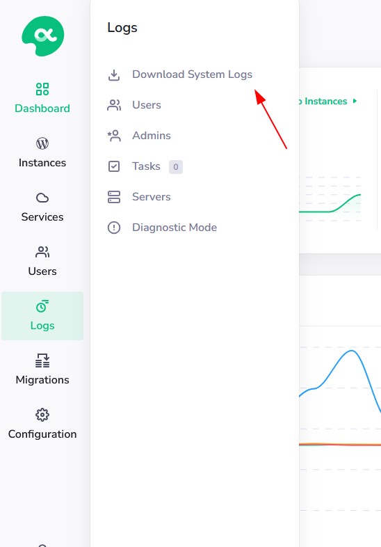

# Logs

The **Logs** area provides diagnostic views for activity, background jobs, API traffic, and incident tracking. Each subpage loads data from the admin API endpoints and keeps filtering controls in sync with the URL, so you can share links with coworkers.

## Activity Logs

Main activity view available at `Admin Area → Logs` (`/logs`).

In this view you can:

- Browse global activity entries (instances, users, services, logins, and admin actions)
- Filter by date range
- Search log entries
- Open predefined filters such as **Users** and **Admins** from the sidebar

The header includes the date picker, action-type chips, and a full-text search input that syncs with the table data. When an admin filter is present in the URL (for example `?admin_id=42`), a chip shows the active admin, and you can clear the filter without losing your other settings. The activity table displays the log ID, the encoded timestamp (hovering reveals the full `MMM DD YYYY hh:mm:ss` value), and the log details rendered via the activity item component, which highlights the affected instance, user, or admin.

## Tasks Logs

Use this section to monitor background jobs and queue tasks. The header allows you to restrict the list to a specific date range, one or more task types, multiple task statuses, and a search phrase.

The admin area ships with preloaded job types such as `Create Staging`, `Push to Staging`, and `Push to Live`. When you create a staging, push a staging to live, or push live changes back to staging, each operation appears as a separate task row. Use the retry icon to rerun failed tasks (non-default queue) and the cancel icon to stop `pending` tasks.

The table columns show Task Name, the related instance or service (with tooltips and links to the instance details), the dispatching admin or user, the current status, the queued timestamp, and the duration metadata. You can select queued tasks with the checkboxes in order to cancel them in bulk, although the table only enables mass selection for tasks whose status is still `pending`. Individual rows expose Retry and Cancel buttons: Retry is enabled for failed or rescheduled tasks that run on non-default queues, and Cancel is enabled specifically for pending tasks.

## Servers Logs

This section lists API and hosting requests with a searchable table. Use the search box to match any fragment of the request or response body, and keep an eye on the infinite-scroll loader at the bottom of the table as new pages of logs are appended automatically. Each row includes the request URI, the response payload, the execution time, and the creation timestamp. Hovering over the timestamp shows the full date, and the time column shows how many seconds the request took. The copy buttons let you copy either the request or response, and the eye icon opens a modal with the full payload when more data is needed.

## Diagnostic Mode Logs

This section contains two tabs: **Current Incidents** exposes entities currently in diagnostic mode (instances or services) and their last update timestamps, while **Logs** lists chronological diagnostic events. Both tabs allow you to expand each row to read the automatic health checks (with color-coded chips and tooltips that explain what each check means). Instance or service links are present in every row so you can jump directly from an incident to the affected entity.

## Download System Logs

Use **Logs → Download System Logs** to generate and download a `.zip` archive of the current system logs. The action opens `/system/logs/download` in a new browser tab and immediately returns you to the Logs list.
