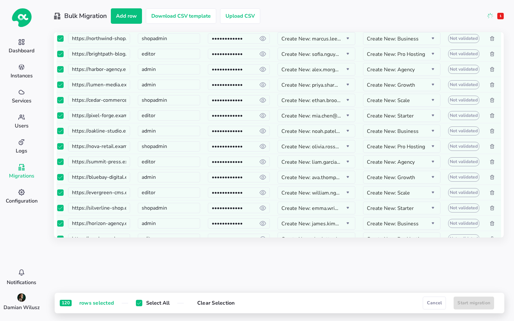

# Migrations

The **Migrations** section covers every way to bring WordPress sites into PanelAlpha. Whether clients start imports in the Client Area or admins step in from the Admin Area, you can monitor progress, intervene quickly, and ensure successful cutovers.

## Quick Overview

- **Who starts it?** Clients (automatic) or admins (manual/assisted/bulk)
- **Methods available:** Plugin, FTP/SFTP, admin file upload, or CSV bulk import
- **Where to monitor:** Admin → Migrations (In Progress, Failed, Successful)
- **How to recover:** Logs + retry, manual handoff, or mark as successful after manual fix

FTP, database, and similar credentials in migration history are **masked**. Administrators see that a value exists without reading the password in cleartext.

## Top Toolbar Actions


The top of the Migrations page provides quick actions for starting or assisting with migrations:

- **Bulk Migration** — Opens the CSV-based bulk import workflow for migrating many WordPress sites at once (see [Bulk Migration](#bulk-migration-csv) below).
- **Manual Migration** — Opens the admin-led migration wizard for uploading files via FTP.
- **Download Plugin** — Opens a modal with step-by-step instructions and the download link for the PanelAlpha WordPress Migrator plugin, which can be installed manually on both the source and destination sites to perform a plugin-based migration.

For details on the other migration methods, see [Migration Types](../migrations/migration-types.md).

## Verified Hosting Compatibility

PanelAlpha migrations have been tested and verified on these major hosting providers:

| Provider | Status |
|----------|--------|
| WP Engine | Works correctly |
| AWS Lightsail | Works correctly |
| Kinsta | Works correctly |
| Pressable | Works correctly |
| Cloudways | Works correctly |
| GoDaddy | Plugin requires manual upload to wp-admin, then works correctly |
| BlueHost | Works correctly |
| DreamHost | Works correctly |
| Hosting.com | Works correctly |
| Hostinger | Works correctly |
| SiteGround | Works correctly |

**Note:** While these providers have been explicitly tested, PanelAlpha migrations work with any standard WordPress hosting environment. If you encounter issues with an unlisted provider, consult the [Troubleshooting](../migrations/troubleshooting.md) guide.

## Documentation Sections

This documentation is organized into focused guides. Pick where you need to dive deeper:

- **[Migration Types](../migrations/migration-types.md):** When to use automatic vs manual migrations, plugin vs FTP.
- **[Import Process](../migrations/import-process.md):** The 7-step engine flow, statuses, and post-import automation.
- **[Managing Migrations](../migrations/managing-migrations.md):** How to monitor, stop, retry, delete, and bulk-manage migrations.
- **[Migration Details](../migrations/migration-details.md):** Tabs, credentials, and logs available per migration.
- **[Troubleshooting](../migrations/troubleshooting.md):** Symptom-first fixes and decision paths.
- **[Best Practices](../migrations/best-practices.md):** Recommended methods by scenario, large-site tips, and validation checklists.

## Quick Start Guide

### Client-Initiated Migration

Client creates instance → Selects "Import Existing WordPress" → Chooses method (Plugin/FTP) → Provides credentials → Admin monitors in Migrations tab

[Learn more: Migration Types](../migrations/migration-types.md)

### Admin-Initiated Migration

Navigate to Migrations → Click "Manual Migration" → Select user & service → Upload files via FTP → Verify → Continue Import → Monitor completion

[Learn more: Manual Migrations](../migrations/migration-types.md#manual-migrations)

### Bulk Migration (CSV)

Use **Bulk Migration** when you need to import many WordPress sites without repeating the full wizard for each one.

1. Go to **Admin Area → Migrations** and click **Bulk Migration**.
2. Download the CSV template (**Download CSV template**) or prepare your own file.
3. Upload the CSV (or add rows manually in the table).



4. For each row, confirm or assign:
   - the destination **user** (existing user matched by email, or create / select manually)
   - an existing **service**, or a **plan** so PanelAlpha creates a new service
5. Validate WordPress credentials for the listed sites, then start the migrations.
6. Monitor progress under **In Progress**, **Failed**, and **Successful**.

#### CSV Format

Required columns:

| Column | Required | Description |
|--------|----------|-------------|
| `wp_url` | Yes | Full WordPress URL (custom admin paths such as `/_admin-login/` are allowed) |
| `wp_admin_username` | Yes | WordPress admin username |
| `wp_admin_password` | Yes | WordPress admin password |
| `user_email` | No | If provided and a matching user exists, PanelAlpha preselects that user |

Example:

```csv
wp_url,wp_admin_username,wp_admin_password,user_email
https://example.com,admin,secret,client@example.com
```

Accepted header aliases:

- `wordpress_url` → `wp_url`
- `wordpress_username` → `wp_admin_username`
- `wordpress_password` → `wp_admin_password`
- `email` / `create_user_email` → `user_email`

#### Behavior Notes

- Each row runs as a plugin-based import after credentials are validated.
- Jobs are processed sequentially to avoid overloading the server.
- Rows can be **skipped** when the service instance limit (or Single Server license limit) is reached.
- Failed rows remain visible in **Failed** and can be retried like other migrations.

## Migration Workflow Overview

The migration process follows these sequential steps:

1. **Migration Initiated** - started by client or administrator; user selects migration method and provides credentials
2. **Step 1: Installing New Instance** - creates hosting account on destination server; sets up domain and directory structure
3. **Steps 2-4: Preparing Source & Destination** - installs plugins if needed; creates temporary FTP accounts; establishes connection to source
4. **Step 5: Preparing Migration** - downloads WordPress files from source; exports database from source; transfers data to destination staging area
5. **Step 6: Running Migration** - extracts WordPress files to destination; imports database into destination; configures WordPress (URLs, paths, wp-config)
6. **Step 7: Cleaning Up** - removes temporary files and accounts; cleans up migration plugin from source; finalizes instance configuration
7. **Migration Complete** - instance active and accessible; SSL certificate issued (if configured); automatic backups enabled; ready for production use

[Learn more: Import Process](../migrations/import-process.md) for a detailed explanation of each step.

## Key Features

- **Real-time Monitoring** - track progress of all migrations in one place
- **Multiple Methods** - automatic (plugin/FTP), manual, and CSV bulk migration options
- **Comprehensive Logging** - detailed logs for troubleshooting and auditing
- **Retry Capability** - retry failed migrations with one click
- **Tested Compatibility** - verified on 11+ major hosting providers

## Getting Started

**New to migrations?** Start here:

1. [Migration Types](../migrations/migration-types.md) - understand automatic vs manual migrations
2. [Import Process](../migrations/import-process.md) - learn the 7-step migration workflow
3. [Managing Migrations](../migrations/managing-migrations.md) - monitor and manage migrations

**Need help?** Check:

- [Troubleshooting](../migrations/troubleshooting.md) - common issues and solutions
- [Best Practices](../migrations/best-practices.md) - tips for successful migrations
