# Services

The **Services** section provides access to all service groups: **Active**, **Trial**, **Pre-Created**, and **Archived**.

## List of Services

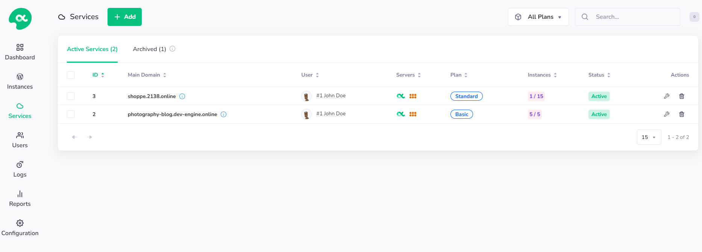

The main services table includes:

- ID number - click to be redirected to the service details
- Main Domain - the main domain; the list of instances is displayed on hover
- User - assigned user data; additional user details are available on hover
- Server - assigned server
- Plan - name of the selected plan; additional details are available on hover
- Instances - number of existing instances in relation to the plan limit
- Status - current status of the service
- Actions - row actions and bulk actions depending on selected entries

Filter the list by plan name, or show all plans.

## Add Service

Click the **Add** button at the top of the page. You will be redirected to a short form where you must fill out the required data to add a new service.

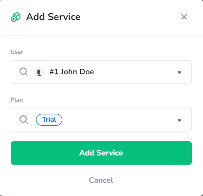

Choose the following data to add a new service:

- **User** - select the user that will be assigned to this service.
- **Plan** - choose a plan from the list of available ones.

Click **Add Service** when the form is complete.

## Service Details

To obtain a deeper understanding of a specific service, use the **Manage Service** option. This functionality enables you to access comprehensive information about a service, such as its configuration settings and any pertinent metadata.

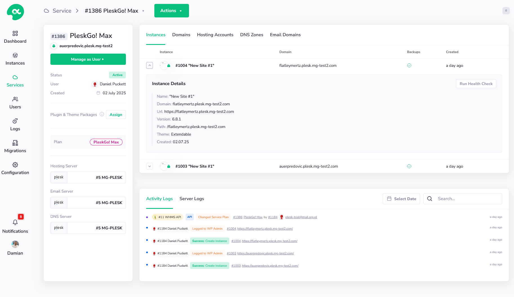

The Service Details view is divided into areas and dedicated tabs. Each tab focuses on one resource domain of the service so that you can drill down quickly and perform contextual actions.

### Layout Overview

The **left sidebar** contains all static and general service details including:

- Service name, status (active / suspended), URL, assigned user, and creation date
- Plugin and Theme Packages assigned to the service (with versions / counts)
- Information about infrastructure: hosting server(s), DNS server(s), email server(s) - when available

The **middle section** is a tabbed interface with detailed, real-time resource data.

### Instances Tab

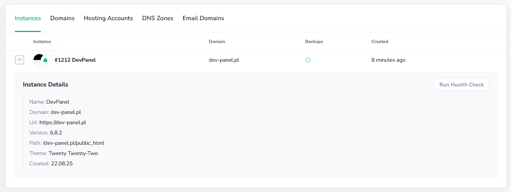

Shows every WordPress instance created within the service.

- Key columns: Instance name & ID, primary domain, backup status, creation date
- Expand an instance row to reveal: version, path, theme, direct URL, created date, and contextual actions (e.g. Run Health Check)
- Health Check: launches an on-demand diagnostic for that single instance (does not affect others). Results appear inline and are also written to Activity Logs
- Bulk selection (when supported) lets you trigger multi-instance actions

### Domains Tab

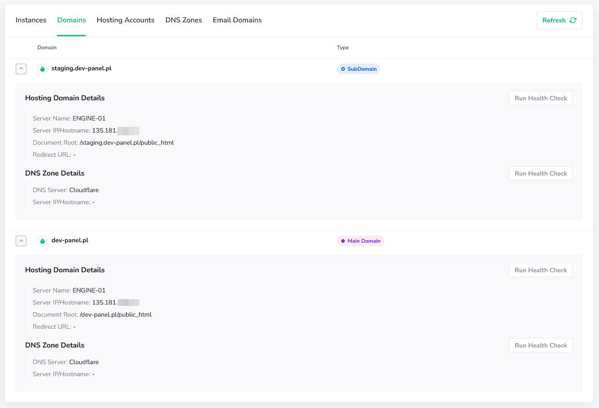

Provides a consolidated list of all domains associated with the service, categorized (main, addon, mapped, parked, etc.).

- Hover tooltips expose DNS status and verification hints
- Use this list to verify domain-instance relationships and detect unused domains
- If integrated with DNS servers, domain status badges indicate propagation / zone presence

### Hosting Accounts Tab

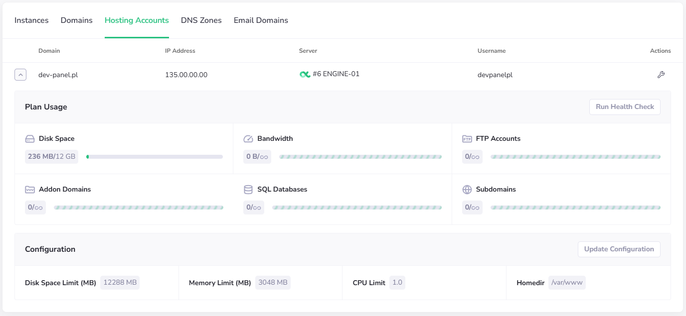

Displays hosting account(s) connected to the service and their provisioned limits.

- Core data: domain, IP addresses (with +N more expansion), server label, username, creation date
- Plan Usage block: disk usage, SFTP accounts, and other resource gauges (visual progress bars for quick capacity assessment)
- Per-account Actions: Run Health Check, Move to Service, and Change Main Domain
- Configuration block: plan quota, PHP workers, burst capability, datacenter / location, SSH access type, and other environment attributes

### Change Main Domain

Each hosting account row displays a **star icon** in the Actions column. To change the main domain, the hosting account must already have at least one **addon domain** added.

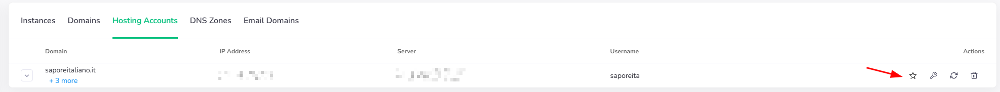

Click the star icon next to the hosting account. A modal will appear with a dropdown listing all available domains — the current main domain is labeled **Main Domain** and addon domains are labeled **Addon**.

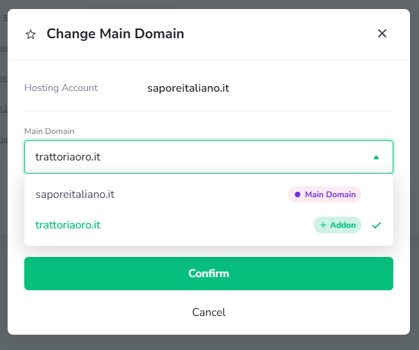

Select the addon domain you want to promote and click **Confirm**. PanelAlpha automatically updates the hosting account on the server.

If the service has two or more instances and the instance associated with the current main domain is deleted, PanelAlpha reassigns the main domain to a domain from another existing instance before the deletion is performed.

### Configuration Options Update

The Update Configuration option, located in the top-right corner of the Configuration block, allows you to upgrade your environment attributes. The available attributes depend on your hosting plan.

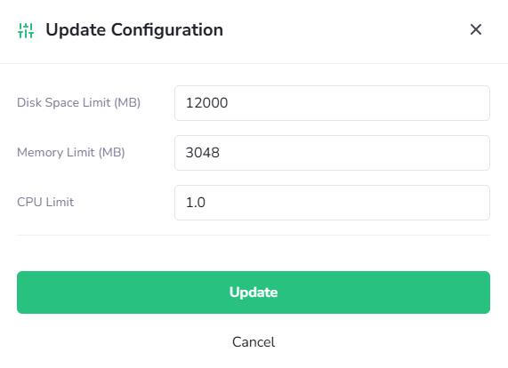

### Move Hosting Account to Service

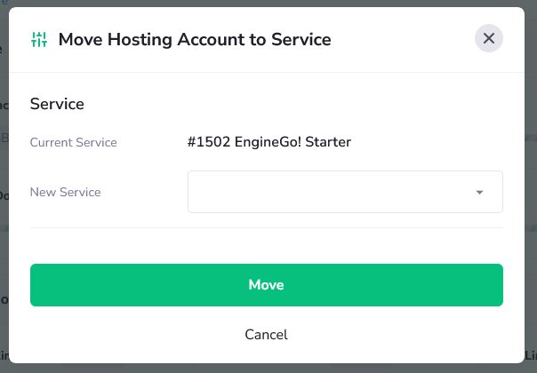

Allows reassigning an existing hosting account from the current service to a different one without reprovisioning the account.

- Opens a modal where you pick the target (New Service) from an allowed list
- Current Service is displayed for confirmation
- After Move:
  - Ownership / linkage metadata is updated
  - Related instances are reassociated with the new service context
- Use cases: consolidating client services, correcting misassignments, or restructuring accounts

### Relink Hosting Account

You can relink a hosting account to a different server or username directly from the **Hosting Accounts** tab in the Admin Area. This is useful if the account was migrated, recreated, or needs to be re-associated with a different server in PanelAlpha.

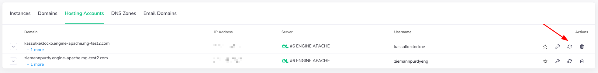

To relink:

1. Go to the **Hosting Accounts** tab.
2. Click the relink icon (two arrows) in the Actions column for the selected account.
3. In the modal, select the target hosting server and (optionally) change the username.
4. Click **Relink** to confirm.

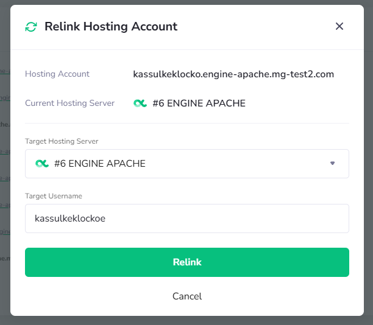

After relinking, the account will be associated with the new server/username in PanelAlpha. This does not move data between servers — it only updates the PanelAlpha configuration.

### DNS Zones Tab

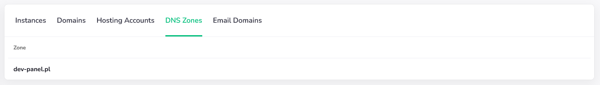

Lists DNS zones (if any) created for the service on connected DNS servers.

- Each row: zone name, status / synchronization flags, linked server
- Useful for verifying automation successfully created or synchronized records

#### Recreating Missing DNS Zones

If a zone was removed on the DNS server side (for example by Cloudflare or on a PowerDNS server), use the **Recreate Missing Zones** button above the list. It is shown only for services that use an external DNS server.

1. Go to the service details page and open the **DNS Zones** tab.
2. Click **Recreate Missing Zones**.

PanelAlpha checks every domain of the service. Zones that are missing on the DNS server are created again, with the records from the DNS template of the plan. Zones that still exist are not changed. If a zone cannot be created, the other zones are still processed.

The message shows the recreated zones, or "No missing DNS zones found. All zones exist on the DNS server." when nothing was missing. The new zone can get different nameservers. Your client must set the nameservers shown in the panel at the domain registrar.

#### Deleting DNS Zones

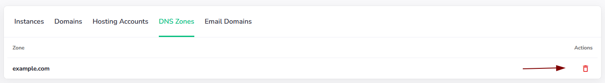

You can manually delete DNS zones directly from the Admin Area. This is useful when:

- A zone was manually deleted on the DNS server and you need to clean up the database record
- You want to remove orphaned zones that are no longer needed
- You need to reassign a new zone to a domain after manual DNS server changes

To delete a DNS zone:

1. Navigate to the service details page
2. Go to the **DNS Zones** tab
3. Click the **delete icon** (trash) next to the zone you want to remove
4. Confirm the deletion by checking the confirmation checkbox
5. Click **Delete**

**Warning:** When you delete a DNS zone from the Admin Area:

- The zone will be removed from the PanelAlpha database
- If the zone still exists on the DNS server, it will also be deleted from the DNS server
- This action cannot be undone

### Email Domains Tab

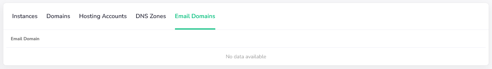

Shows domains configured on email servers for this service.

- Indicates whether mailboxes / forwarders exist (counts) and any verification or DNS alignment status
- Empty state clarifies that no email domains are yet linked

### Activity Logs

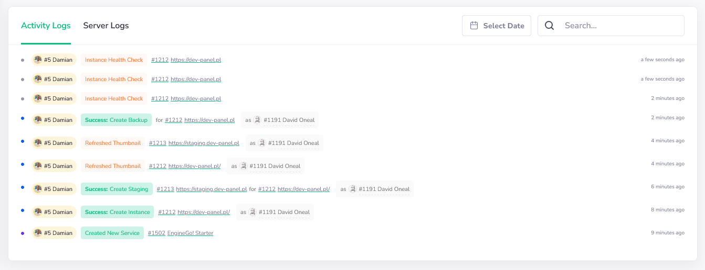

Chronological record of service events (provisioning, moves, health checks, ownership changes, suspension, etc.).

- Advanced filtering by date range and search bar
- Use for auditing and troubleshooting sequence of changes

### Server Logs

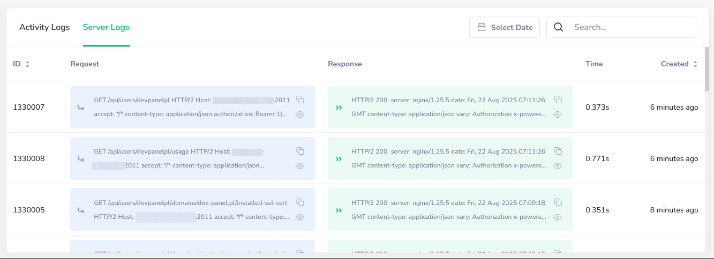

Aggregated server-level logs relevant to the service (performance, errors, background tasks) with powerful filters for pinpoint analysis.

## Quick Actions

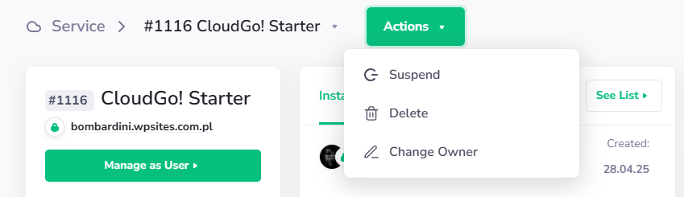

Click the **Actions** button at the top of the screen. At this point you may:

- Suspend or unsuspend the service (depending on current status)
- Open **Trial Settings**
- Open **Upgrade**
- Change the owner of the service
- Delete the service

## Change Owner

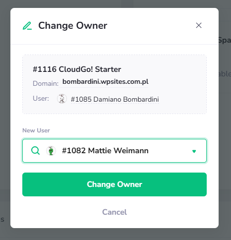

PanelAlpha allows you to transfer service ownership to another user. Through this functionality, you can select a new user who will become the owner of the service.

When you change the owner:

- The system automatically updates data on the remote hosting account if needed
- A notification is displayed informing about the necessity to update the administrator account in WordPress

This feature is particularly useful when restructuring client accounts or transferring service management responsibilities from one user to another.
