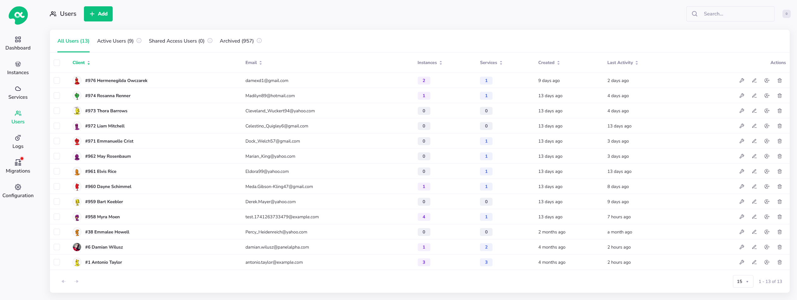
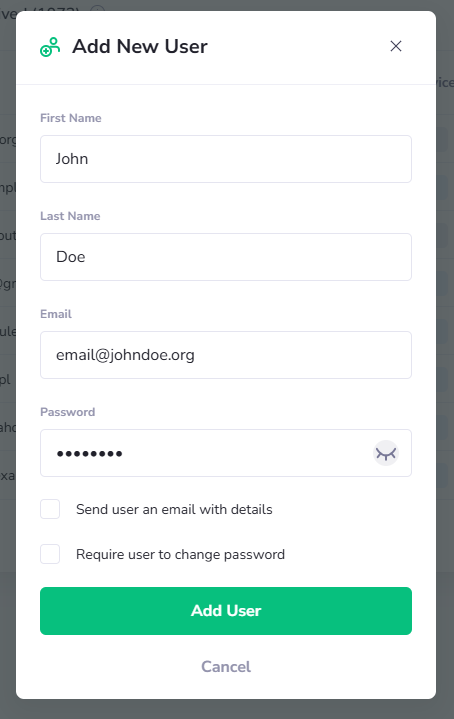
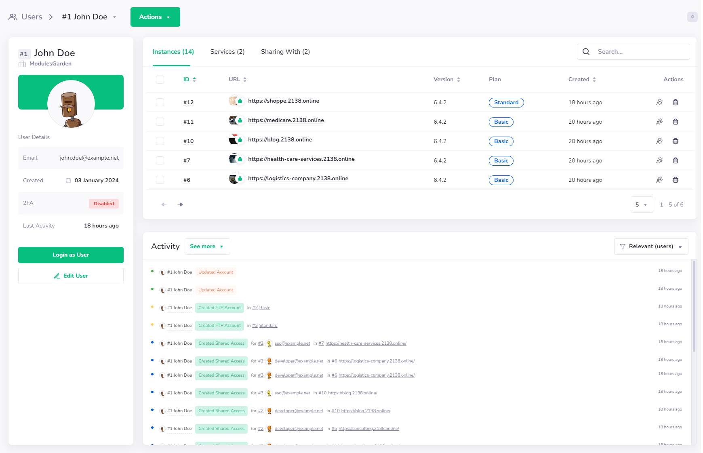

# Users

In this section you will find all users who have access to the platform, including active users and shared-access users.

### Lists of Users

Available tabs:

- **All users** - full list of all users, regardless of status or access
- **Active users** - users who own at least one service
- **Shared access users** - users who have access to instances via **Shared Access**
- **Archived users** - users removed from active views

**Available actions on a single user:**

- **Manage User** - redirects to the user details page
- **Edit User** - quickly change basic information about the user (first name, last name, company name, email address, and password)
- **Disable 2FA** - available from the context menu when the user has two-factor authentication enabled
- **View in Client Panel** - log in to the client area as that user
- **Delete User**
- **More Info** - hover over the client name to see a tooltip with basic data. You will also find a **Show More Info** button that redirects to the user details page.

### Adding New User

Click the **Add** button to create a new user. A simple modal form will appear.

Provide these details to add a new user:

- First name
- Last name
- Email address
- Password

Additionally, you have two important options that you can enable:

- **Send user an email with details** - when enabled, the system will automatically send an email to the new user containing their login credentials. This is useful for immediately notifying users about their new account.
- **Require user to change password** - when enabled, the user will be prompted to change their password on their first login. This is recommended for security purposes.

Click **Add User** when you are ready. The new user will immediately appear in **All Users**.

### User Details Page

Click the username or **Manage User** icon to open the user details page.

1. On the left side there is a user summary box with:
   - Email address
   - Creation date
   - Two-factor Authentication status
   - Last activity time

   There are also two buttons allowing you to quickly use **Log In As User** and **Edit User**.

   The **2FA** field now shows the current status directly as **Enabled** or **Disabled**. When 2FA is enabled, a red action button next to the status opens the existing confirmation modal and allows the administrator to disable 2FA for that user.

2. The next widget includes summaries for **Instances**, **Services**, and **Sharing With**.

3. A dedicated **Activity** widget with a summary of user-related logs and category filters:
   - Show everything
   - Most Relevant
   - Plugins
   - Backups
   - Themes
   - Hosting
   - Users
   - Sharing access
   - Log-ins
   - Admins
   - Config

   Click **See more** to open the main Logs section.

4. Quick **Actions** button:
   - Edit the user details
   - Open reseller settings
   - Disable 2FA
   - Force reset password
   - Delete the user

When an administrator disables 2FA for a user from Admin Area, the system also clears the stored 2FA requirement timestamp. This makes the reset cleaner and avoids leaving the user stuck in a forced-2FA state after the reset.
