# Billing Scenarios

The pages below describe billing use cases in PanelAlpha. WHMCS scenarios keep a **Workflow** section and a **Configuration** section. Stripe trials and paid plans are documented as use cases in [Stripe Integration](../direct-billing/stripe.md).

Before you begin:

- [Installation](../getting-started/installation.md)
- [Server Configuration](../system-configuration/hosting-servers.md)
- [Plan Configuration](../system-configuration/plans.md)
- [Direct Billing](../direct-billing/index.md) if you sell trials or collect invoices in the Client Area
- The WHMCS module, if that is your billing system

## Trials and Direct Billing

To offer a **free trial**, use **Direct Billing** (named Background Billing before v1.9.8). Trial length and links are set on the plan **Billing** tab.

- Direct Billing: [Direct Billing](../direct-billing/index.md)
- Stripe trials and paid plans: [Stripe Integration](../direct-billing/stripe.md)
- Trial scenario overview: [Free Trial Period](free-trial-period.md)

## Single WordPress Instance

### Offering a Single WordPress Instance as a Service

This is the most commonly used workflow for most of our customers and is a perfect setup for end users who want to "purchase a WordPress hosting service." The idea is to set up simple products that correspond to a single WordPress instance.

It covers the recommended **Quick Onboarding Process**, which makes it easier for the end customer to set up their first site without extensive configuration or setting up their live domain. The first site is configured on a subdomain that can be changed to their own domain at a later stage.

### Workflow Illustration

1. End customer orders a new service in the WHMCS system, for example: "WordPress Single Site - Bronze"
2. They go through the standard ordering process ("Lagom One Step Order Form For WHMCS" is a recommended setup).

   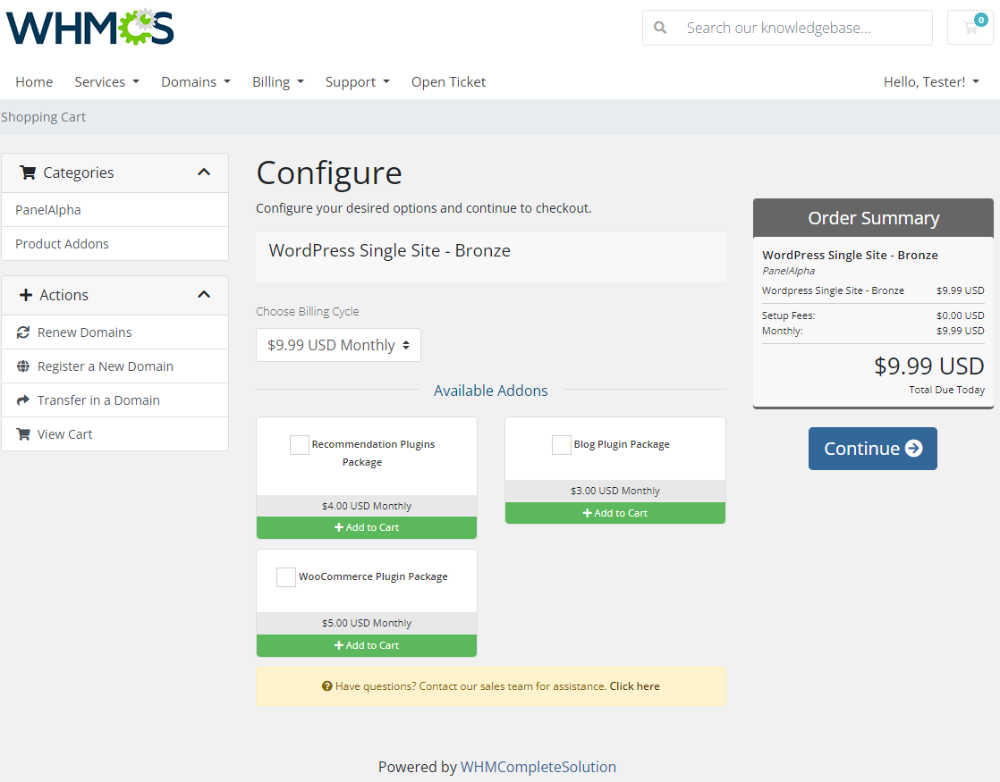

3. After payment is complete:
   - The end customer receives an email with details about their service
   - From the WHMCS client area they can proceed directly to the new PanelAlpha user page. Use the "WordPress Management" section in the menu - it uses SSO to automatically authenticate them into PanelAlpha
   - Alternatively, they can go to their service page and click "Log In To PanelAlpha" - it also uses SSO to automatically authenticate them into PanelAlpha

   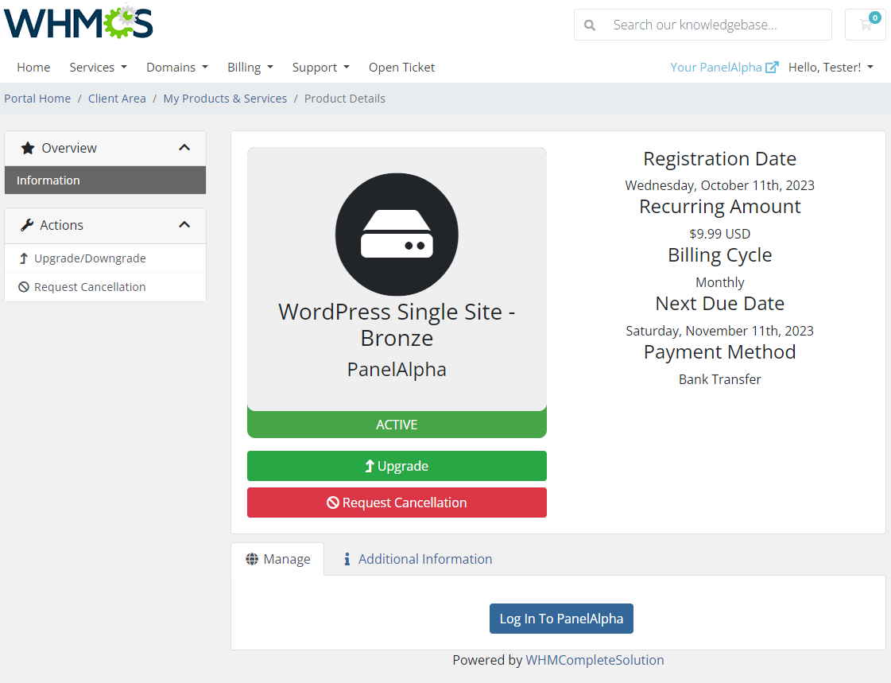

4. Once redirected to PanelAlpha, SSO is used for automatic authentication.
5. The first page they see is the option to create the first instance.
   - Clients may create a brand new site or migrate their instance from existing hosting
   - For a migration workflow, read more [here](../client-area-instances/importing-existing-instance.md)

   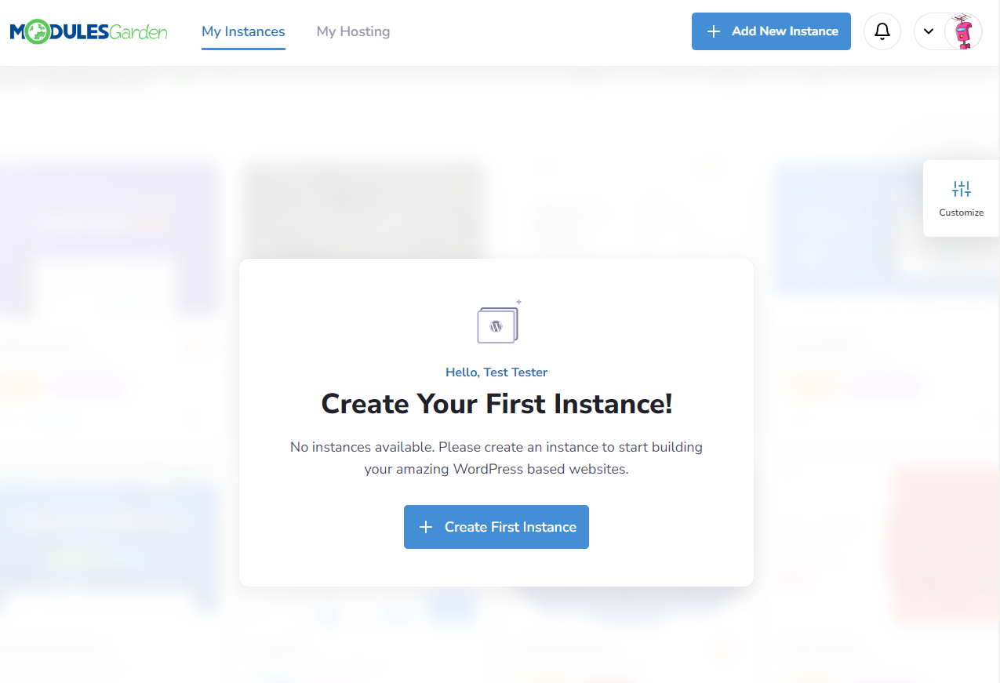

   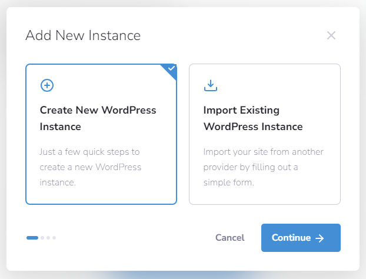

6. When they choose to create a new site, the system presents the available themes to choose from.

   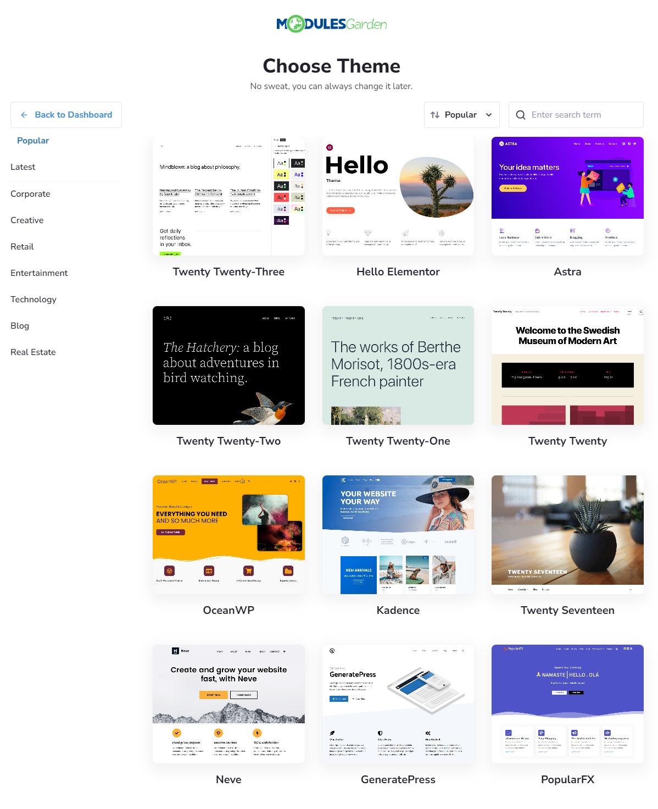

7. Once chosen, they are asked to enter their site name. Click the "Create Site" button and the site will be provisioned right away.
   The site name (domain) can be changed later, so you may type in any name at this point.

   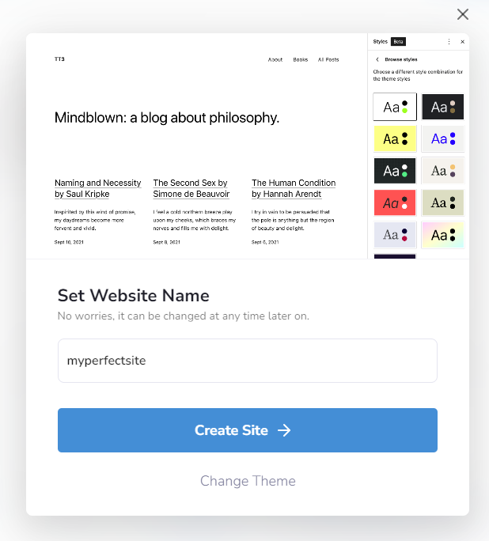

8. The new site is ready for the client to manage!

   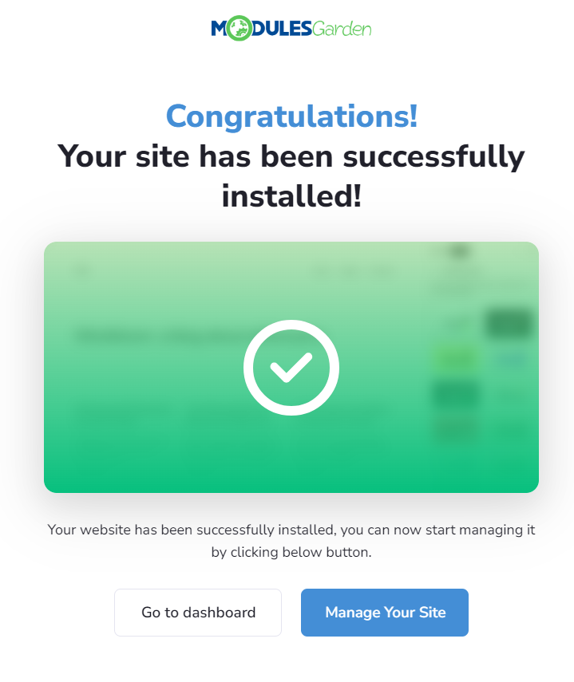

### Configuration in PanelAlpha

1. **Plan Configuration** - provide basic details to create a new plan:
   - Plan Name
   - Instances Limit - in this case, "1"
   - Upgrade Link - a hyperlink directing to a page where users can upgrade their current plan
   - Label Color - a visual identifier associated with a specific plan, usually used to indicate differences between plan types
   - Preview

   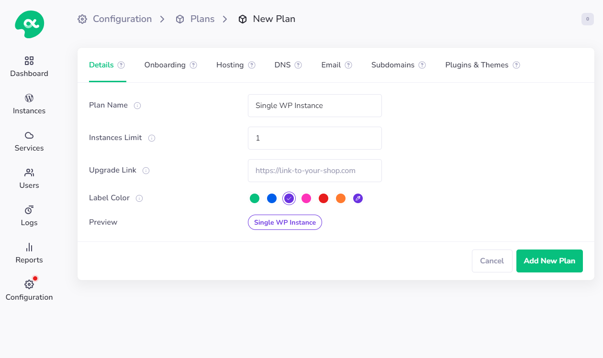

2. **Onboarding** - select between two onboarding methods: "Quick Onboarding" and "Standard Onboarding." Check the details and differences between them:
   - **"Quick Onboarding"** - specifically designed to deliver an exceptional user experience, similar to web-builder products, ensuring optimal satisfaction for end users. The end customer can order a basic service in WHMCS even without requiring a domain. Upon completion of the order, they can log in to PanelAlpha, where they will be presented with a selection of templates.
     - To enhance the overall experience, you can integrate it with a pre-installed website builder plugin for WordPress, enabling users to enjoy a seamless and high-quality experience.
     - Utilize the free trial feature within WHMCS (see [Free trial period](free-trial-period.md)), which can effectively increase conversion rates.

   **This selection is highly recommended for all advanced users.**

   **Available options:**
   - *Force installation for new users after login* - enabling this option is highly recommended
   - *Domain used for subdomains* - enter the main domain to allow creating subdomains
   - *Automatic subdomain format:*
     - Friendly name based on website name; e.g. *john-blog.mydomain.com*
     - Friendly name random combination; e.g. *purplegoose.mydomain.com*
     - Specified number: enter description and the next number to generate a subdomain, e.g. "temp{number}", "100000": *temp100000.mydomain.com*
     - Random Length: enter the number of signs to generate a subdomain, e.g. "10": *4d7wg9r98x.mydomain.com*

   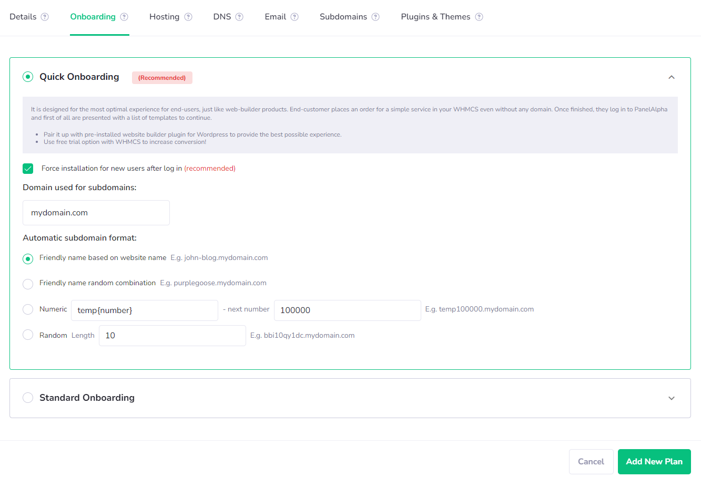

3. **Hosting** - server selection and configuration.
   - Server Type - choose between:
     - [cPanel](../hosting-servers/cpanel.md)
     - [PanelAlpha Engine](../hosting-servers/engine.md)
   - Server Group - choose one from the previously created groups (read more [here](../system-configuration/hosting-servers.md))
   - Server Assignment Rule:
     - Random - the service will be set up on a randomly selected server
     - Least Accounts - the service will be set up on the server within the specified group that has the smallest number of accounts
     - Specific Server - the service will be set up on the pointed server
   - Hosting Account Configuration:
     - WHM Package Name

   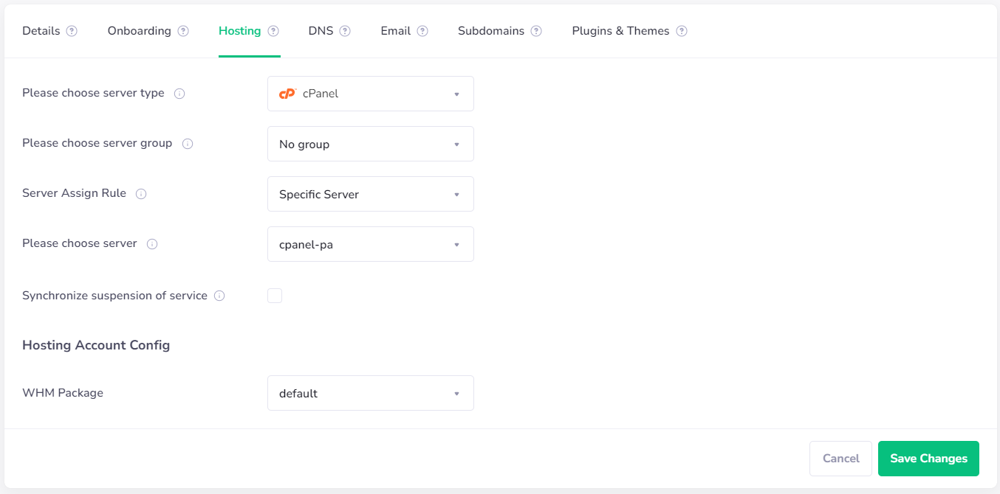

4. **DNS** - select and configure the DNS server responsible for translating domain names into IP addresses.

   Available DNS server types:
   - cPanel's DNS Server
   - [PowerDNS](../dns-servers/powerdns.md)
     - select DNS Server for your services
     - enter the zone template name

   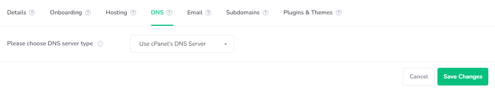

5. **Email** - select and configure the email server.

   Email server types:
   - Use cPanel's Email Server
   - None
   - [Mailcow](../email-servers/mailcow.md)
     - choose email server
     - enter the Mailcow package name

   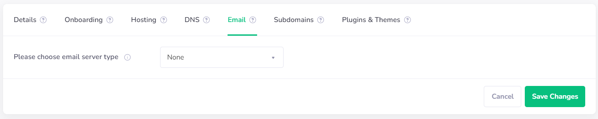

6. **Domains** - add domains that users of this plan will be allowed to use as subdomains.
   Click "Add New Domain" to start; a modal will appear where you must type in the new domain name.
   Manage the blacklist: create a list of forbidden words, enable "Block Profanity" to blacklist all uncensored expressions at once.

   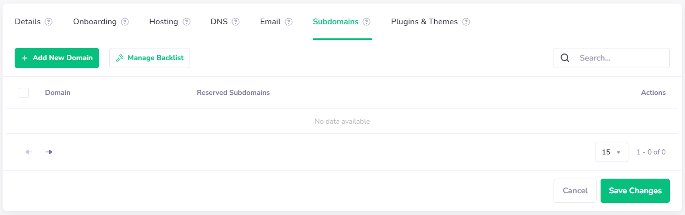

7. **Plugins & Themes** - manage the plugins that will be installed or deactivated on instances.

   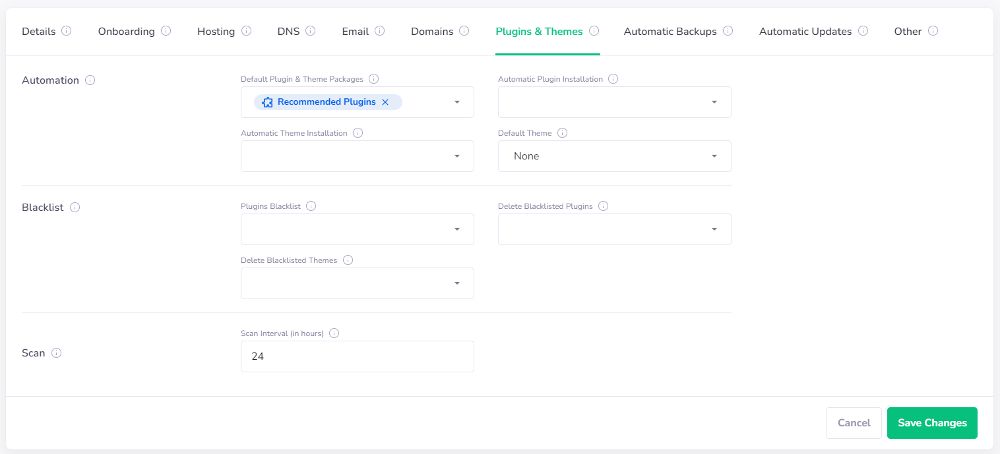

   - **Automation:**
     - **Default Plugin & Theme Packages** - assign packages of plugins and themes to a WordPress instance within the plan
     - **Automatic Plugin Installation** - assign plugins that will be automatically installed during the WordPress instance installation process
     - **Automatic Theme Installation** - assign themes that will be automatically installed during the WordPress instance installation process
     - **Default Theme** - select a default theme that will be installed on the instance

   - **Blacklist:**
     - **Plugin Blacklist** - assign prohibited plugins that will be hidden from search results in the Client Area and WordPress admin, blocked from installation (including ZIP uploads), and have their activation disabled with a tooltip explanation if already installed
     - **Delete Blacklisted Plugins** - assign prohibited plugins that will be automatically removed from any WordPress instance in the plan during the daily synchronization process
     - **Delete Blacklisted Themes** - assign prohibited themes that will be automatically removed from any WordPress instance in the plan during the daily synchronization process. Blacklisted themes are also hidden from search results, blocked from installation, and cannot be selected during instance creation

### Configuration of Product in WHMCS

Before you proceed to WHMCS and start server and product configuration, you must first generate your API token - you will need it in further steps.

Proceed to your PanelAlpha admin area → Configuration → Admins → API Token.

Once you enable the API Token, you will get one-time access to it. Keep in mind that this is the only moment when you see it, so please copy it and keep it in a safe place!

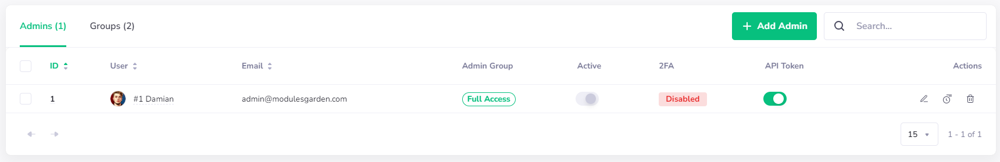

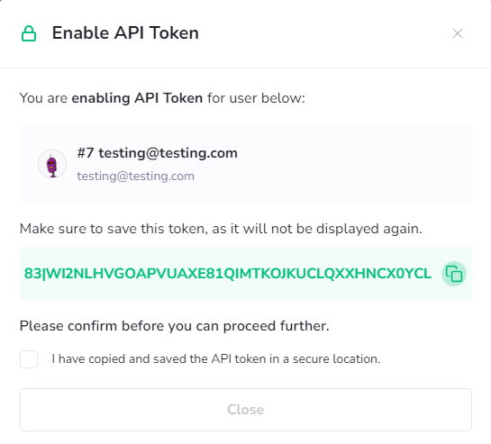

Once ready, you may move to your WHMCS platform and begin the configuration.

1. Under System Settings → Products/Services → Servers create a new server. Fields that must be filled out are:
   - **Name** - any name for your server
   - **IP Address** - provide the IP address with a port number where your PanelAlpha is located. The *Hostname* field may be left empty; after saving, it will be filled in automatically
   - **API Token** - PanelAlpha token generated as described above

   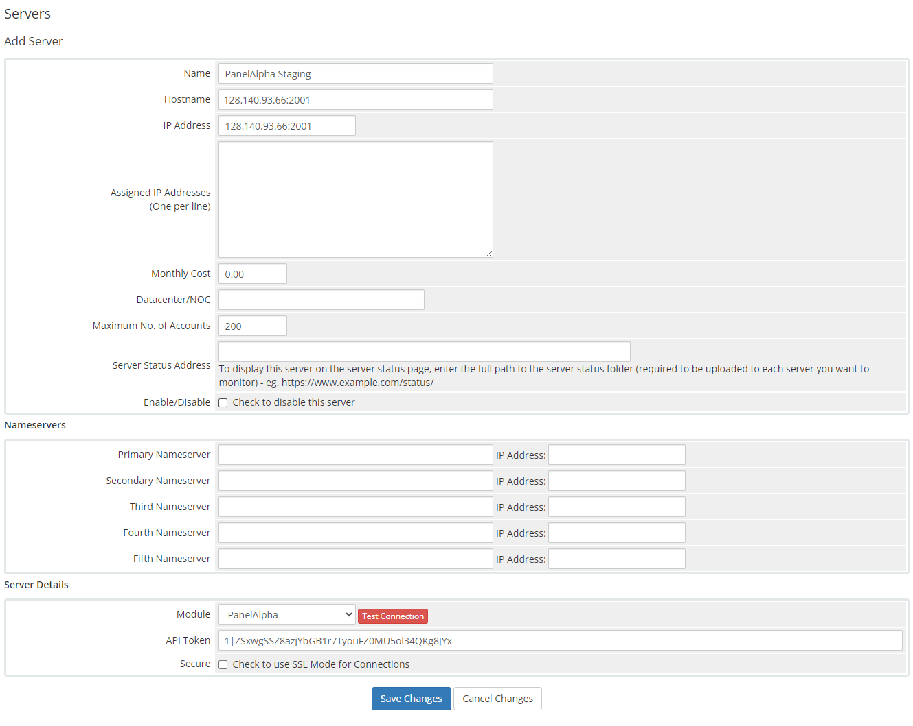

2. Under System Settings → Products/Services → Servers create a new group of servers and assign the newly created server to this group.

   

3. Next, proceed to System Settings → Products/Services and create a new group of products.

   

4. Once you have the group, you may create your PanelAlpha product.
   - Product Type - set it to "Shared Hosting"
   - Product Group - select the newly created group
   - Product Name - in this example: "WordPress Single Site - Bronze"
   - Module - select "PanelAlpha" from the dropdown menu
   - Click "Continue" to move to the next step

   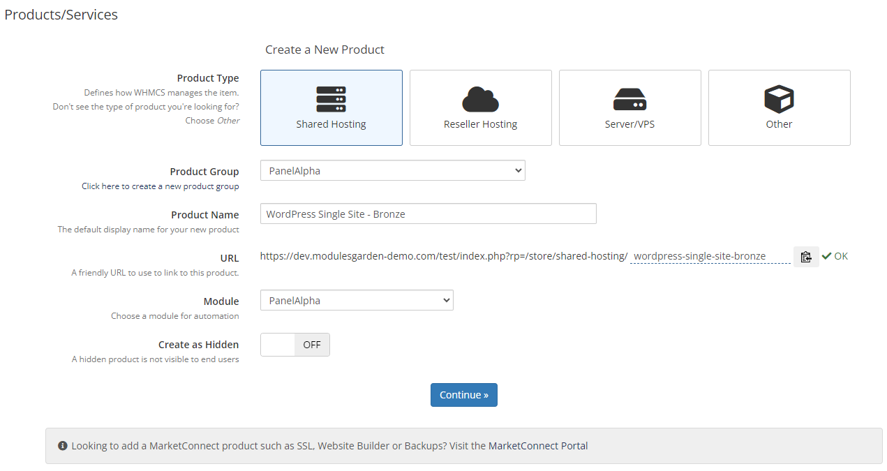

5. Now, go to the "Module Settings" section. As the module name has already been selected, find the server group where the server you need to connect with is assigned in the dropdown menu. Once selected, all module configuration settings will appear.
   - **PanelAlpha Plan** - select the plan you wish to assign to this product. In this example, that will be "Single Instance"
   - Based on the selected plan, all further settings will be automatically filled in. Save the changes once the configuration is ready.

   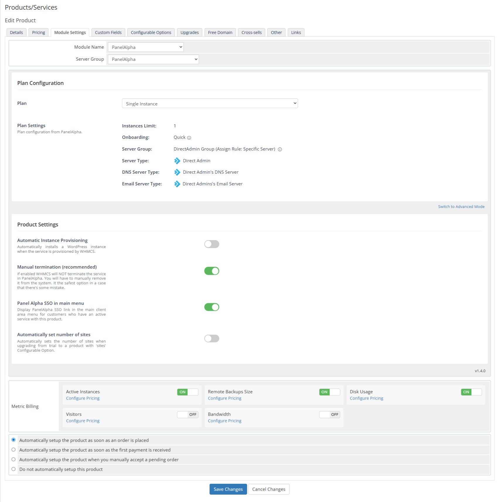

6. Finally, set the pricing details for your product in the "Pricing" tab.

   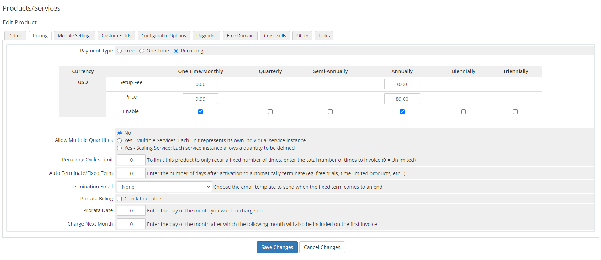

## Predefined WordPress Template

### Offering a Predefined WordPress Template

This is a similar workflow to offering a single instance; however, the customer will have WordPress automatically installed when the service is activated. This configuration is recommended for companies offering their own instance templates.

For example: a site with predefined plugins, theme, and configuration that works perfectly for a dental clinic business.

### Workflow Illustration

1. End customer orders a new service in a billing system, for example WHMCS: "Dental Clinic"
2. They go through the standard ordering process.

   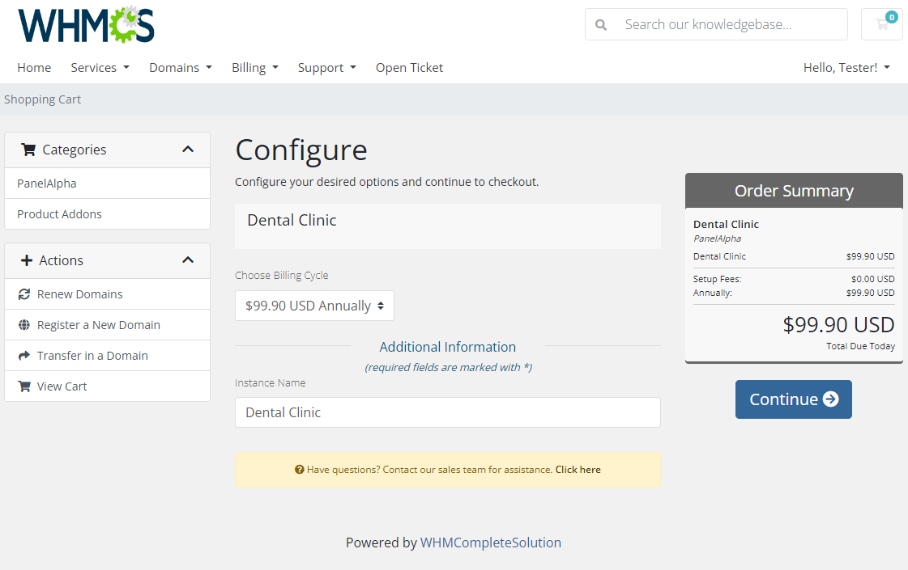

3. After payment is complete:
   - The end customer receives an email with details about their service
   - From the WHMCS client area they can proceed directly to the new PanelAlpha user page via the "WordPress Management" section - it uses SSO to automatically authenticate them into PanelAlpha
   - Alternatively, they can go to their service page and click "Log In To PanelAlpha" - it also uses SSO to automatically authenticate them into PanelAlpha

   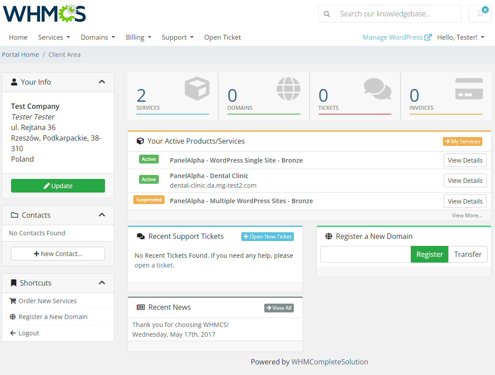

   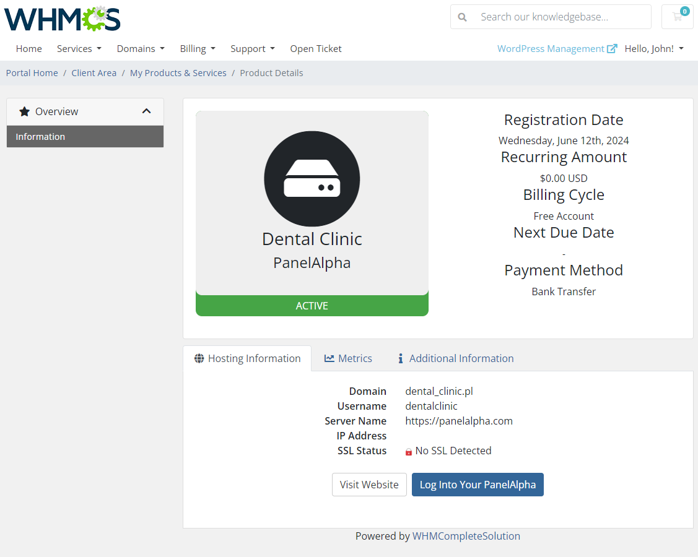

4. Once redirected to PanelAlpha, SSO is used for automatic authentication.
5. The first page they see is information on the instance installation process. Wait a moment until the process is complete.

   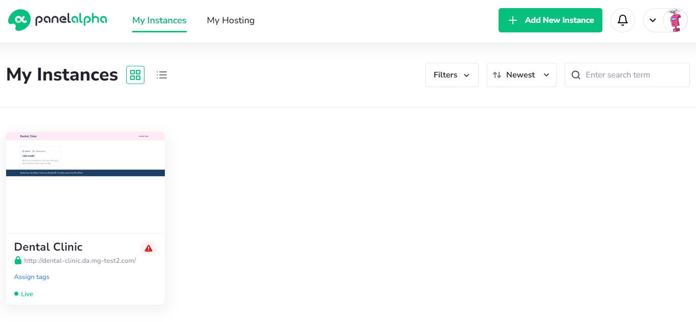

6. The new site is ready for the client to manage! After opening the dashboard, they can access their new site.

   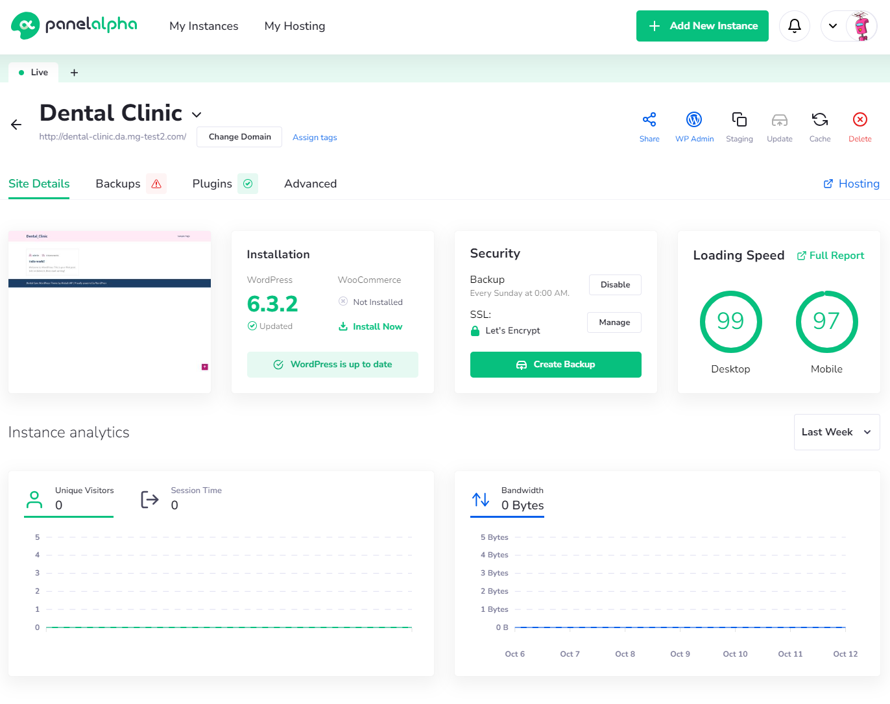

### Configuration in PanelAlpha

1. To start using instance templates, you must first create them. Navigate to *Admin Area → Instances → Instance Details* and locate the action button labeled **Save as Template**. Provide a name for the template and confirm by pressing **Save**. Currently, saving an existing instance as a template is the only method available for creating them.

   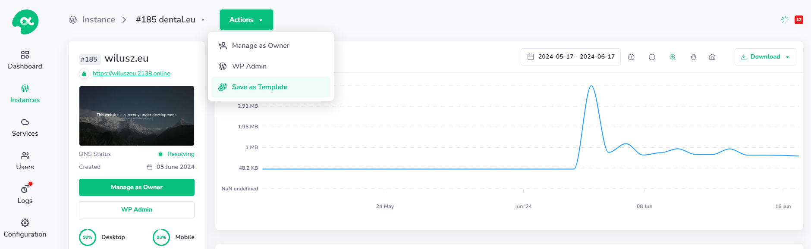

   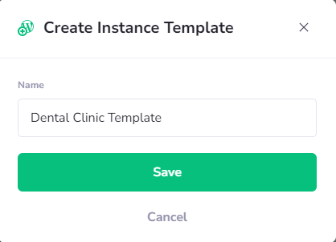

2. The created template will appear on the list of **Instance Templates**. Make sure its status is active, as only then you will be allowed to assign it to a plan.

   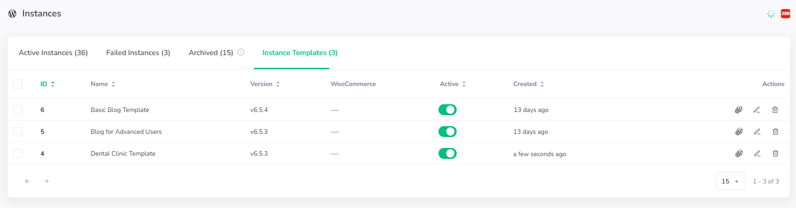

3. Let's proceed to the configuration of a plan that allows creating instances from templates. For demonstration purposes, we will show how it works using the recommended Quick Onboarding method.
4. Create a new plan and fill in the details section by providing the plan name - we have set it to "Dental Clinic - Predefined Template" - define the instances limit (1), and fill out the remaining options according to your preferences.

   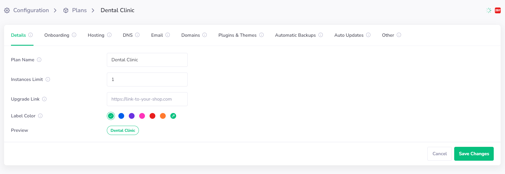

5. In the **Onboarding** tab, make sure to **select the instance template that will be used by default for creating the new website**. In our case, we are leaving "Allow to choose themes" and "Ask for domain" unselected and "Force installation for new users after login" selected. This way, after logging in to the PanelAlpha client area, the end user will have the website installed automatically without any additional steps.

   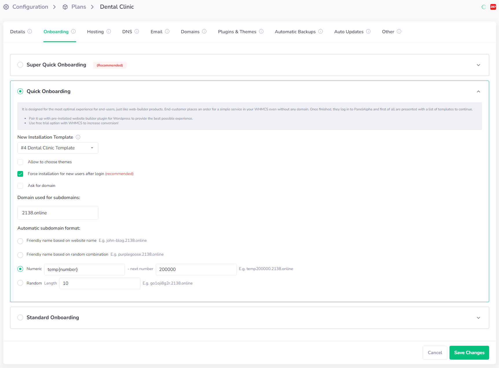

6. Define the **Hosting, DNS, and Email server details** to establish the connection.
7. Define the **Domains** creation rules. Skip the "Plugins & Themes" section as you are going to offer a predefined instance template with already installed plugins and themes.
8. Enable **automatic backups** and set up the frequency. You may skip the "Other" section. Save the changes to confirm creating the plan.

   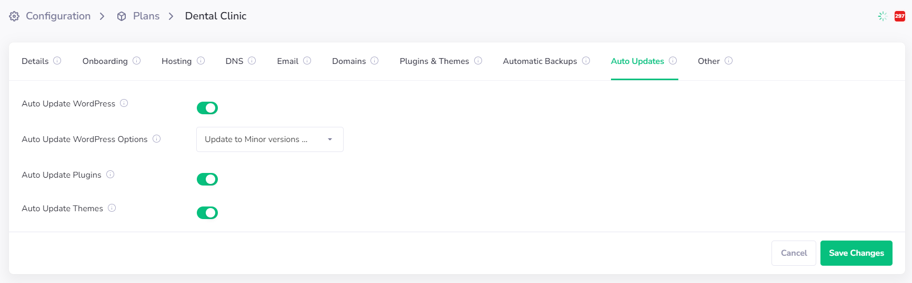

### Configuration in WHMCS

1. Before you proceed to WHMCS and start server and product configuration, you must first **generate your API Token** - you will need it in further steps.
2. Once you enable the API Token, you will get one-time access to it. Keep in mind that this is the only moment when you see it, so please **copy it and keep it in a safe place!**
3. Proceed to your PanelAlpha admin area → Configuration → Admins → API Token.

   

   

   Once ready, **move to your WHMCS platform** and begin the configuration.

4. Under *System Settings → Products/Services → Servers* create a new server. Fields that must be filled out are:
   - **Name** - any name for your server
   - **IP Address** - provide the IP address with a port number where your PanelAlpha is located. The *Hostname* field may be left empty; after saving, it will be filled in automatically
   - **API Token** - PanelAlpha token generated as described above

   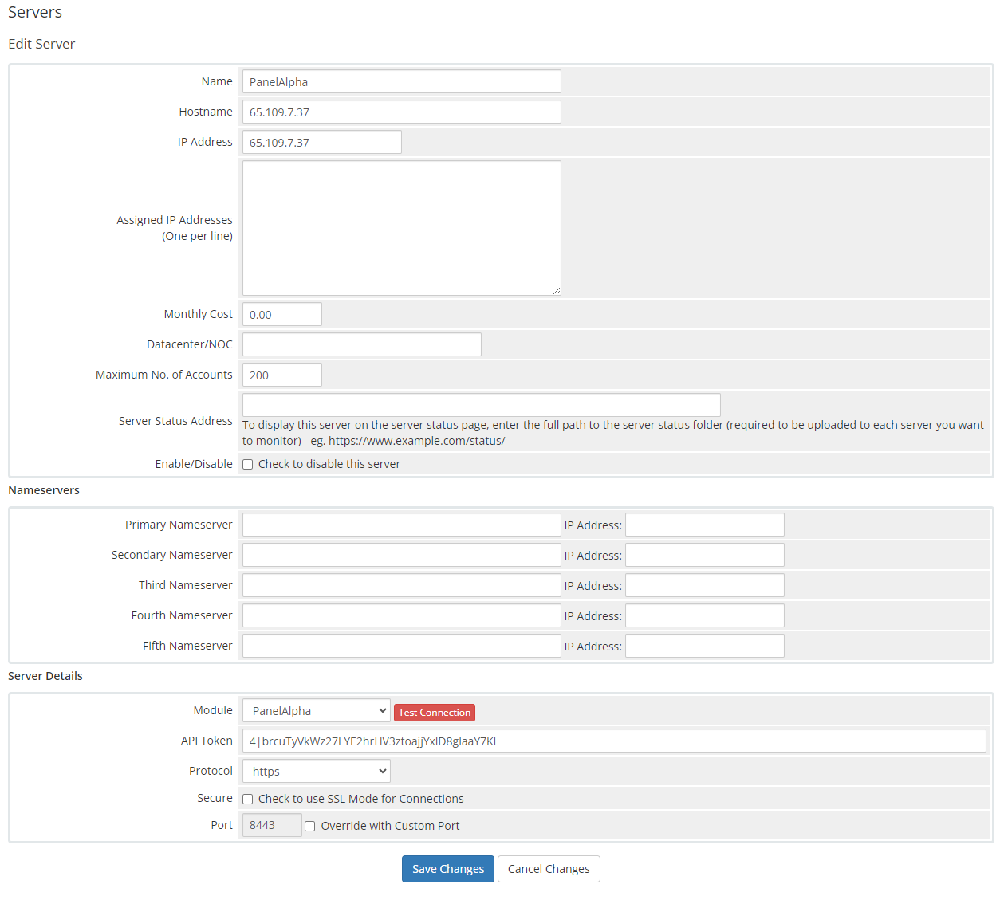

5. Under *System Settings → Products/Services → Servers* create a new group of servers and assign the newly created server to this group.

   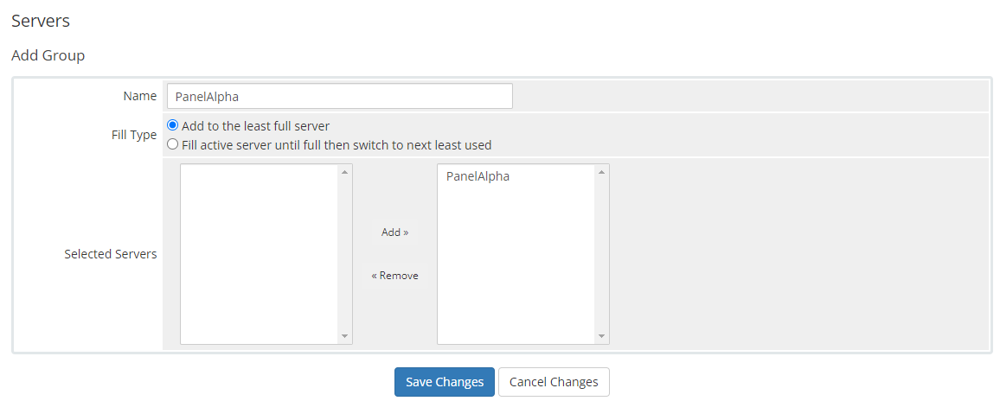

6. Next, proceed to *System Settings → Products/Services* and create a new group of products.

   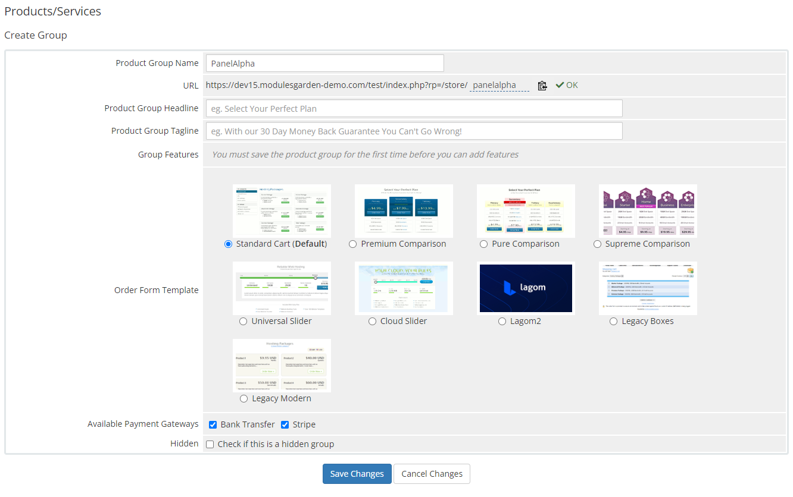

7. Once you have the group, you may create your PanelAlpha product.
   - Product Type - set it to "Shared Hosting"
   - Product Group - select the newly created group
   - Product Name - in this example: "Dental Clinic"
   - Module - select "PanelAlpha" from the dropdown menu
   - Click "Continue" to move to the next step

   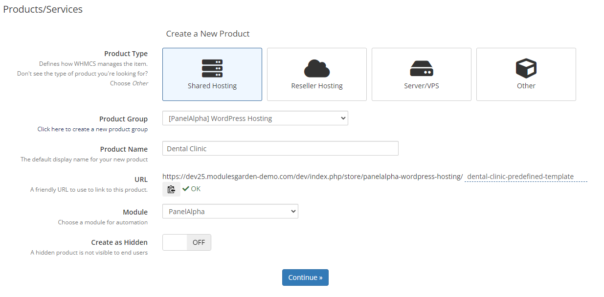

8. Now, go to the **Module Settings** section. As the module name has already been selected, find the server group where the server you need to connect with is assigned in the dropdown menu. Once selected, all module configuration settings will appear.
   - **PanelAlpha Plan** - select the plan you wish to assign to this product. In this example, that will be "Dental Clinic - Predefined Template"
   - Based on the selected plan, all further settings will be automatically filled in. Save the changes once the configuration is ready.

   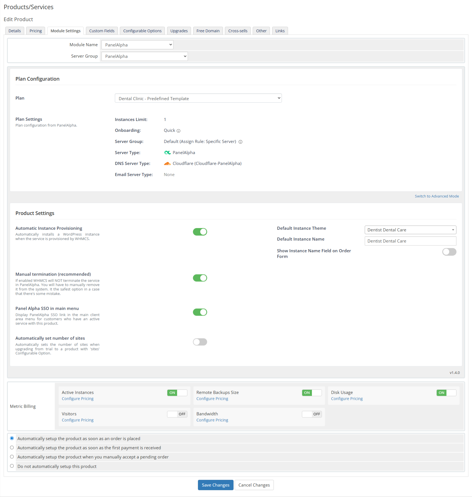

9. Finally, set the pricing details for your product in the "Pricing" tab.

   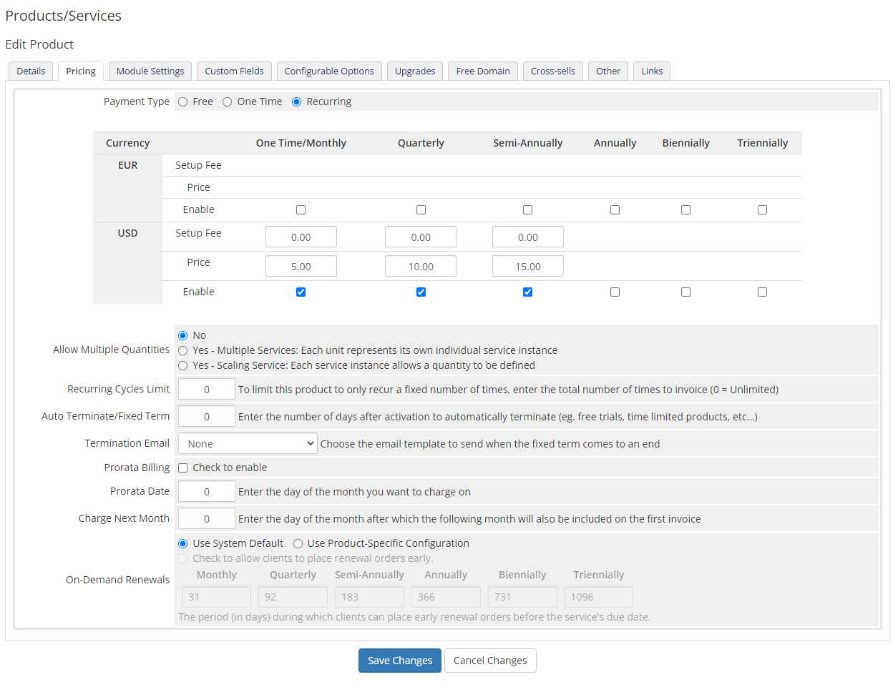

## Multiple WordPress Instances

### Offering a Service with Multiple WordPress Instances Limit

This is a recommended service for **large customers or agencies** that manage multiple WordPress instances. In this case, it does not make sense to ask them to order a new service from your billing system for every instance. You can offer predefined limit packages (e.g. 10 sites, 50 sites, 100 sites) or use Usage Billing to charge for the total number of instances in use.

### Workflow Illustration

1. End customer orders a new service in a billing system, for example WHMCS: "Multiple WordPress Sites - Bronze"
2. They go through the ordering process.
3. After payment is complete, they receive an email with details about their service and can use the "Manage WordPress" section in the menu with SSO authentication.
4. Once redirected to PanelAlpha, SSO is used to automatically authenticate them.
5. The end customer can click "Add New" to create a new site.
6. They fill in a dedicated form and the site is created immediately.

The configuration follows similar steps as the Single WordPress Instance scenario, but with the instances limit set to the desired number (e.g. 10, 50, 100).

## Plan Upgrade

### Upgrading a Plan

PanelAlpha offers a user-friendly method for customers to seamlessly manage plan upgrades directly within the application. When users approach the maximum number of available sites or their hosting space nears capacity, they can initiate an upgrade for their website.

### Workflow

1. When the end client reaches the limit of their sites, they will receive a dashboard notification that they cannot create any new instances before upgrading their plan.

   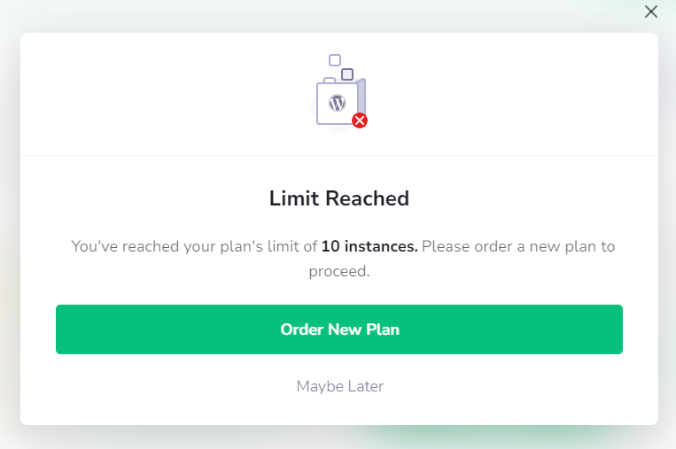

2. In the "My Hosting" section of the PanelAlpha client area, in the top right corner of the "Plan Usage" table, there is a button that allows upgrading the current plan.

   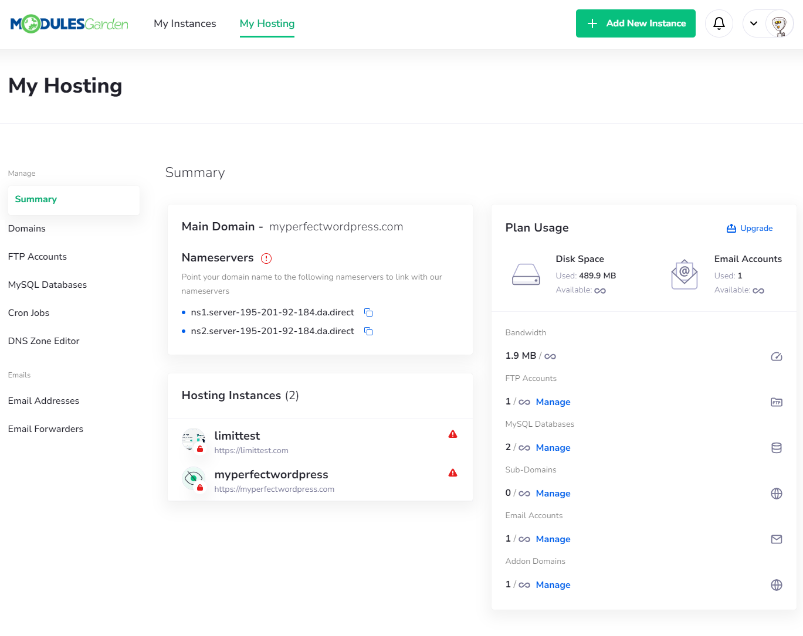

3. The upgrade process is handled through WHMCS, where customers can select a higher-tier product and complete the payment.
4. Once payment is complete, the user will see the new product active and can return to PanelAlpha to create new instances within the upgraded limit.

## Cross-Selling Scenarios

### Cross-Selling Paid Plugins and Themes

PanelAlpha supports cross-selling paid plugins and themes as additional services through WHMCS product addons. This allows you to offer premium plugins and themes that customers can purchase and have automatically installed on their WordPress instances.

### Cross-Selling Domains

You can configure PanelAlpha to integrate with domain registrars through WHMCS, allowing customers to purchase domains directly from their WordPress management interface and have them automatically configured with their instances.
