# PanelAlpha WordPress Hosting For WHMCS

:docs-button{href="https://github.com/panelalpha/panelalpha-for-whmcs/archive/refs/heads/main.zip"}[Direct Download]

**PanelAlpha WordPress Hosting For WHMCS** is a module that integrates PanelAlpha platform provisioning and management options with your WHMCS system. As a widely recognized web hosting and billing platform, WHMCS empowers you to efficiently provision and bill your clients for a variety of services. These may include ordered accounts with WordPress websites, product addons like plugins and themes, and services offered by PanelAlpha.

### Features List

- Admin Area
  - Create / Terminate / Suspend / Unsuspend PanelAlpha Service
  - Change Package
  - Configure Service Per PanelAlpha Plan
  - View Selected Plan Configuration From PanelAlpha:
    - Instances Limit
    - Onboarding Type
    - Server Type And Group
    - Disk Space And Memory Limit
    - Selected DNS And Email Server
  - Define Custom Server Configuration per product
  - Generate Configurable Options for features available within a plan
  - Enable Automatic WordPress Instance Provisioning When Service Is Created
  - Define Default WordPress Instance Theme
  - Define Default WordPress Instance Name
  - Toggle WordPress Instance Name Field On Order Form
  - Enable Only Manual Service Termination
  - Enable PanelAlpha Single Sign-On (SSO) For Client Area
  - Configure Metric Billing For:
    - Active WordPress Instances
    - Remote Backups Size
    - Disk Usage
  - Create / Terminate Service Addons With Preconfigured Packages From PanelAlpha:
    - View Selected Package Configuration With Included Plugins And Themes
  - Synchronize Accounts Between WHMCS And PanelAlpha Platform
- Client Area
  - Use Single Sign-On (SSO) To Manage WordPress Instances In PanelAlpha
  - View Current Usage Billing For:
    - Active WordPress Instances
    - Remote Backups Size
    - Disk Usage
- General Info
  - Multi-Language Support
  - Supports PHP 8.2 Back To PHP 8.1
  - Supports WHMCS Themes "Six" And "Twenty-One"
  - Supports WHMCS V8.12 Back To WHMCS V8.9

## Installation

This tutorial provides step-by-step instructions on the installation and configuration process of the PanelAlpha WordPress Hosting For WHMCS module. Our guide will ensure you successfully set up the module and customize the offered options to meet your business needs.

1. Download the module from our [GitHub Repository](https://github.com/panelalpha/panelalpha-for-whmcs/).
   - **Direct download link:** [https://github.com/panelalpha/panelalpha-for-whmcs/archive/refs/heads/main.zip](https://github.com/panelalpha/panelalpha-for-whmcs/archive/refs/heads/main.zip)
2. Upload and extract the module files into the main WHMCS directory.

That's it! You have successfully installed the PanelAlpha WordPress Hosting For WHMCS module.

## Configuration

### Server

1. Go to **System Settings → Servers** and click the **Add New Server** button.
2. Choose **PanelAlpha** from the **Module** dropdown menu.

   Remember **not to use SSL Mode for connections**; keep this option disabled or you will encounter errors when testing the server connection.

   Fill in the following fields:
   - **Name** - enter any name of your choice
   - **Hostname** - remember to always add the **port number**, as shown on the screen below
   - **API Token** - the API token can be generated in the PanelAlpha admin area in **Configuration → Admins** under the **Enable API Token** action
3. **Check the connection** when your server configuration is ready.

   To check the connection with the PanelAlpha server, click the "Test Connection" button.

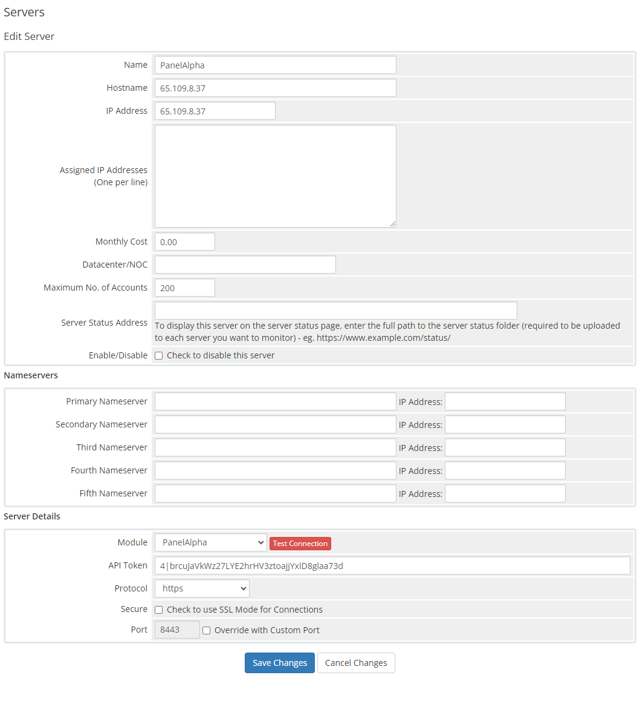

4. The next step is creating a server group. To do so, click **Create Server Group**.
5. Enter the name, click your previously created server, click **Add**, and then **Save Changes**.

### Product

1. To create and configure a product, go to **Setup → Products/Services → Products/Services**.
   Click the **Create a New Group** button.
2. Enter the **product group name** and click **Save Changes**.
3. Once you have a product group, you can assign your product to it. To create a product, click **Create a New Product**.
4. Choose your product type and assign the product to the group created in the previous step. Enter your **product name**, select **module: "PanelAlpha"**, and then click "Continue".

   Remember to disable the default "Create as Hidden" option beforehand.
5. Now, go to the "Module Settings" section and choose both **PanelAlpha and your previously created server group** from the dropdown menus. Available options for the product configuration will appear:
   - **PanelAlpha Plan** - a plan will be assigned to the service on the basis of which the service will be created
   - **Plan Settings** - depending on the selected plan and assigned hosting server, adequate settings options will appear here
   - **Custom Server Configuration** - depending on the selected plan and hosting server, default settings will appear here that will override the ones specified in the PanelAlpha plan
   - **Configurable Options** - generate WHMCS Configurable Options for features available in the assigned PanelAlpha plan
   - **Automatic instance provisioning** - if enabled, a new instance will automatically be created with the selected theme when the service is created
     - **Default Instance Theme** - select a theme that will be installed once the service is created
     - **Default Instance Name** - provide the name of the instance that will be installed once the service is created
     - **Show Instance Name Field on Order Form** - if enabled, a custom field with the instance name will be visible on the order form
   - **Manual termination** - if enabled, termination of the service will only occur after a manual action by the admin
   - **PanelAlpha SSO in main menu** - if enabled, the user will receive a link to their PanelAlpha account on the main client area menu
   - **Automatically set number of sites** - automatically sets the number of sites when upgrading from trial to a product with a "sites" Configurable Option. When enabled, the system will automatically configure the sites value based on the client's current usage during upgrade from trial. If only one "sites" Configurable Option exists, the system will redirect directly to checkout. Otherwise, the field will be locked with the automatically determined value.

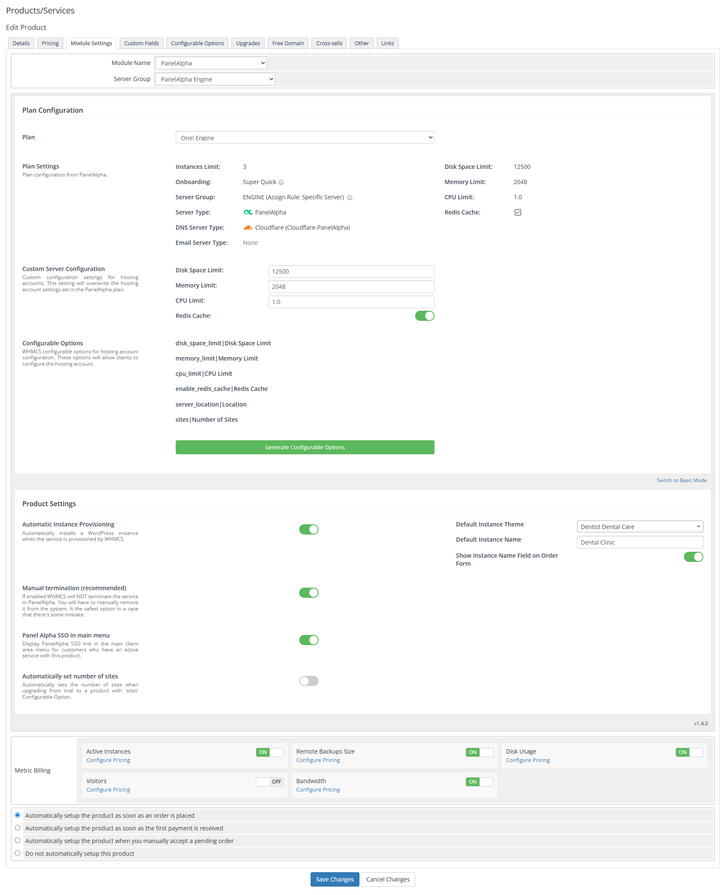

6. Do not forget to click the "Save Changes" button when your configuration is ready.

### Configurable Options Generation

Within the **Module Settings** tab of a PanelAlpha product, the **Configurable Options** section provides a **"Generate Configurable Options"** button. Use this button to automatically create a WHMCS Configurable Option Group and populate it with options derived from the PanelAlpha plan assigned to the product.

#### What Gets Created

When you click **"Generate Configurable Options"**, the module performs the following actions automatically:

1. **Creates a Configurable Option Group** named `Configurable Options for {product name} product`.
2. **Links the group to the current product**.
3. **Generates an individual configurable option** for each option exposed by the assigned PanelAlpha plan.

The set of options that can be generated depends entirely on the PanelAlpha plan's `configurable_options` field — only options available within the assigned plan appear. The module uses `updateOrCreate` logic, so clicking the button multiple times is safe and will update existing options rather than duplicate them.

#### Available Configurable Options

The module can generate the following WHMCS Configurable Options, grouped by category:

**Locations**

- **Server Location** (`server_location`) — the server or location on which the hosting account will be created. When the plan's server assign rule is set to **Random** or **Least Accounts**, the dropdown sub-options are populated dynamically from each server in the plan's hosting server group (formatted as `id|name`). For other assign rules, static sample values are used and you are expected to adjust them.
- **Geo Affinity** (`geo_affinity`) — geographic location, with sample options such as Amsterdam/NL, Los Angeles/CA, Ashburn/VA, and Dallas/TX.

**Resources**

- **Number of Sites** (`sites`) — quantity-based option.
- **Space Quota** (`space_quota`) — in MB.
- **Disk Space Limit** (`disk_space_limit`).
- **Memory Limit** (`memory_limit`).
- **CPU Limit** (`cpu_limit`).
- **MySQL Databases Limit** (`mysql_databases_limit`).
- **FTP Accounts Limit** (`ftp_accounts_limit`).
- **SFTP Accounts Limit** (`sftp_accounts_limit`).
- **Addon Domains Limit** (`addon_domains_limit`).
- **Subdomains Limit** (`subdomains_limit`).
- **Inodes Limit** (`inodes_limit`).
- **Bandwidth Limit** (`bandwidth_limit`) — in MB per month.

**Performance**

- **PHP Workers** (`php_workers`).
- **PHP Memory Limit** (`php_memory_limit`) — dropdown with values such as 512 MB, 1024 MB, 1536 MB, and 2048 MB.
- **Burst Up PHP Workers** (`burst_up_php_workers`) — yes/no toggle.
- **PHP-FPM Pool Settings** (`php_fpm_pool_settings`).
- **LiteSpeed Settings** (`lsphp_settings`) — quantity.
- **Enabled Redis Cache** (`enable_redis_cache`) — yes/no toggle.

**Access & Network**

- **Enabled SSH Access** (`default_ssh_access_enabled`) — yes/no toggle.
- **Dedicated IPv4** (`dedicated_ipv4`) — yes/no toggle.
- **Dedicated IPv6** (`dedicated_ipv6`) — yes/no toggle.
- **Read Rate Limit (Bps)** (`device_read_bps`).
- **Write Rate Limit (Bps)** (`device_write_bps`).

**Plan & Package**

- **WHM Package** (`whm_package`) — dropdown.
- **Package** (`package`) — dropdown.
- **Hosting Plan** (`hosting_plan`) — dropdown.

#### WHMCS Option Types

Each generated option uses one of the following WHMCS option types:

| Type | Meaning | Customer Experience |
|---|---|---|
| **Dropdown** | Customer selects one value from a predefined list. | Standard select field on the order form. |
| **Quantity** | Customer enters a numeric value. | Text input accepting whole numbers. |
| **Boolean (Yes/No)** | Customer toggles the option on or off. | Checkbox on the order form. |

#### Setting Pricing

The generation process creates the option structure only — it does **not** set pricing. After generation, go to **Setup → Products/Services → Configurable Options** in WHMCS, locate the group named `Configurable Options for {product name} product`, and set pricing for each option cycle as you would for any standard WHMCS Configurable Option.

#### Automatically Set Number of Sites

If you generate a **Sites** configurable option, you may also want to enable the **"Automatically set number of sites"** product setting described in the previous step. When enabled, the system automatically configures the sites value based on the client's current usage during an upgrade from a trial product. If only one "sites" Configurable Option exists, the client is redirected directly to checkout with the value locked.

### Addon

1. Go to **System Settings → Product Addons** and click the "Add New Addon" button.
2. Choose the **addon type as "Independent Product"**, enter the package name, and **select the addon module: "PanelAlpha"**.
3. Now, go to the addon's "Module Settings" section and select the package:
   - **Package** - you can select a ready package configured in PanelAlpha
   - Preview the package configuration:
     - **Plugin automation on assign** - describes what happens to the plugins when the package is added to the service
     - **Theme automation on assign** - describes what happens to the themes when the package is added to the service
     - **Plugins included** - list of plugins assigned to the selected package
     - **Themes included** - list of themes assigned to the selected package

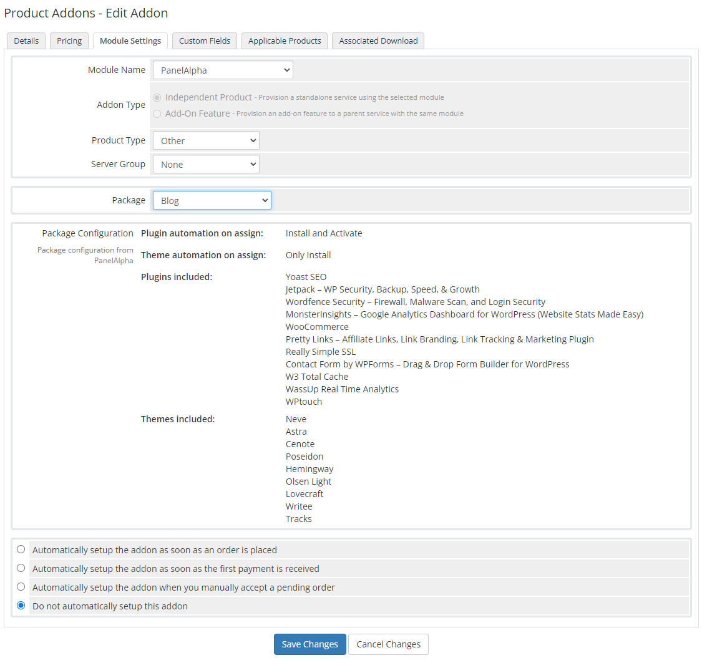

4. Assign the addon to the selected products in the "Applicable Products" tab.

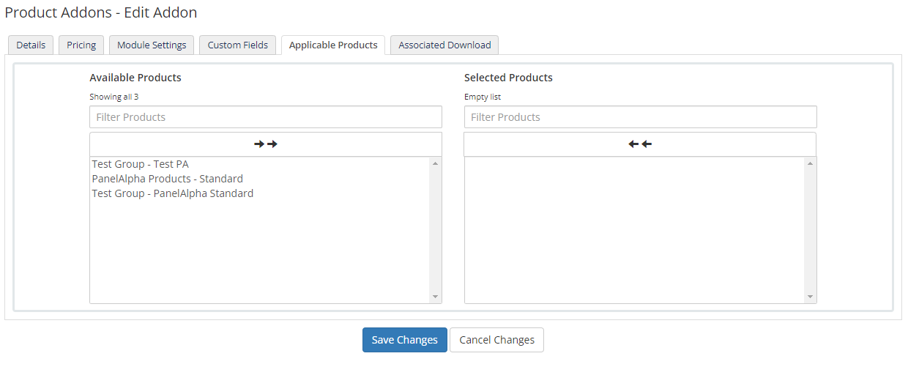

5. Remember to click "Save Changes" when your addon configuration is ready.

## Management

### Admin Area

As soon as you set up a server for a client, you can request various actions and view server details from the WHMCS admin area.

**Available module commands:**

- Create / Suspend / Unsuspend / Terminate the service
- Change Package
- SSO (Single Sign-On) button to log in as the user in the Client Area PanelAlpha

**Metric Statistics:**

- Data on active instances assigned to the service
- Data on the remote backup size
- Disk usage analysis
- Bandwidth usage tracking
- Website visitor statistics

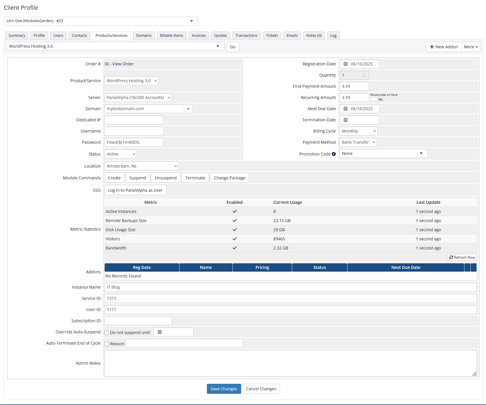

### Addon Page

If your product has an addon, you can also review its details from the admin area. Simply locate it in the list under the main product name.

**Available actions on addons:**

- Create the addon
- Terminate the addon

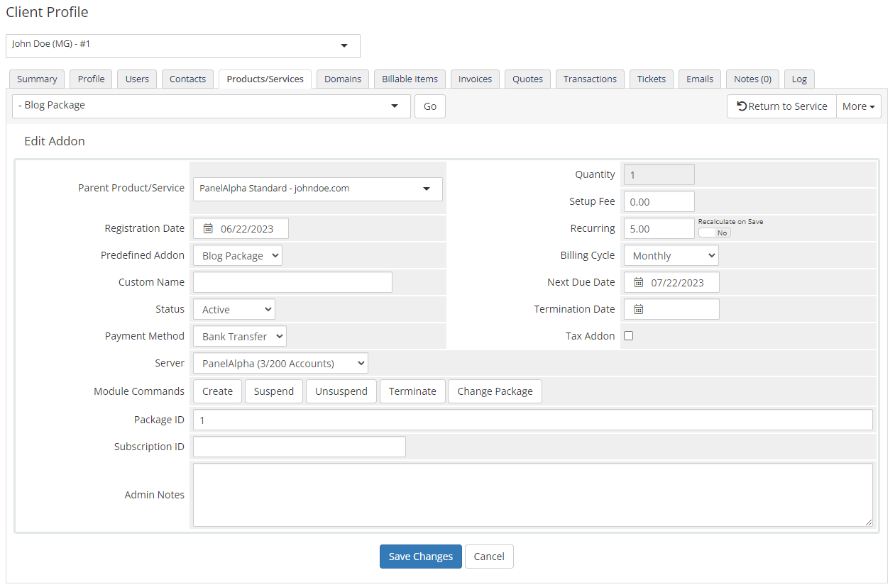

### Client Area

Accessing their account on PanelAlpha is easy for clients - they simply need to click the **Manage WordPress** button in the navigation bar.

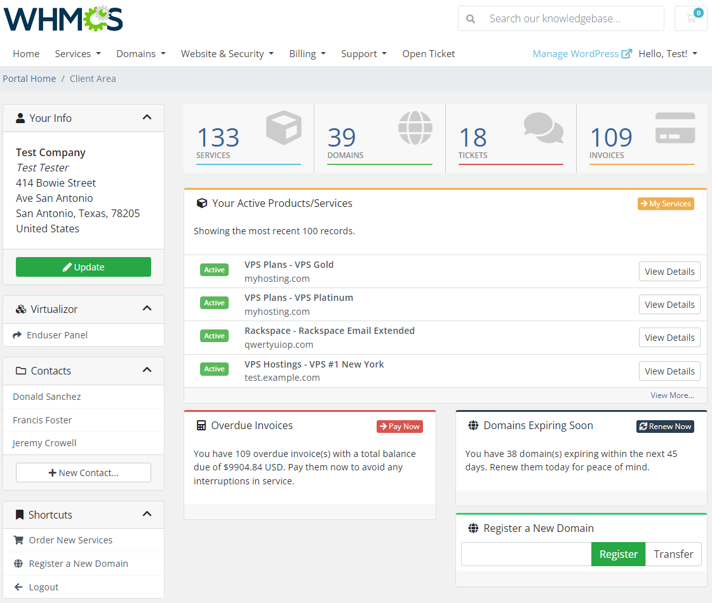

Access the PanelAlpha service, where you will find a button that allows **direct login** to the platform via SSO.

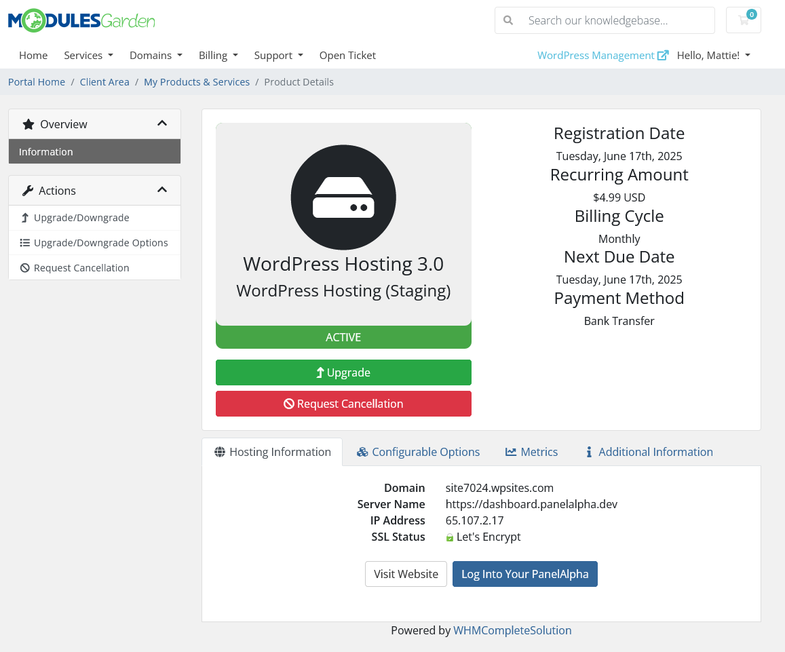

In the **Metrics** section, you can also view the current billing usage for **active WordPress instances, the size of remote backups, disk usage, bandwidth consumption, and website visitor statistics**.

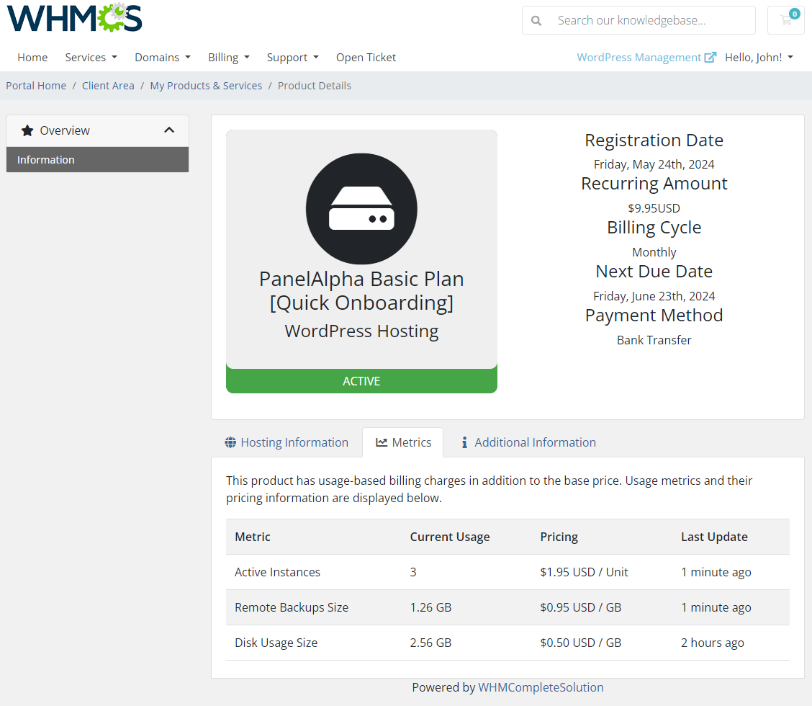

The **Additional Information** section provides details on the **WordPress instance name** that has been created on this service.

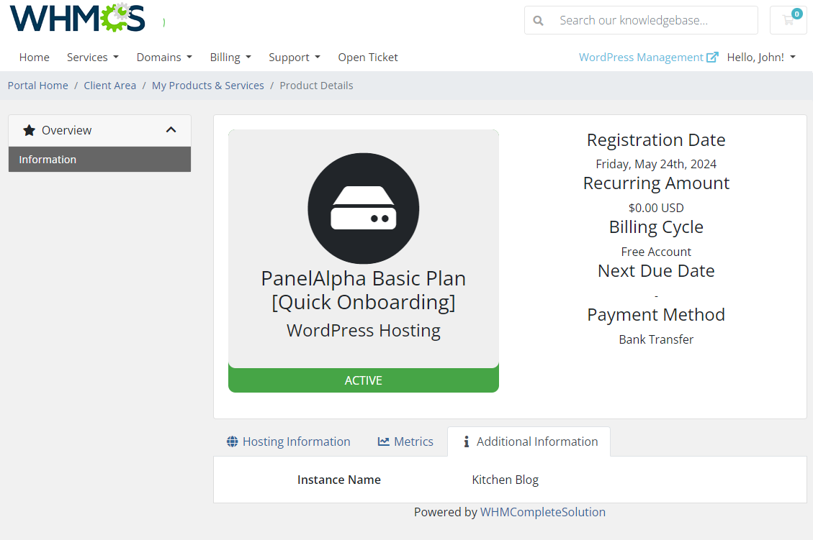

### Account Synchronisation

Follow the guide below to synchronize and import services from PanelAlpha into your WHMCS.

1. In your WHMCS installation, navigate to **System Settings → Servers**.
2. **Step 1** - locate your PanelAlpha server in the list and click the **Sync Accounts** button.

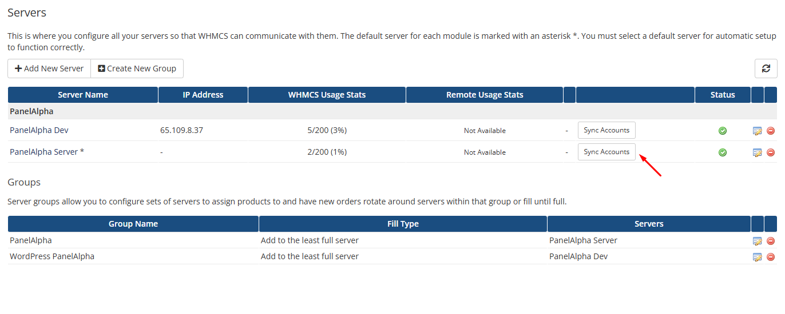

3. **Step 2: Analyse** - a table will display available services and their details.
   - Select the services that are not yet synchronized and that you wish to import by checking the **Import/Sync** box. Then, click **Continue**.

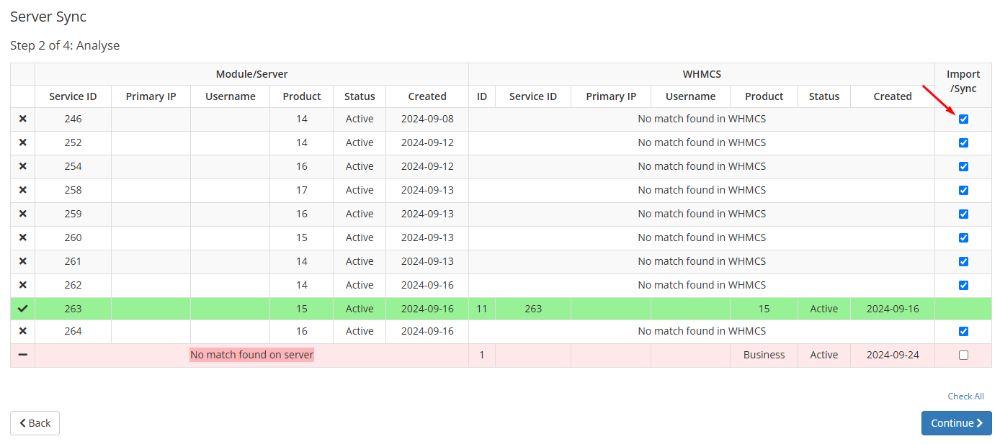

4. **Step 3: Review** - you will be moved to the **Review** step. Here, you can see the PanelAlpha services that will soon be created in WHMCS.
   - Configure account import settings:
     - **Send Client Welcome Email** - enable to send a welcome email to clients for newly created accounts. Select the template from the dropdown menu, and set the status to **Yes** to activate.
     - **Reset Service Account Passwords** - set to **Yes** to auto-generate new passwords for imported accounts.
     - **Send Service Welcome Email** - set to **Yes** to send a welcome email for existing products only.
     - **Set Recurring Billing Information** - enable to automatically set billing based on the selected cycle. This applies to existing products only.
   - Once configured, click **Continue** to complete the account synchronisation process.

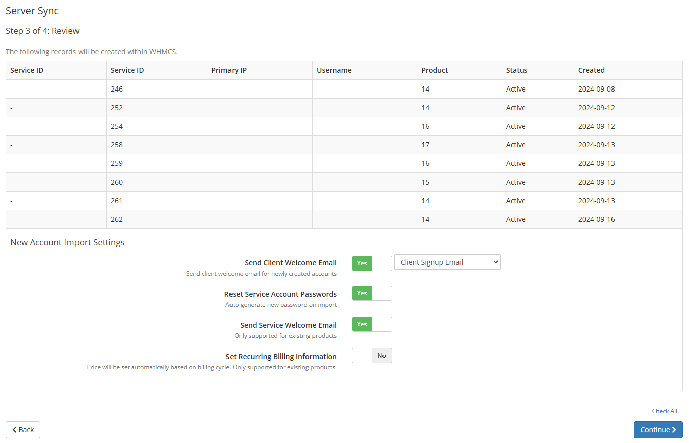

5. **Step 4: Summary** - wait a moment for synchronization to complete. A success message will confirm the server synchronization completion.

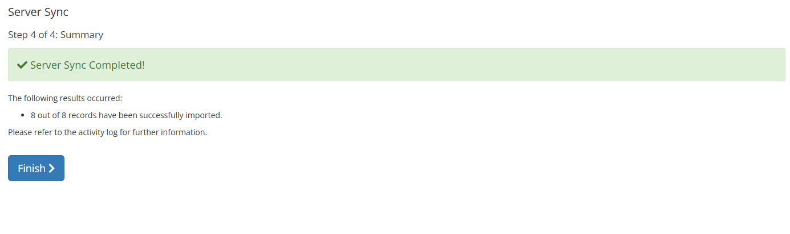

**Important!**

The synchronization process verifies account existence in both WHMCS and PanelAlpha. This means that if a service exists in WHMCS but is no longer available in PanelAlpha, it may be removed from WHMCS during synchronization.

Services that no longer exist in PanelAlpha but still have active corresponding accounts in WHMCS are marked as shown on the screen below and can be selected in **Step 2** of the account synchronization process. These services will be deleted from WHMCS upon successful completion of the process.

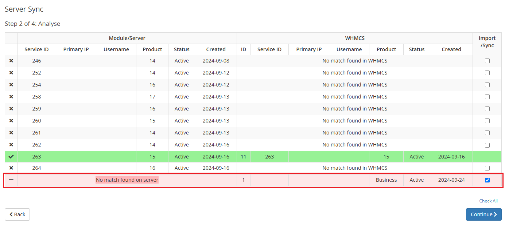

### Domain Synchronization

Starting from **version 1.5.0** of the module, domain synchronization has been added for existing services in WHMCS. This feature automatically keeps domain information up-to-date between PanelAlpha and WHMCS.

The synchronization process runs automatically through a hook that executes after the main WHMCS cron job. This ensures that any domain changes made in PanelAlpha are reflected in the corresponding WHMCS services, maintaining consistency across both systems.

## Direct Billing

To activate Direct Billing (named Background Billing before v1.9.8) in PanelAlpha, you need the WHMCS module version v1.2 or higher. This feature allows automated usage-based billing between PanelAlpha and WHMCS.

Follow these steps to configure Direct Billing with WHMCS:

1. Enable the WHMCS Addon Module by navigating to **Setup → Addon Modules** and activating the **PanelAlpha WordPress Hosting For WHMCS** module.

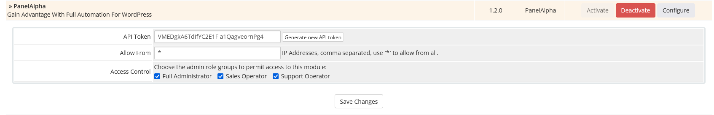

2. After activation, generate an API token that will be used by PanelAlpha to communicate with your WHMCS installation.
3. In the module configuration, specify the IP addresses from which PanelAlpha servers will be allowed to connect to your WHMCS installation. Enter the IP addresses in a comma-separated format. You can use `*` to allow connections from all IP addresses, but for security reasons, it is recommended to specify only the PanelAlpha server IP addresses.

Then in PanelAlpha go to **Configuration → Direct Billing**, select **WHMCS**, and paste the API token. Full Direct Billing UI: [Direct Billing](../direct-billing/index.md). For Stripe instead of WHMCS, see [Stripe Integration](../direct-billing/stripe.md).

If no WordPress instance exists yet, SSO from WHMCS into PanelAlpha shows an error. That message follows your **Application Name** / white-label branding rather than a hard-coded PanelAlpha label.

## Additional Information

1. **Domain Require** - the WHMCS option that determines whether a client needs to provide a domain when placing an order has been hidden from the WHMCS product "Details" section. For PanelAlpha services, this field is automatically populated based on the **onboarding type** defined in the plan associated with the product.
