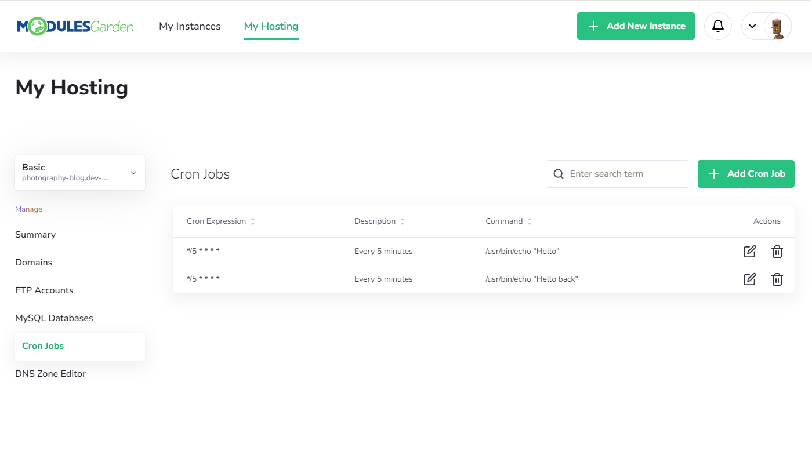
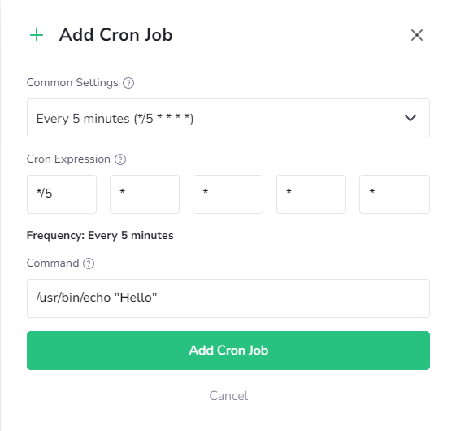

# Cron Jobs

Cron jobs are used to perform certain tasks automatically at specific intervals, just as you would on regular hosting.

To find a specific cron job in the table, use the **search bar** located next to the Add Cron Job button.

The cron tab table includes:

- Cron Expression
- Description
- Command

Under **Actions** you will find buttons to **Edit** and **Delete** your cron jobs.

### Adding New Cron Job

To add a cron job, click the **Add Cron Job** button above the table.

Specify the **cron frequency** by selecting an option from the **dropdown menu** or by entering the **cron expression** manually. Next, enter the command you want the cron job to run.

Click **Add Cron Job** to save. Your new cron job will be added to the crontab of your hosting.
