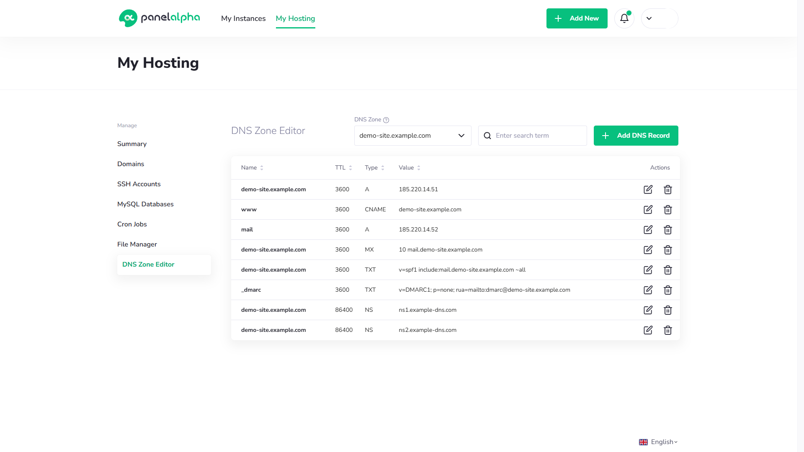

# DNS Zone Editor

This section covers the DNS Zone Editor, which allows you to add, edit, and delete DNS records. Before making any changes, make sure you choose the **correct domain** from the **dropdown menu** above the records table.

You can **Add DNS Record** by using the button to the right, above the table. Use the **search bar** next to it to find a DNS record in the table. **Delete** or **Edit** a DNS record using the Actions buttons.

The table features sortable columns:

- Name of the record
- Time To Live (TTL)
- Type of the record
- Value

**Cloudflare Note:** When adding a DNS record with Cloudflare integration, setting the TTL value to "1" means "automatic." The value must be between 60 and 86400, with the minimum reduced to 30 for Enterprise zones.

**Cloudflare Proxy and Edge Cache Warning:** When enabling the Cloudflare proxy toggle for a DNS record, PanelAlpha checks whether any WordPress instance using that domain has Edge Cache active. If a conflict is detected, a warning modal appears before the change is applied, informing you that running Cloudflare Proxy and Edge Cache simultaneously may cause caching issues. You can proceed anyway or cancel.
