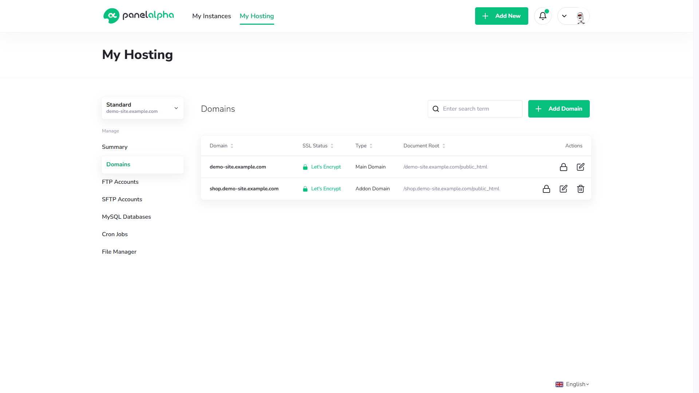
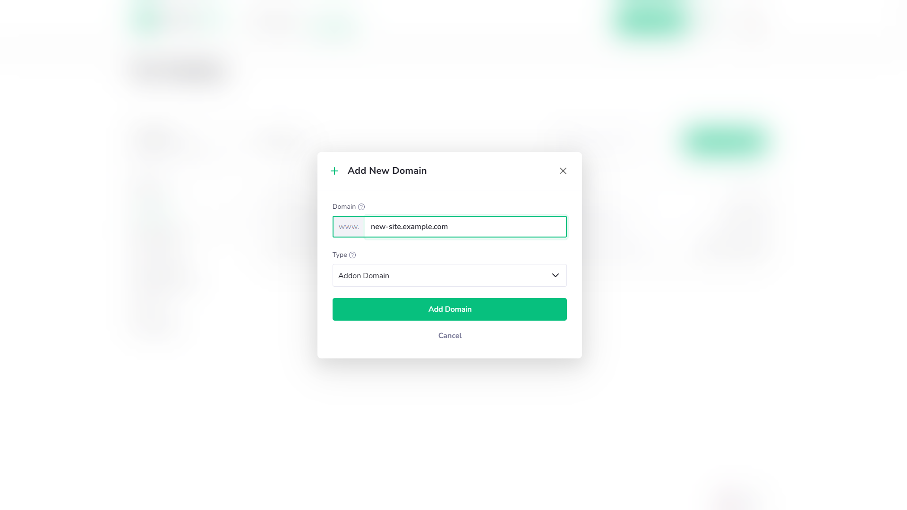
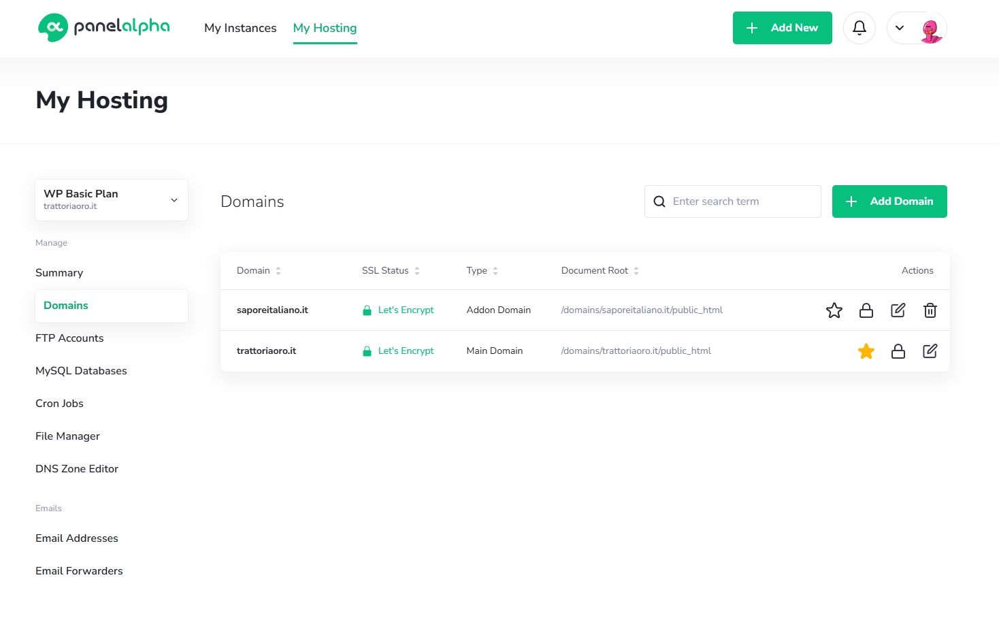
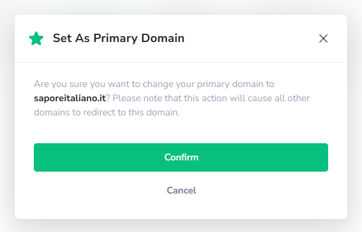

# Domains

All your domains are organized in a table here. You can see previously created domains including the main domain, edit SSL settings, and delete, edit, or add new domains.

Sortable columns of the table include:

- Domain - if something needs your attention, you will see a warning icon here
- SSL Status - hover for a tooltip with an explanation of the status. The tooltip also shows **Detected from:** with the IP address the certificate was fetched from. If the domain currently resolves to a different IP than this server, a warning says so and that DNS may still be propagating.
- Type: Main Domain, Addon Domain, Subdomain
- Document Root path

The **Actions** on the far right allow you to **Edit SSL**, **Delete Domain**, and **Edit Domain** (change **Document Root** or enable the **Redirect** function).

**Edit SSL** opens the SSL management modal for the selected domain. You can manage automatic certificates or install a **Custom Certificate** by pasting the CRT, private KEY, and optional CA bundle. SSL actions require the plan privilege **Manage SSL Certificates**; if that privilege is disabled, **Edit SSL** is hidden.

To **Add Domain**, click the button above the table, then input your new domain and choose its type. To find a specific domain in the table, use the **search** function nearby.

### DNS Records for Addon Domains

When you add an **addon domain** (apex / root domain), PanelAlpha shows the DNS records you need to create at your DNS provider before the domain can resolve correctly.

The suggested records include:

- **A record** for the apex domain pointing to the hosting server IPv4 address
- **CNAME record** for `www` pointing to the apex domain (when a domain name is entered)

The server IP is taken from the hosting account and is visible in the modal as soon as you open **Add Domain**, so you can prepare the A record without contacting support. After the domain is created, the same instructions are shown again so you can finish DNS setup.

If your DNS provider does not support CNAME flattening / ALIAS at the apex, use the displayed A record IP for the root domain.

## Setting a Main Domain

You can change the main domain of your hosting account directly from the Domains list. To do this, you first need to have at least one **addon domain** added to the hosting account.

Each domain row displays a **star icon** in the Actions column. A filled yellow star marks the current main domain. An empty star next to an addon domain indicates it can be promoted to the main domain.

Click the empty star next to the addon domain you want to set as the main domain. A confirmation modal will appear.

Click **Confirm** to apply the change. PanelAlpha automatically updates the hosting account on the server to reflect the new main domain.

### Automatic Domain Handling

PanelAlpha performs the following actions automatically when the main domain changes:

- **Change domain** — when an addon domain is promoted to main, the hosting account on the server is updated accordingly.
- **Delete instance** — when a service has two or more instances and the instance associated with the current main domain is deleted, PanelAlpha automatically reassigns the main domain to a domain from another existing instance before the deletion is performed.
