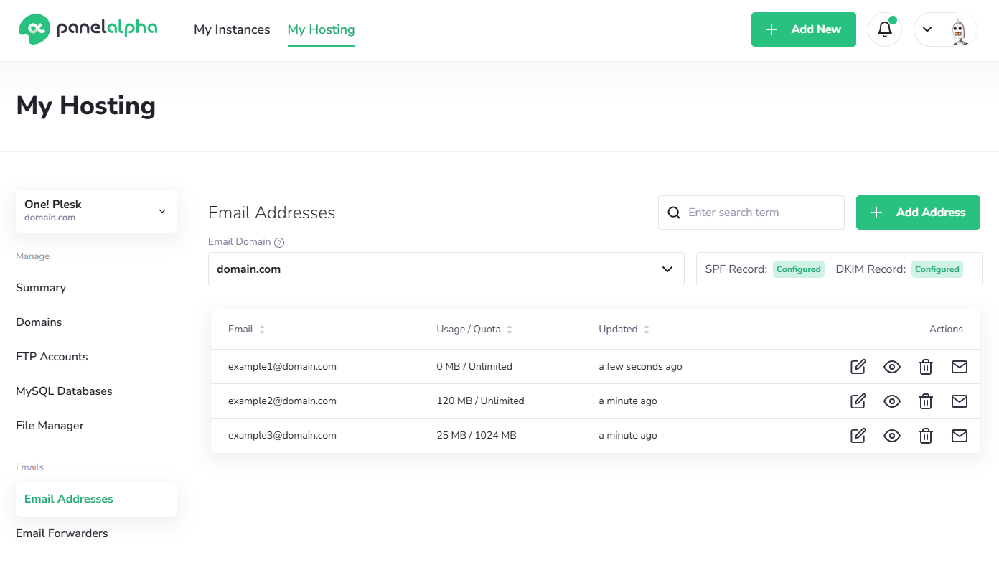
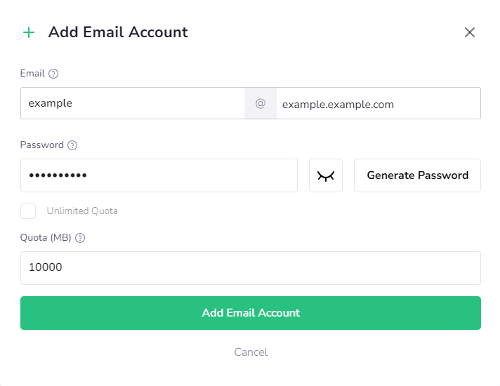
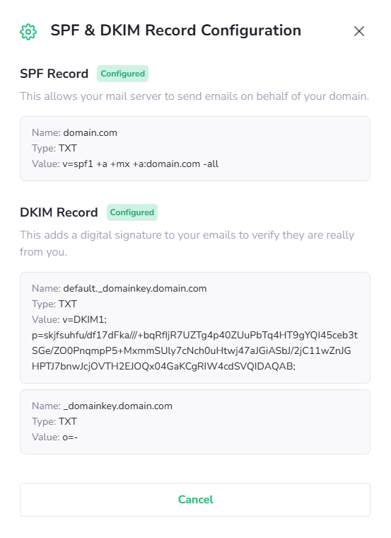

# Email Addresses

In this section you can **log in to webmail** directly by clicking the **envelope** icon under Actions.

This is also where you can manage your email addresses. To **add** a new email address, use the button above the table.

The **search field** next to it can help you find a specific email address in the table below.

The table includes information such as:

- Email
- Usage / Quota
- Last Updated Time

On the right side of the table, you will find **Actions**. These allow you to **change password** and **quota**, **see details**, **delete the email account**, or **log in to webmail**.

The details include Secure SSL/TLS Settings and Non-SSL Settings such as:

- Username
- Password
- Incoming Server
- IMAP Port
- POP3 Port
- Outgoing Server
- SMTP Port

### SPF and DKIM Status

At the top of the Email Addresses section, you will find the status of your domain's SPF and DKIM records. Please note that the availability of this feature depends on your plan's settings.

- A green label with "Passed" indicates that the records are correctly configured, and your emails are more likely to be delivered without issues.
- A red label with "Failed" indicates an issue with the records. To fix this, click the record status to open a pop-up window. This window will show you the correct DNS records (Name, Type, and Value) that need to be configured in your domain's DNS zone.

This functionality ensures your emails are authenticated, which significantly improves deliverability and helps prevent them from being marked as spam.
