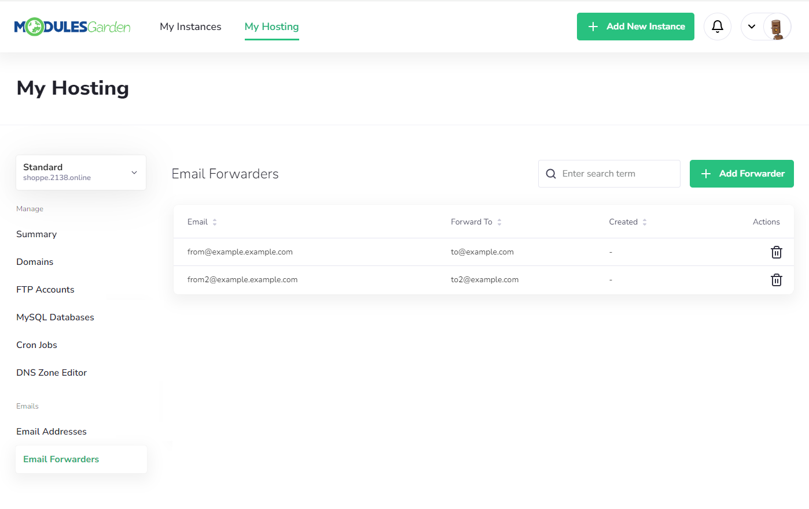
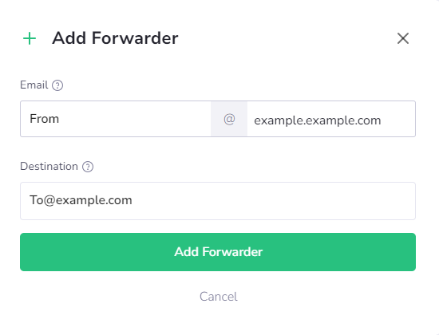

# Email Forwarders

If you wish to add an email forwarder, you can do it here. Enter the email address you want to forward **from** and the email address you want to forward **to**. To **add more forwarders**, use the button above the table.

Use the **search** bar next to the Add Forwarder button to quickly find a specific forwarder in the table below.

The table includes:

- Email messages are forwarded from
- Email messages are forwarded to
- Time since forwarder creation

You can **delete** forwarders by clicking the trash bin icon under Actions.
