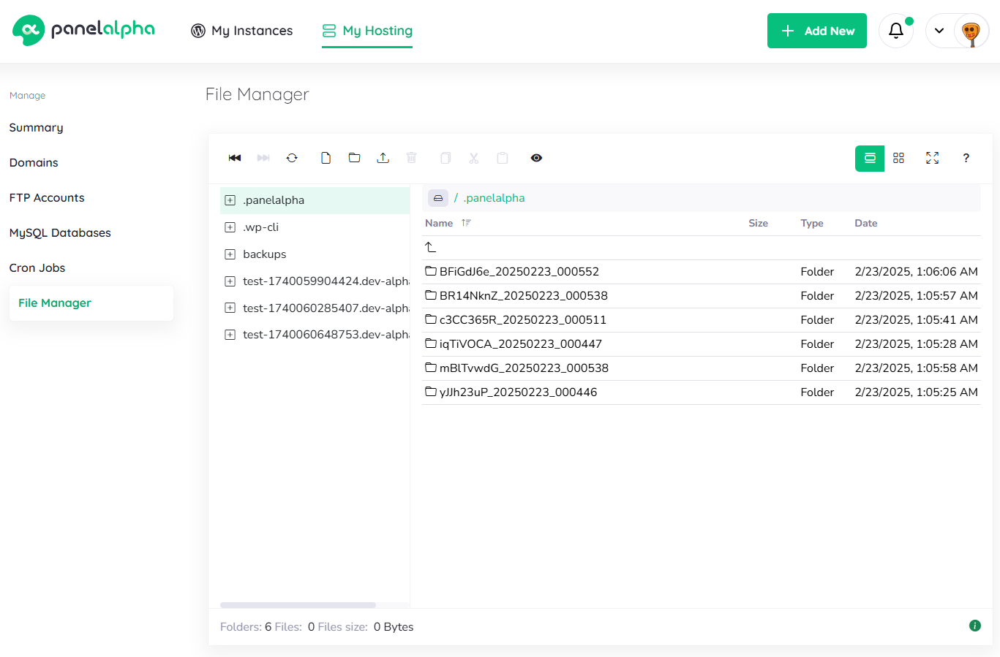
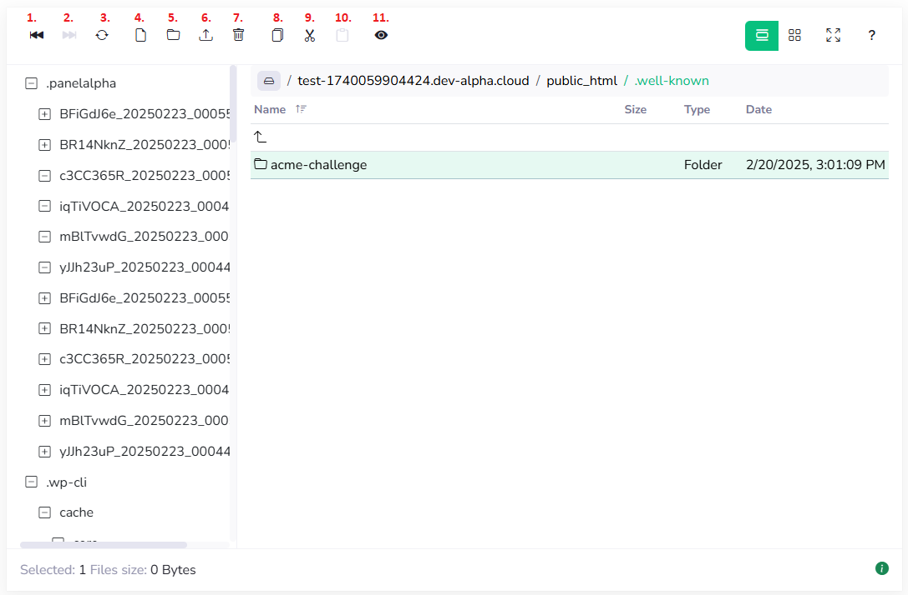
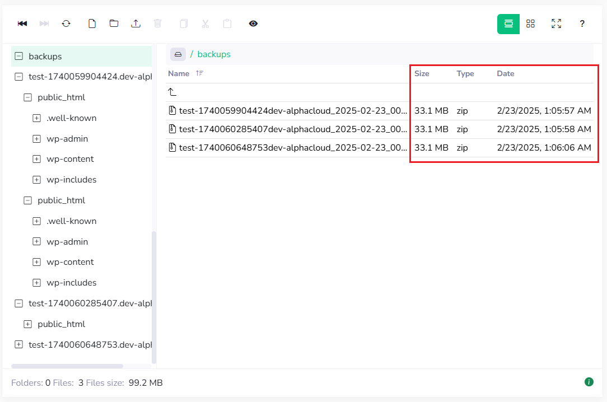
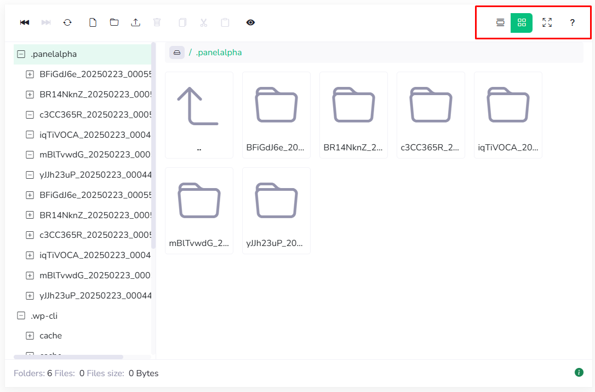
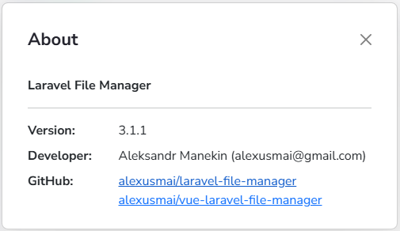

# File Manager

PanelAlpha automatically organizes all files in your account into structured folders. Use the File Manager interface to easily manage and edit your files. Access to the File Manager is controlled by the admin through PanelAlpha's configuration settings, located under "Other" → "Disable Privileges" → "Manage Related Hosting" → "Manage File Manager." By default, this feature is enabled for end users and can also be granted to additional users via the "Shared Access" option.

## Management

PanelAlpha's File Manager offers a comprehensive suite of actions to help you manage your files efficiently. Below is an overview of all available features and functionalities.

### File Actions

1. **Move Back** - navigate back to the previously accessed directory or file location
2. **Move Forward** - advance to the next directory or file location in your browsing history
3. **Refresh** - immediately update the file list to display the latest changes
4. **Add New File** - create a new, blank file directly from the File Manager
5. **Add New Folder** - organize your workspace by creating new folders
6. **Upload** - import files from your local system into PanelAlpha
7. **Delete** - remove unwanted files or folders from your account
8. **Copy** - duplicate files or folders to retain a backup or create variations
9. **Paste** - insert the file or folder that was previously copied or cut into the current directory
10. **Cut** - move files or folders by cutting them from one location and pasting them into another
11. **Show Hidden Files** - toggle the display to reveal or hide files that are normally concealed

### File Details

For each file, the File Manager displays key information. Note that this is available for the table view only:

- **Name** - the file's title
- **Size** - the file size, indicated in appropriate units
- **Type** - the file format or extension
- **Date** - the date when the file was created or last modified

### Additional Options

Customize your file browsing tool with multiple display modes. You will find the management button in the top right corner of the File Manager toolbar.

- **Table View** - display files and folders in a structured tabular format
- **Grid View** - browse files and folders in a visually appealing grid layout
- **Full Screen** - expand the File Manager to occupy the entire screen
- **About** - access detailed information about the File Manager, including the Laravel File Manager version, developer details, and a link to the GitHub repository

- **Status ("i" Icon)** - located in the bottom right corner, this icon provides real-time updates on the system's status. It lists any error messages encountered during file operations, and you can clear the list as needed to keep track of your current operational status.
