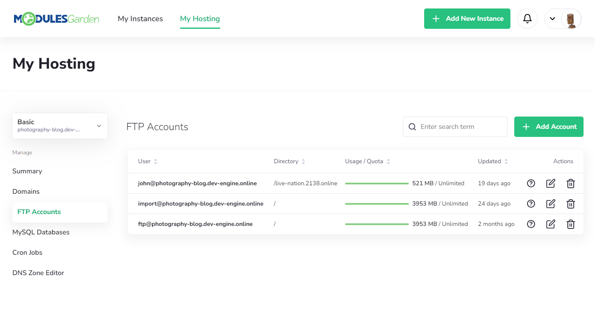
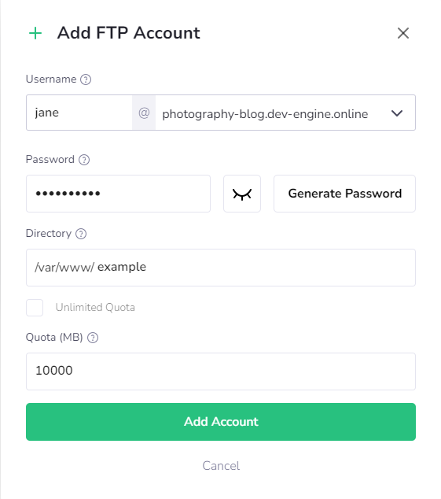

# FTP Accounts

You can add and manage your hosting's FTP accounts here. After your first FTP account is added, you will see a table with sortable columns that include:

- User
- Directory
- Usage / Quota
- Last Update Time

The actions at the end of the table let you see **access details**, **change password** and **quota**, or **delete** the account.

To find a specific FTP account in the table, use the **search** function next to the Add Account button.

### Add Account

To **Add Account**, click the button above the table, then input the **FTP account username**, **password** (you can have PanelAlpha generate a password), and choose its **directory**. You can specify a **storage quota** for the account (in MB) or leave it **unlimited**.
