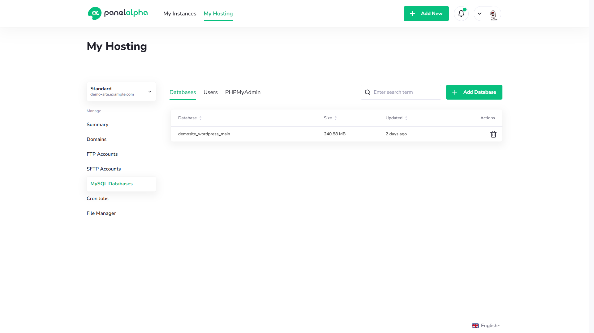
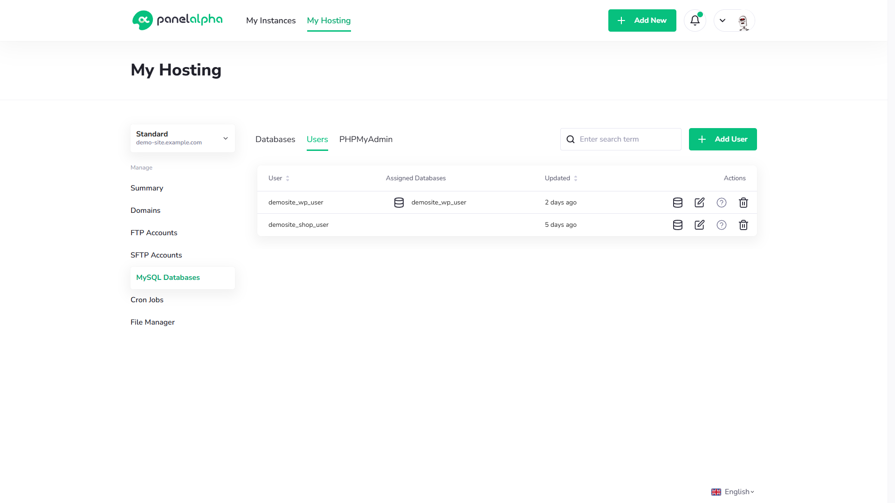
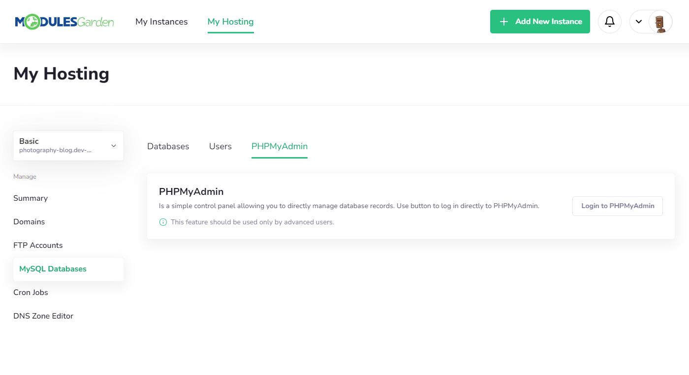
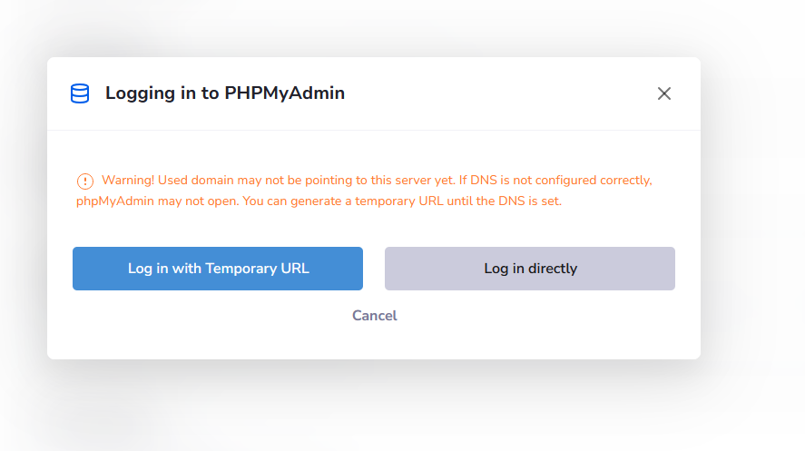

# MySQL Databases

The MySQL Databases section contains comprehensive details on databases, database users, and swift login procedures using phpMyAdmin.

### Databases

**Add a new MySQL database** using the button to the right, above the table. Use the **search bar** next to it to find a specific database in the table. **Delete** or **Rename** a database using the Actions buttons.

The table features sortable columns:

- Database Name
- Size
- Last Updated Time

### Users

**Add a new MySQL user** by clicking the button to the right, above the table. Use the **search bar** next to it to find a specific MySQL user in the table. **Manage Privileges**, **Edit User**, **Show Access Details**, or **Delete User** using the Actions buttons.

The table features sortable columns:

- User
- Assigned Databases
- Last Updated Time

### phpMyAdmin

Log into phpMyAdmin using the button on the right.

If the domain used for phpMyAdmin SSO does not yet resolve through DNS and [WithoutDNS](../integrations/withoutdns.md) is enabled, a modal appears with two options: **Log in with Temporary URL** (uses a system domain, works even without DNS) or **Log in directly** (uses the regular domain). This allows you to manage your databases even before DNS is fully configured.

