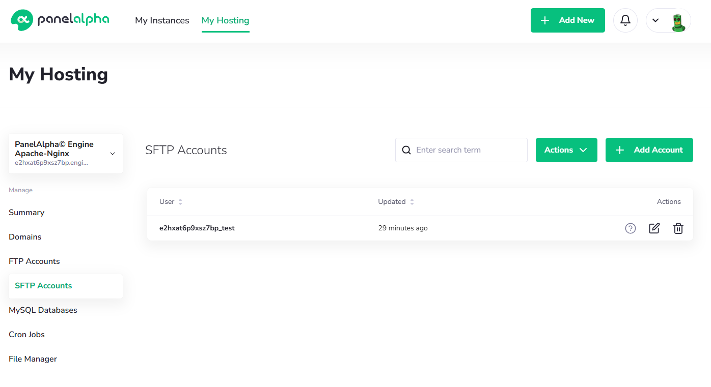
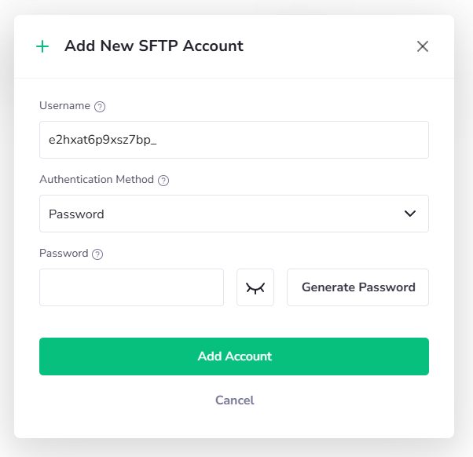

# SFTP Accounts

You can add and manage your hosting's SFTP (Secure File Transfer Protocol) accounts here. SFTP provides secure file transfer over SSH, offering enhanced security compared to traditional FTP by encrypting both authentication credentials and data transfers.

### Requirements

- Available on hosting servers that expose SSH/SFTP (PanelAlpha Engine **v1.0.0+**, WP Cloud with SSH enabled, cPanel, DirectAdmin, Plesk) when the plan allows SFTP
- New accounts inherit plan limits; admins can set per-plan limits to control how many SFTP users a service may create

After your first SFTP account is added, you will see a table with sortable columns that include:

- User
- Updated

The actions at the end of the table let you **show access details**, **edit**, or **delete** the account.

To find a specific SFTP account in the table, use the **search** function next to the Add Account button. You can also perform bulk actions by selecting multiple accounts using the **Actions** dropdown menu.

### Add Account

To **Add Account**, click the button above the table. In the form that appears, provide:

- **Username** - the SFTP account username (automatically prefixed with your hosting account name)
- **Authentication Method** - select the method from the dropdown menu (e.g. Password)
- **Password** - enter a password or click **Generate Password** to automatically create a secure password

Once all fields are filled, click **Add Account** to create the new SFTP account.

**Info:** SFTP uses SSH encryption to protect your data during transfer, making it more secure than traditional FTP. All authentication credentials and file transfers are encrypted, preventing interception by unauthorized parties.

### Managing SFTP Accounts

For each SFTP account in the table, you have access to the following actions:

- **Show Access Details** (info icon) - view the complete connection information for the account
- **Edit** (pencil icon) - modify the account settings, including changing the password
- **Delete** (trash icon) - remove the SFTP account permanently

### Connection Details

When you click **Show Access Details** for an SFTP account, you will see the connection information needed to connect to your hosting via SFTP:

- **Host/Server** - the SFTP server address
- **Port** - typically port 22 (SSH default port)
- **Username** - your full SFTP account username
- **Password** - your account password

You can use these credentials with any SFTP client application such as FileZilla, WinSCP, or Cyberduck to securely transfer files to and from your hosting account.
