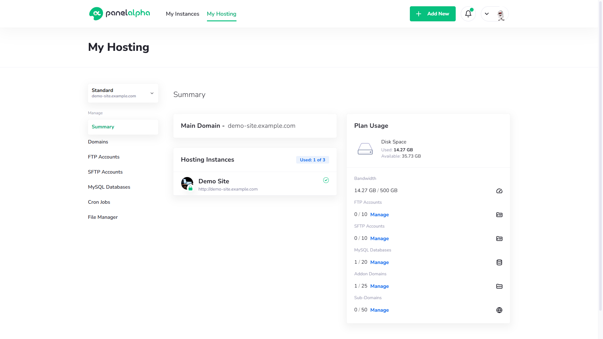

# Summary

Once a plan has been added to your account and you have created your first instance, you can access **My Hosting**. This is where you manage hosting-level features for your service.

If you have more than one hosting service, you can switch between them from the dropdown above the menu on the left.

On **My Plans**, you can also filter services by status (**Active** or **Cancelled**) and search by name, which helps when the account includes both current and cancelled plans.

## Available Sections

Sections visible in the left menu depend on your hosting provider and plan configuration.

Common sections:

- [Summary](summary.md#summary-information)
- [Domains](domains.md)
- [SFTP Accounts](sftp-accounts.md) (in some setups displayed as **SSH Accounts**)
- [MySQL Databases](mysql-databases.md)
- [File Manager](file-manager.md)

Additional sections that may be available depending on server type and enabled features:

- [FTP Accounts](ftp-accounts.md)
- [Cron Jobs](cron-jobs.md)
- [DNS Zone Editor](dns-zone-editor.md)
- [Email Addresses](email-addresses.md)
- [Email Forwarders](email-forwarders.md)

**Summary** is the default section and is described below.

## Summary Information

At the top of the section you can find details like your **Main Domain** and, where applicable, nameserver information.

Below, you can see **Hosting Instances** assigned to this hosting service. Clicking an instance opens its [details page](../client-area-instances/instance-details.md), and clicking its URL opens the website.

If you are the owner of the service, an instance usage counter is displayed next to the section header — for example **Used 1 of 3** — showing the number of instances currently created against the plan limit.

On the right side:

- **Log In To Control Panel** - SSO login to the hosting control panel (for integrations that support it, e.g. Plesk / DirectAdmin / cPanel)
- **Plan Usage** - limits and current usage for resources available in your plan

Displayed usage metrics are plan-dependent and may include, for example:

- Disk Space
- SFTP/SSH Accounts
- FTP Accounts
- MySQL Databases
- Aliases / Addon Domains / Subdomains
- Email-related limits

Use **Manage** shortcuts to open the selected hosting section directly.
