# Advanced Settings

All information and settings that go beyond day-to-day operations can be found in the **Advanced** section of the instance details. They are grouped into several categories:

- Site Details
- Security
- Auto Updates
- Google Analytics (if enabled and allowed on the plan)
- WordPress Multisite (WP Cloud only, if allowed on the plan)
- Developer Settings
- CDN (if enabled on the plan)
- WordPress MCP (if enabled in plan)
- Git (if enabled on the plan)
- WordPress Config
- Users
- Themes
- Logs

Each category is covered in more depth below.

## Site Details

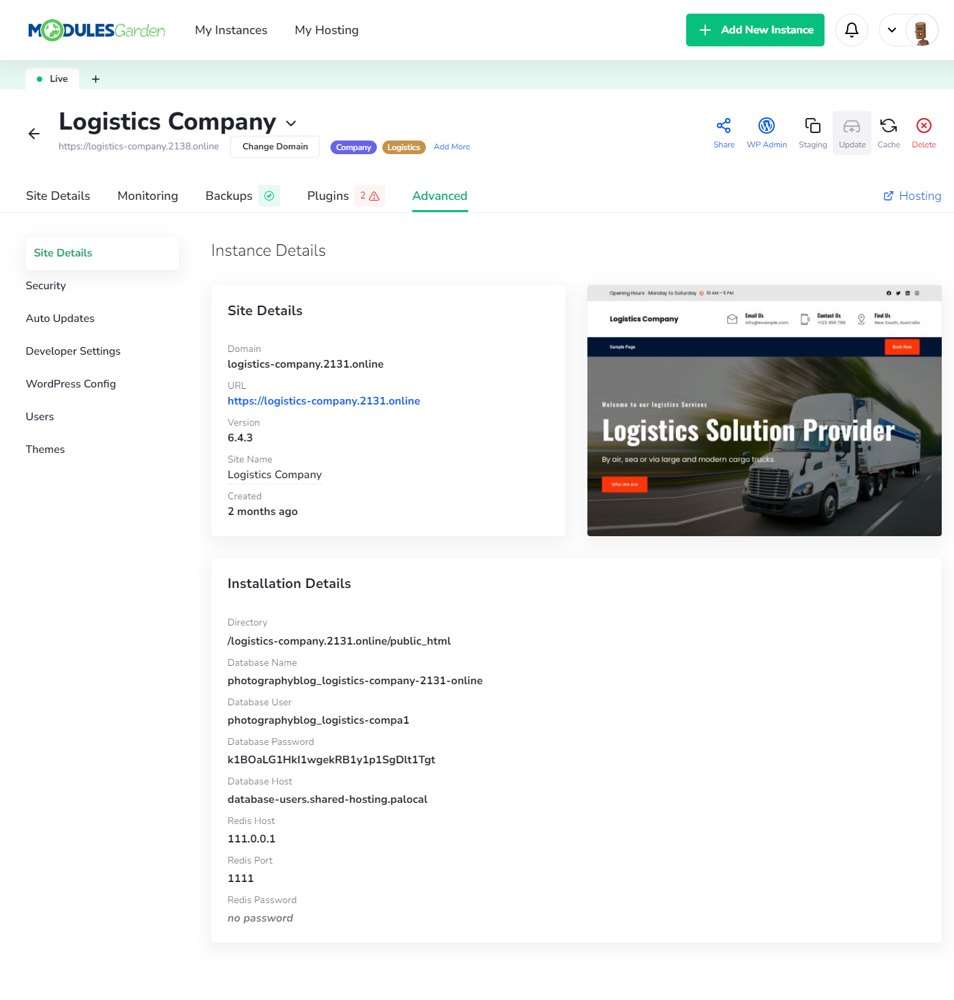

You will find detailed information regarding your site and installation here, including:

- Domain
- URL
- WordPress Version
- Site Name
- Site Age
- Installation directory
- Database Name
- Database User
- Database Password
- Database Host

You can also see the preview on the right-hand side.

Sensitive installation fields (for example database credentials and installation paths) are shown in the **Installation Details** area. Administrators can hide that block for a plan by disabling the **View Installation Details** privilege under **Configuration → Plans → [plan] → Other → Disable Privileges**. Overview fields such as domain and WordPress version remain visible.

## CDN

If the instance plan uses a CDN provider such as [Fastly](../integrations/fastly.md), the **CDN** section appears in Advanced settings (requires the **Manage CDN** privilege).

From this section clients can:

- **Purge Cache** — clear the edge cache for the website
- **Under Attack Mode** — enable or disable the stronger protection profile
- review always-on protection features configured on the plan (for example Origin Shield or automatic purge on content updates)

Administrator setup and plan options are described in the [Fastly](../integrations/fastly.md) integration guide.

## Security

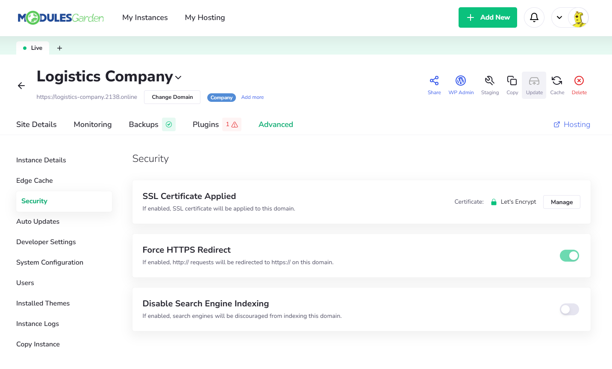

Manage your security settings, including:

- SSL Certificate (if enabled, an SSL certificate will be applied to your domain)
- Force HTTPS Redirect (if enabled, HTTP requests will be redirected to HTTPS on your domain)
- Disable Search Engine Indexing (if enabled, search engines will be discouraged from indexing this domain)

### Custom SSL Certificate

When SSL management is available for the instance (plan privilege **Manage SSL Certificates**), open **Manage** next to the SSL Certificate setting to open the **Set SSL Certificate** modal.

You can:

- keep or request an automatic certificate from the configured SSL provider
- select **Custom Certificate** and paste:
  - **Certificate (CRT)**
  - **Private Key (KEY)**
  - optional **Certificate Authority Bundle (CABUNDLE)**

If the administrator set **Order Custom SSL Certificate Link** under **Configuration → General → Other**, the modal can also show a link to order a certificate from an external provider.

The same custom certificate flow is available from **Hosting → Domains → Edit SSL**.

**Note:** Custom certificates are for PEM material you already have. Automatic SSL / Let's Encrypt remains the default path for most sites.

## Auto Updates

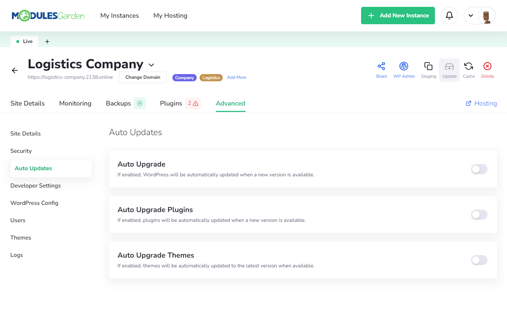

Enable or disable automatic updates for your domain. The options include:

- Automatic WordPress update
- Automatic Plugin updates
- Automatic Theme updates

Plugins and themes that you install from the panel get auto-updates turned on when they are installed.

If auto-updates are on for only some of your plugins or themes, the switch is shown as off and a warning is shown under it. For example: "Only some plugins have auto-updates enabled." Turn the switch on once to enable auto-updates for all plugins or all themes. You do not need to turn it off first.

## Google Analytics

This page is shown only when Google Analytics is enabled as a statistics provider by your administrator and your plan allows the **Manage Reporting** privilege.

The panel adds its own Google Analytics tag to your site. It uses this tag to collect the visitor statistics shown in the panel. Use the **Google Analytics Tag** switch to turn the tag off for this instance.

When the tag is off, the panel does not add it to your site and collects no new statistics. Statistics collected earlier stay available. The tag stays off after a push to live and after a backup restore.

## WordPress Multisite

This page is available only for WordPress instances on a WP Cloud server. It is shown when your plan allows WordPress Multisite and has the **Convert to Multisite** privilege. It is also shown for instances that are already a Multisite network.

Use it to turn the site into a WordPress Multisite network. A network lets you run many sites from one WordPress install. Each new site lives in a subdirectory, for example `example.com/shop`.

Read the list on the page before you convert:

- The conversion cannot be undone from the panel.
- A backup of files and database is created first. For this you need a free manual backup slot. If the backup limit is reached, delete one manual backup and try again.
- If the instance has a staging instance, delete the staging instance first.
- After the conversion, these panel features are not available: Change domain, Set primary domain, Staging, Push to live and push to staging, Copy instance, Preview, Create template, and Theme delete.

To convert:

1. Go to **Advanced → WordPress Multisite**.
2. Click **Convert to Multisite**.
3. Confirm in the **Convert to Multisite?** window by clicking **Convert**.

The page shows "Converting to Multisite. This can take a few minutes." while the work runs. You get a notification when it finishes or fails. If it fails, click **Try again**. A backup was made before the conversion and you can restore it.

When the conversion is done, the page shows "This instance is a Multisite network" and the instance shows a **Multisite** badge next to its name. To manage the sites in the network, open WP Admin and go to **My Sites → Network Admin**. Plugins, themes, WordPress updates and the user list keep working.

## Developer Settings

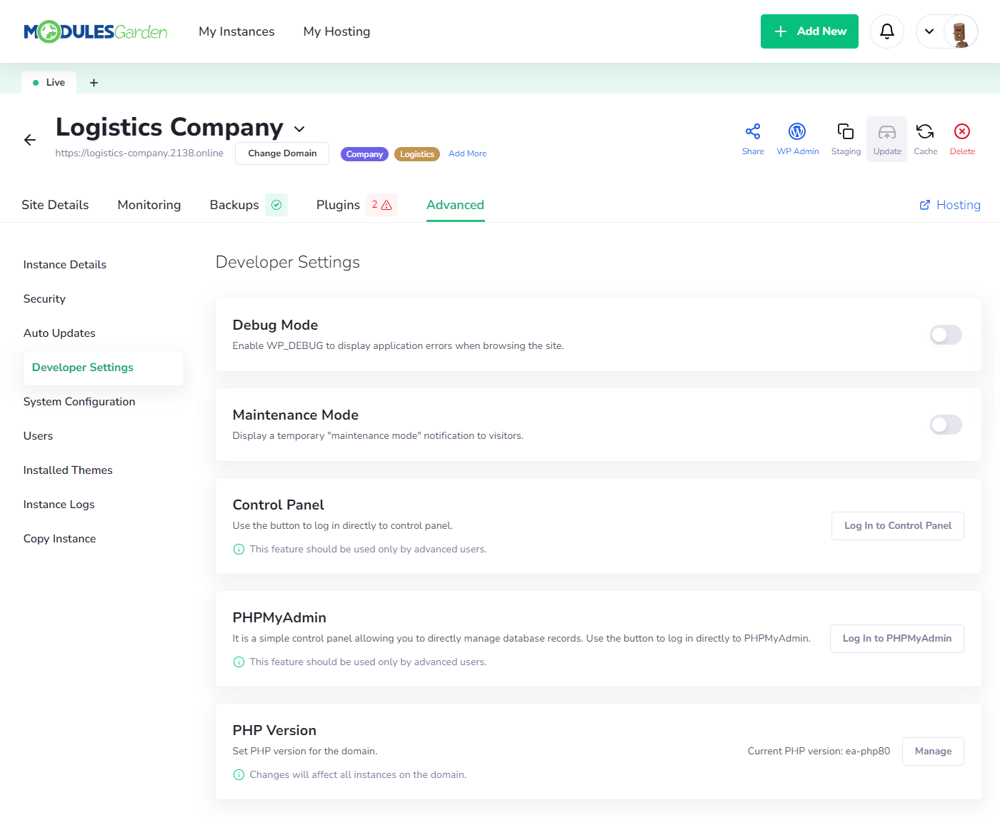

Tools particularly useful for website developers can be found here:

- **WordPress Debug Mode** - when enabled, application errors will be displayed while browsing the site
- **Maintenance Mode** - when enabled, a temporary maintenance notice will be shown to visitors
- **Control Panel** - use SSO for direct login to the control panel (Plesk, DirectAdmin, or cPanel). SSO functionality is handled by a must-use plugin that is automatically maintained by the system
- **phpMyAdmin Access** - a shortcut for direct login to the phpMyAdmin panel. If the domain used for phpMyAdmin SSO does not yet resolve through DNS and [WithoutDNS](../integrations/withoutdns.md) is enabled, a modal appears with two options: **Log in with Temporary URL** (uses a system domain, works even without DNS) or **Log in directly** (uses the regular domain).
- **PHP Version** - check the current PHP version used by the domain and update it if needed. Changing the PHP version will apply to all instances running on the domain
- **PHP Settings** - set PHP settings for the domain. You can add, edit, or remove PHP configurations specific to this domain. When adding a directive, choose from common suggestions (for example `memory_limit`, `upload_max_filesize`, `display_errors`, `error_reporting`) or enter a custom directive name. Boolean-style directives use an On/Off value selector.

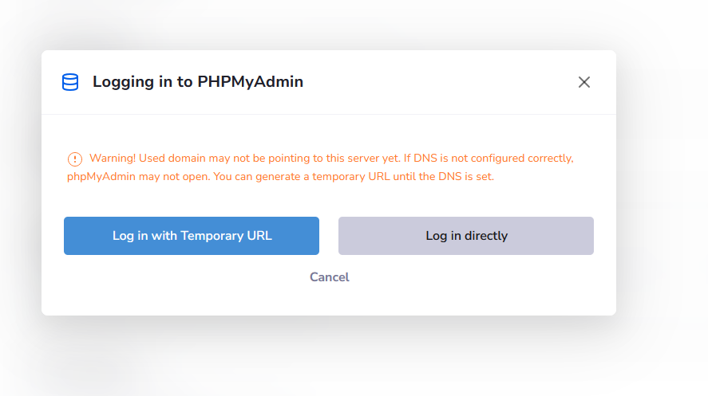

## WordPress MCP

This section is available only when the administrator enables **WordPress MCP** in the plan configuration under **System Configuration → Plans → [selected plan] → Other**.

Administrators can customize the connection snippet shown to clients: on the plan, enable **WordPress MCP**, open **Configure**, and edit the **WordPress MCP Config Template**. The template supports placeholders such as <span v-pre><code>{{endpoint}}</code></span> and <span v-pre><code>{{wp_api_url}}</code></span>, which PanelAlpha replaces per instance. Use **Reset to default** to restore the factory snippet.

The **Documentation** link shown in this Client Area section uses the system **Documentation Link** from **Configuration → General → Other**. If that setting is empty, the documentation link is hidden.

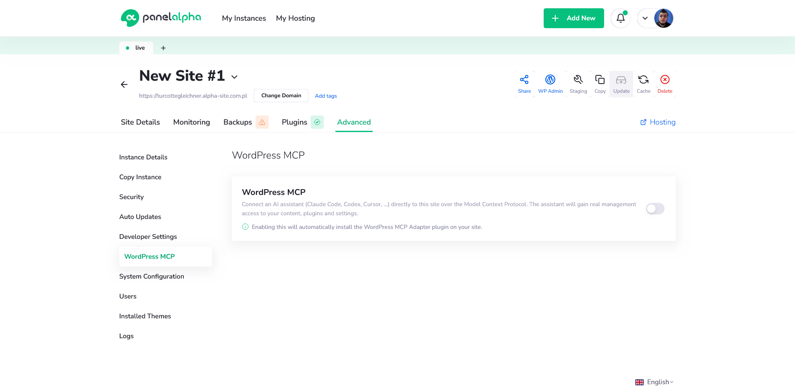

Use **WordPress MCP** to connect **Codex**, **Claude Code**, **Cursor**, and other MCP-compatible tools directly to the selected WordPress site through the **Model Context Protocol**. After the toggle is enabled, PanelAlpha automatically installs the **WordPress MCP Adapter** plugin on the site.

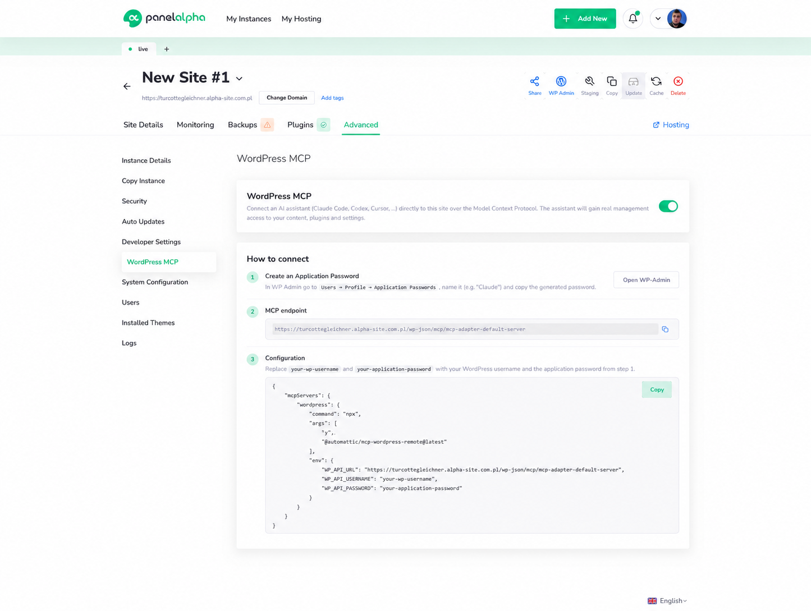

Typical setup flow:

1. Enable the **WordPress MCP** toggle in the instance's **Advanced** section.
2. Open **WP-Admin** from the shortcut on the right.
3. In WordPress go to **Users → Profile → Application Passwords**, create a new application password, and copy it.
4. Copy the **MCP endpoint** shown by PanelAlpha.
5. Copy the generated configuration snippet and replace:
   - `your-wp-username` with the WordPress username
   - `your-application-password` with the application password created in step 3
6. Paste the updated configuration into your MCP-compatible assistant.

If the MCP endpoint shows a temporary error right after enabling the feature, wait a moment and refresh the page. The adapter plugin may still be activating in the background.

### Custom abilities

The MCP Adapter exposes abilities registered by plugins through the WordPress **Abilities API**. To add your own tool — for example, a "create post" ability — drop a small must-use plugin into `wp-content/mu-plugins/`:

```php
<?php
add_action( 'wp_abilities_api_init', function () {
    wp_register_ability( 'mcp/create-post', [
        'label'       => 'Create Post',
        'description' => 'Create a WordPress post.',
        'input_schema' => [
            'type'       => 'object',
            'properties' => [
                'title'   => [ 'type' => 'string' ],
                'content' => [ 'type' => 'string' ],
            ],
            'required'   => [ 'title' ],
        ],
        'execute_callback' => function ( $input ) {
            $id = wp_insert_post( [
                'post_title'   => $input['title'],
                'post_content' => $input['content'] ?? '',
                'post_status'  => 'draft',
            ], true );

            return is_wp_error( $id )
                ? [ 'error' => $id->get_error_message() ]
                : [ 'id' => (int) $id ];
        },
        'permission_callback' => fn () => current_user_can( 'edit_posts' ),
        'meta' => [ 'mcp' => [ 'public' => true ] ],
    ] );
} );
```

After saving, the ability shows up in the MCP client and is called via `mcp-adapter/execute-ability`. Access is controlled by the `permission_callback` and the capabilities of the WordPress user whose Application Password the client uses — so the MCP client can never do more than that user is allowed to do.

## Git

The **Git** section appears in Advanced settings when the plan has the **Manage GIT** privilege enabled. On existing plans it is disabled by default (turned off during the 1.9.0 upgrade). Enable it under **Configuration → Plans → [plan] → Other → Disable Privileges → General Management**. Newly created plans leave **Manage GIT** enabled unless you disable it. See [Plans](../system-configuration/plans.md#other).

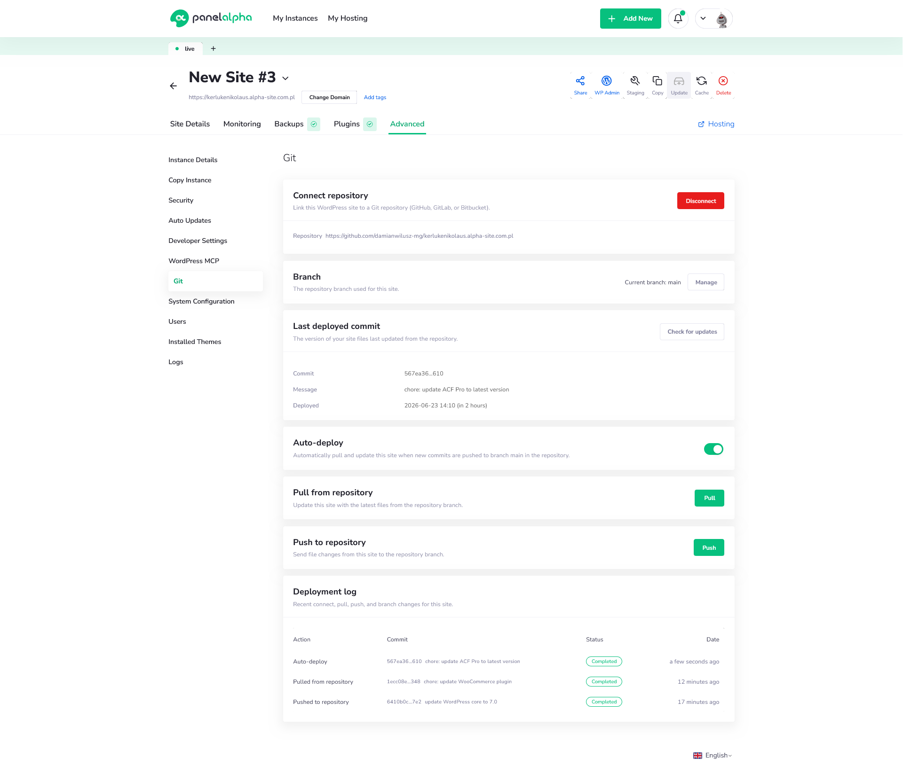

Use this section to connect the WordPress instance with a Git repository hosted on **GitHub**, **GitLab**, or **Bitbucket**. After connecting the repository, you can manage the branch, review deployment history, and synchronize files between the instance and the repository.

- **Connect repository** - connect or disconnect the current instance from a repository. The card shows the linked repository URL.
- **Branch** - shows the branch currently assigned to the instance. Use **Manage** to switch the branch used for pull, push, and auto-deploy operations.
- **Last deployed commit** - displays the latest commit deployed from the repository, including the commit hash, message, and deployment time. Use **Check for updates** to compare the current branch state with the instance.
- **Auto-deploy** - when enabled, new commits pushed to the connected branch are deployed to the instance automatically.
- **Pull from repository** - downloads the latest files from the connected branch and deploys them to the instance.
- **Push to repository** - sends the current instance files to the connected branch in the repository.
- **Deployment log** - lists recent Git actions for this instance, including repository pulls, pushes, branch changes, and their current status.

At the moment, repositories can be connected only through **HTTP(S)** with a **personal access token**. **SSH authentication is not supported yet**.

For private repositories, prepare an access token before connecting the repository. The token should have enough permissions to read and write repository contents for the selected project or repository. The exact token type and permission names differ between Git providers.

If you only need standard synchronization, the token must support at least **pull** and **push** operations. If you want to use **auto-deploy**, the repository integration must also support **webhooks**, because automatic deployment depends on repository webhook events reaching PanelAlpha correctly.

### Provider Configuration

Below you can find recommended token setup paths for each supported Git provider.

### GitHub

GitHub recommends using a **fine-grained personal access token** when possible.

To create it:

1. In the upper-right corner of GitHub, open your profile menu and go to **Settings**.
2. In the left sidebar, open **Developer settings**.
3. Open **Personal access tokens** and then **Fine-grained tokens**.
4. Click **Generate new token**.
5. Enter a token name, expiration date, and select the correct **Resource owner**.
6. Limit access to the repository you want to connect with PanelAlpha.
7. Set the required repository permissions.
8. Generate the token and copy it immediately. GitHub does not show the full token again later.

Recommended GitHub permissions:

- For **pull** and **push**: set **Contents** to **Read and write**.
- For **auto-deploy**: also allow **Webhooks** access so PanelAlpha can work with repository webhook events.

If your GitHub organization restricts fine-grained tokens or your workflow requires permissions that are not available there, you may need to use a different GitHub token type allowed by your organization.

### GitLab

GitLab uses **personal access tokens** for Git over HTTP(S). In the current GitLab UI, token creation for this flow is available through **Legacy token** on the personal access tokens page.

To create it:

1. In the upper-right corner of GitLab, select your avatar.
2. Go to **Edit profile**.
3. In the left sidebar, open **Access > Personal access tokens**.
4. From **Generate token**, choose **Legacy token**.
5. Enter the token name, optional description, and expiration date.
6. Select the scopes required for your repository workflow.
7. Generate the token and save it immediately. After leaving the page, GitLab does not display the token value again.

Recommended GitLab scopes:

- For **pull**: `read_repository`
- For **push**: `write_repository`
- For **auto-deploy** or webhook-related repository automation: `api`

### Bitbucket

Bitbucket currently offers two practical approaches for this kind of integration:

- **API token** - user-based token
- **Repository access token** - repository-scoped token, usually a better choice when you want to limit access to a single repository

**Bitbucket API token**

To create it:

1. Open your Bitbucket profile menu in the upper-right corner.
2. Go to **Account settings**.
3. On the Atlassian account page, open the **Security** tab.
4. Open **Create and manage API tokens**.
5. Click **Create API token with scopes**.
6. Enter the token name and expiration date.
7. Select **Bitbucket** as the app.
8. Select the required scopes and create the token.
9. Copy the token immediately after creation.

Recommended Bitbucket API token scopes:

- `read:user:bitbucket`
- `read:workspace:bitbucket`
- `read:repository:bitbucket`
- `write:repository:bitbucket`
- For **auto-deploy**: also add webhook permissions such as `read:webhook:bitbucket` and `write:webhook:bitbucket`

**Bitbucket repository access token**

To create it:

1. Open the target repository in Bitbucket.
2. Next to the repository name in the left sidebar, open **More actions (...)** and go to **Settings**.
3. Under **Security**, open **Access tokens**.
4. Click **Create access token**.
5. Enter the token name, optional expiration, and choose the required repository permissions.
6. Create the token and copy it immediately.

Recommended repository access token permissions:

- For **pull**: **Repository Read**
- For **push**: **Repository Write**
- For **auto-deploy**: also enable **Webhooks Read** and **Webhooks Write**

## System Configuration

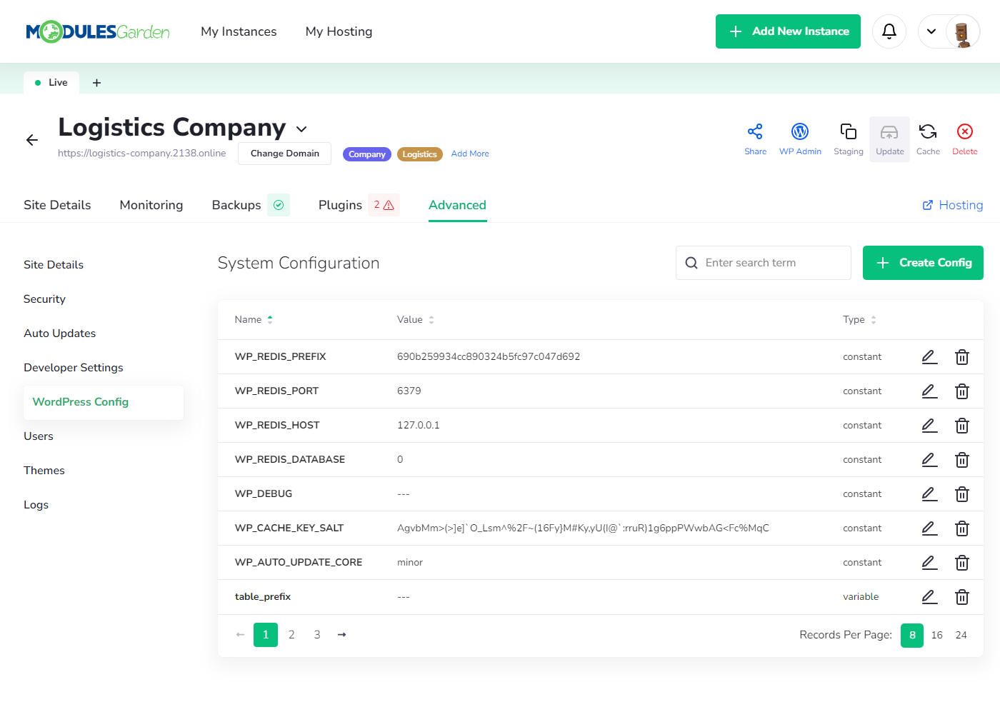

Remotely introduce changes to your **WordPress configuration** file. **Add new** config by clicking the **Create Config** button on the right. The configs are placed in a table which includes **Name**, **Value**, and **Type** fields (all sortable). Every config can be **edited** or **removed** using the action buttons on the right. You can find a specific config using the **search bar** above the table.

## Users

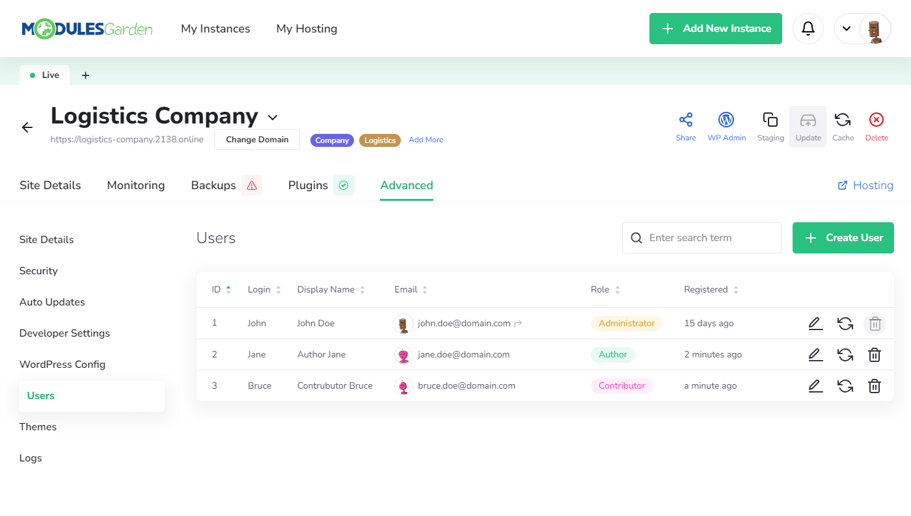

Manage admins and users that access your instance. Every user added will be placed in the users table. The following data will be displayed:

- ID
- Login
- Display Name
- Email Address
- Role
- Registration Time

Use the icons on the right to **edit** the data, **reset password**, or **delete** the user.

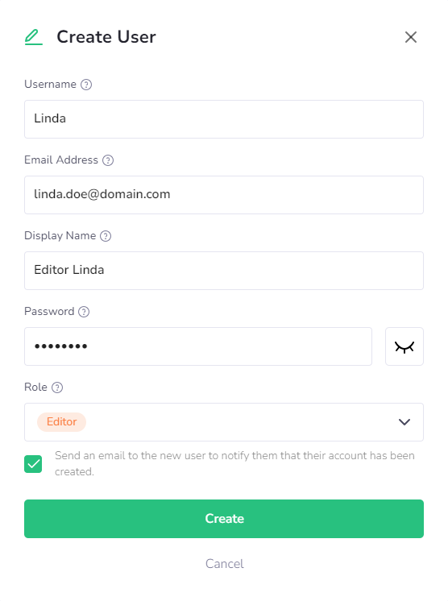

You can find a specific user with the **search** feature above the table, or **create a new user** by clicking the button next to it.

## Installed Themes

This is where you can manage your themes. Mirroring the Plugins section, you can switch between tile view and list view for both installed themes and when browsing for a new theme. The list view and tile view provide the same information and options in different layouts.

**Installed Themes**

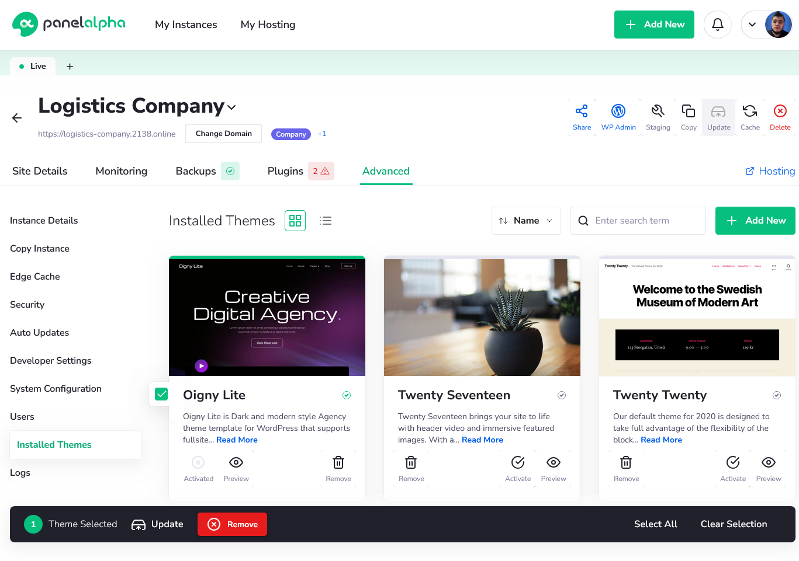

Every installed theme can be found here.

- Each tile includes the **name** and a short **description** of the theme. Clicking **Read More** will display the full description.
- The symbol next to the name indicates if the theme is **up to date**.
- You can **deactivate**, **activate**, **preview**, or **remove** installed themes by clicking their respective action button at the bottom of a tile.
- Perform actions in bulk by **selecting multiple** or **all** themes at once. Checkboxes appear to the left of each tile when your cursor is within its borders. The option to **select all** appears on the bar at the bottom of your screen after you select at least one theme.
- You can **sort** the list by Name or Status using the **dropdown menu** next to the search function above the tiles.

List view:

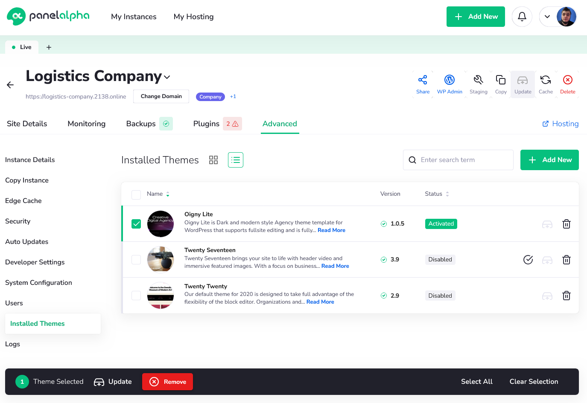

- The **name** and a short **description** of the plugin can be seen on the left. Clicking **Read More** will display the full description.
- One step to the right you will find the installed **version** of the theme. The symbol next to the version number indicates if the theme is **up to date**.
- The **status** is indicated by "Activated" and "Disabled" markers in the "Status" column, as well as by the green or gray highlight on the **edge of the list**.
- You can **deactivate / activate**, **update**, or **delete** installed themes by clicking their respective action button on the far right.
- Perform actions in bulk by **selecting multiple** or **all** themes at once. Checkboxes are on the far left; the checkbox in the header selects all themes.
- You can **sort** the list by clicking Name or Status in the header.

**New Themes**

To install a completely new theme, click the **Add New** button to the right of the search bar.

Use the **search bar** to find your desired theme or pick one of the **popular search tags**. The search results can be **sorted** by rating or recency.

If you cannot find a specific theme, it may have been **blacklisted** by your administrator. Blacklisted themes are automatically filtered from search results and cannot be installed, even from a ZIP file. Additionally, blacklisted themes cannot be selected during instance creation.

Tile view:

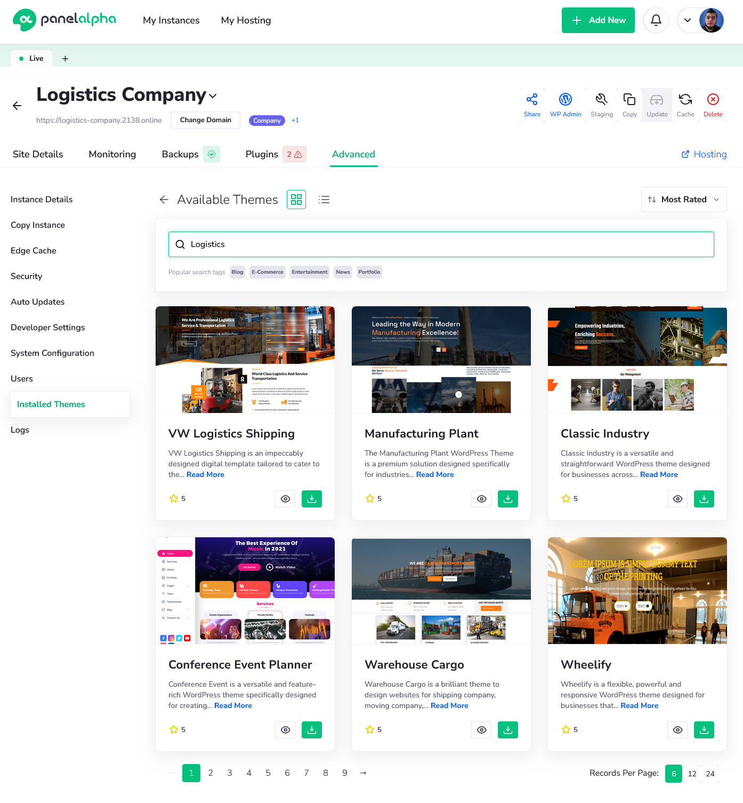

- Each tile includes the **name** of the theme and a short **description**. You can click **Read More** to view the full description.
- The **average rating** of the theme can be seen next to the star symbol in the bottom left corner of the tile.
- The **Preview theme** function is on the right side, next to the download button.
- **Download** the theme by clicking the download button in the bottom right corner of the tile.

List view:

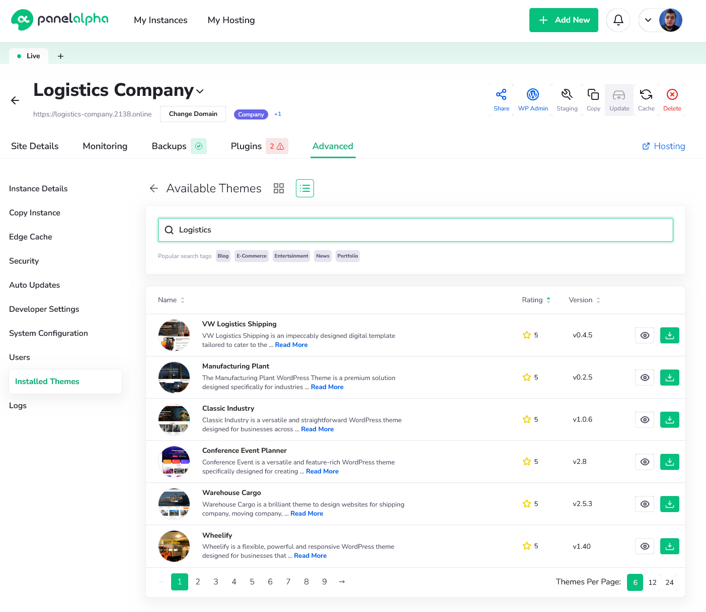

- The first column includes the **name** and **description** of the theme. Click **Read More** to view the full description.
- The **average rating** of the theme can be seen next to the star symbol.
- Next you will find the current **version** of the theme.
- **Preview** a theme by clicking the eye icon.
- **Download** the theme by clicking the green button on the far right.

## Logs

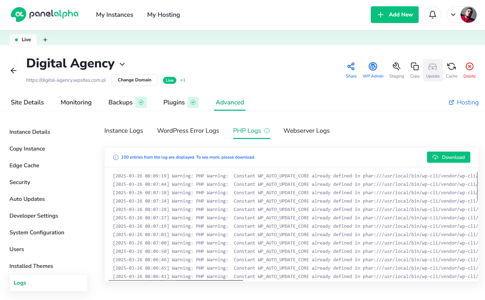

This section provides access to various logs for your instance. You can review and download:

- **Instance Logs:** provide a general overview of actions performed on the instance, including user activities and timestamps
- **WordPress Error Logs:** contain information about errors, warnings, and notices generated by WordPress, which can be helpful for troubleshooting
- **PHP Logs:** record PHP-related errors and warnings, providing insights into potential problems with your PHP code or configuration
- **Webserver Logs:**
  - `access.log`: records all incoming HTTP requests to your web server
  - `error.log`: contains errors and warnings reported by the web server

## Copy Instance

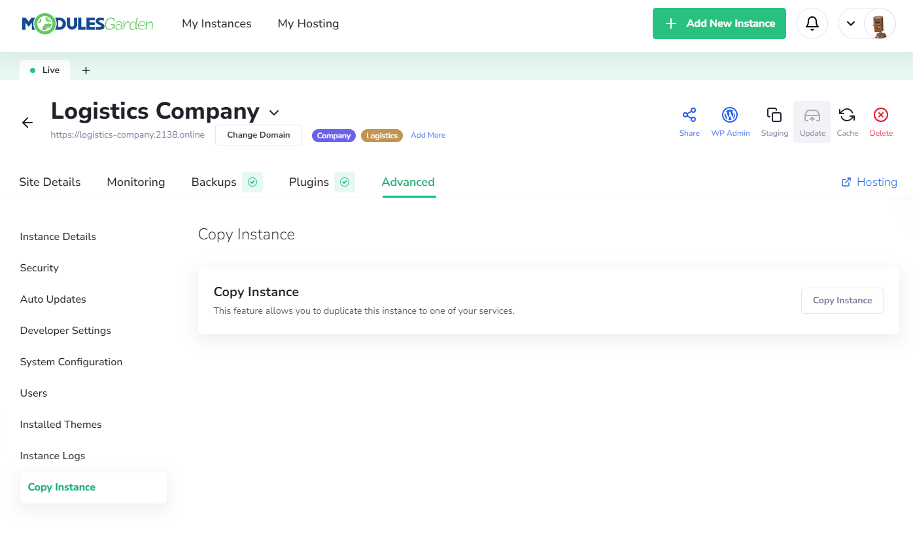

Use this feature to **duplicate the instance to any of your services**. Click **Copy Instance**, then select the service where the duplicated WordPress instance should be installed, provided you have more than one service with a free instance limit.

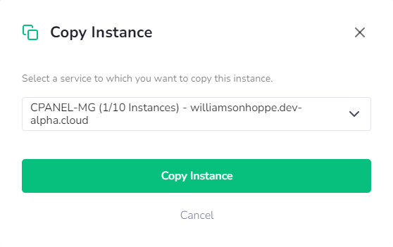

Please note that this option must be enabled by the administrator for the plan associated with the service. If not enabled, this section will remain hidden.
