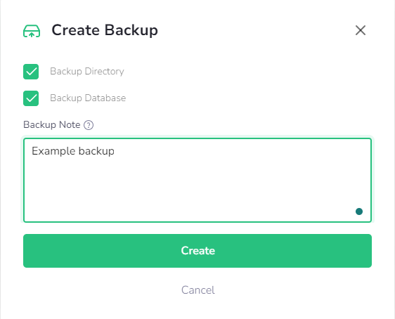
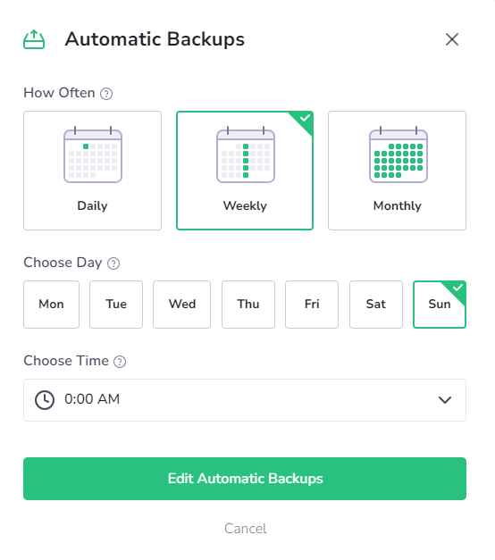
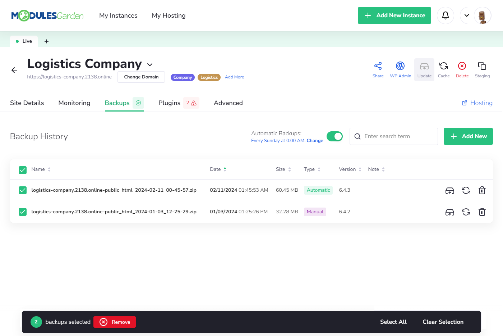

# Backups

Website backups are crucial for protecting against data loss due to accidental deletion, hacking, or server failure. They provide a safety net in case of unforeseen events, allowing you to restore your site to a previous state and minimize downtime. Regular backups also offer peace of mind, ensuring that valuable content and customer data are safeguarded against potential disasters. That is why PanelAlpha features the "Backups" section of the instance details, where you can manage your backups with ease.

Create a new backup by clicking the **"Add New"** button on the right.

It is also possible to enable and schedule **Automatic Backups** for your website. Please note that the availability of this feature depends on the type of product your instance is created on. Therefore, for one instance you might be allowed to schedule automatic backups freely, while for others (where the plan associated with the used product restricts the option), backup creation will be imposed upfront by your administrator, and you will not be able to change the schedule.

1. View your **Backup History**, which includes:
   - **Name** of the backup
   - **Date** and **Time** of the backup
   - Its **Size**
   - **Type** (Automatic / Manual)
   - **WordPress Version**
   - Custom **Notes**

2. Utilize the **search feature** above the backup history.
3. **Download**, **restore**, or **delete** your backups using the action buttons on the far right of the list.
4. You can **select** multiple backups to delete at once.

If backups fail or restores stall, see the [Backup troubleshooting guide](../../troubleshooting-center/backups/backup-issues.md) for detailed steps.
