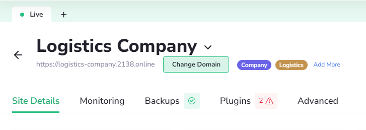
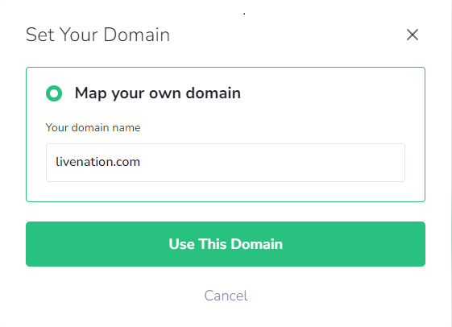
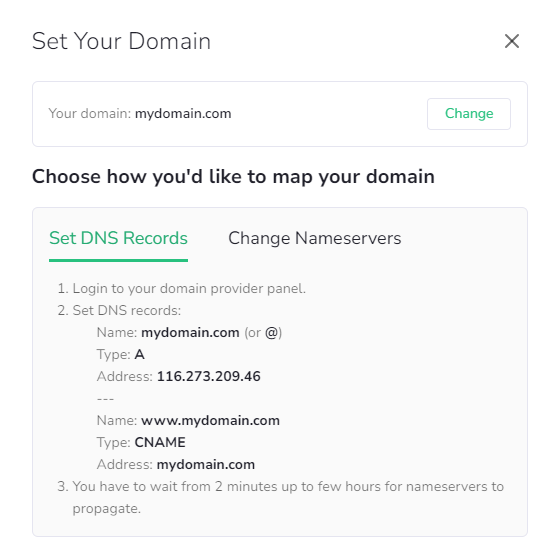

# Changing Domain

1. If you wish to change the domain of your instance, navigate to instance details and find the **Change Domain** button under your instance's name.

2. **Type in your new domain** and save by clicking the **Use This Domain** button.

**Note:** Subdomain labels are validated against the plan **Subdomain Blacklist** and profanity rules (the same checks used when creating an instance on a temporary subdomain). Forbidden labels are rejected during Change Domain as well.

3. To finish the process, choose one of the two domain mapping methods shown in the **Set Your Domain** modal:

## Set DNS Records

Expand the **Set DNS Records** section to see the exact DNS records you need to add at your current DNS provider. This method keeps your existing DNS provider and nameservers in place — only specific records (typically an `A` record and a `CNAME` for `www`) are added or updated.

If the plan uses **Fastly CDN**, the records are Fastly edge addresses, not the hosting server IP. Use those values so traffic stays on the CDN. Details: [Fastly](../integrations/fastly.md#dns-instructions-for-customers).

## Set Nameservers

Expand the **Set Nameservers** section for step-by-step instructions:

1. Log in to your domain registrar's panel.
2. **Remove** the nameservers currently assigned to your domain — PanelAlpha detects and lists them for you.
3. **Set** the new nameservers shown in the panel (e.g. `ns1.yourdns.example.com` and `ns2.yourdns.example.com`).
4. Wait from 2 minutes up to a few hours for the nameserver change to propagate.

**Warning:** DNS records are not migrated automatically. Switching nameservers transfers DNS authority to the new provider but does **not** copy your existing DNS records. You will need to recreate any records (MX, TXT, additional A/CNAME entries, etc.) manually in PanelAlpha's DNS zone after the change.

For guidance on what to do after switching nameservers, see [Nameserver Changes and DNS Migration](nameserver-changes-and-dns-migration.md).

**Tip:** Starting from PanelAlpha 1.4.3, adding a root domain automatically pairs it with its `www` alias (and vice versa). Keep both DNS records reachable while the SSL order is processed. If you later switch the primary domain, remove or update stale DNS zones and records on your DNS provider to avoid pointing traffic to the old site.
