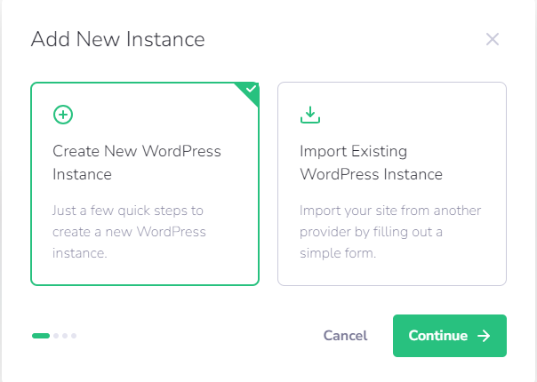
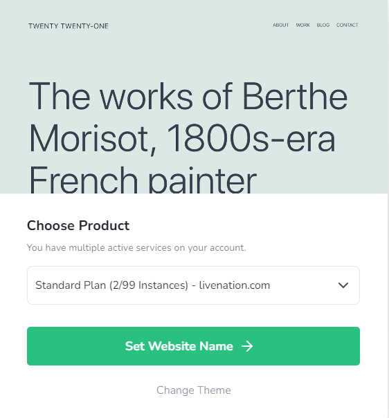
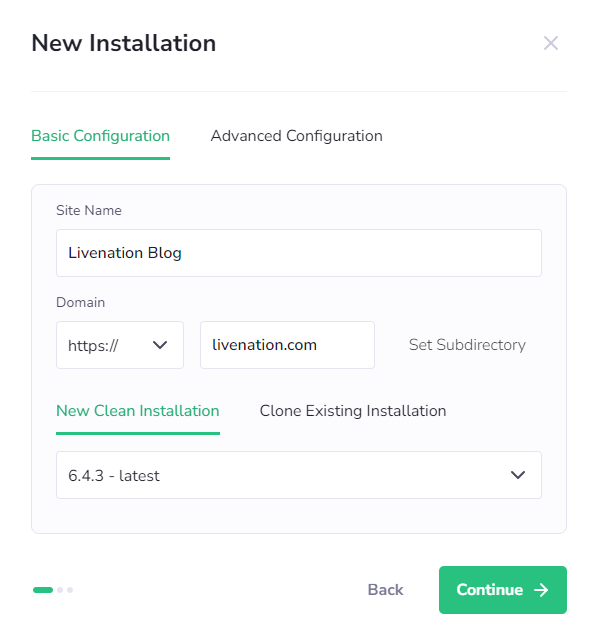
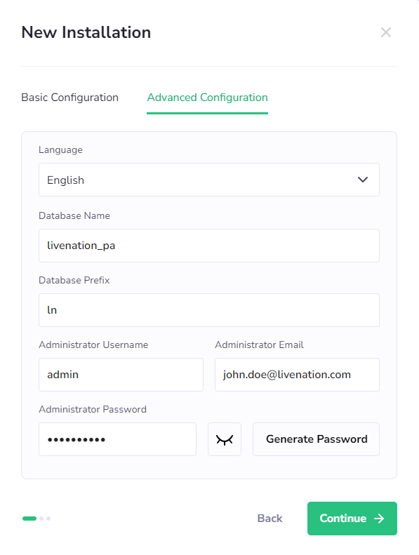
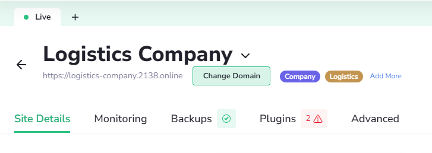

# Creating New Instance

The process of adding a new instance can differ depending on the selected product and plan configuration.

In some setups, the flow is very short (for example, only location / domain input). In others, additional configuration steps are available.

Use the flow below as a reference. If one step does not appear in your panel, continue to the next one.

### Exemplary Workflow

1. Open **Add New** in the top-right corner of the Client Area.

2. Choose installation type:
   - **Create New WordPress Instance**
   - **Import Existing WordPress Instance**

   Then click **Continue**.

3. When the installation flow opens, PanelAlpha fetches the available options for your service in the background. During this time a loading indicator is briefly visible. This step determines the target hosting server (applying the plan's [Server Assignment Rule](../system-configuration/plans.md#hosting-server), such as **Least Accounts**) and loads any user-configurable options specific to your plan.

4. Depending on plan / onboarding settings, one of the first steps can be:
   - choosing a datacenter / location (for example WP Cloud)
   - choosing a theme / template
   - or moving directly to domain / site configuration

5. If you have multiple hosting services, select the target hosting service for the new instance.

6. Configure installation details shown for your plan. Depending on onboarding mode, available fields can include:
   - Domain and related options
   - Clean installation vs clone / template
   - Language
   - Database name and prefix
   - WordPress admin credentials (username, password, email)

#### Choosing a Domain or Temporary Subdomain

If the plan has parent domains configured under **Domains → Subdomains** (see [Plans](../system-configuration/plans.md#domains)), the domain step can offer two options:

1. **Own domain** — enter or select a custom domain for the new site.
2. **Subdomain** — type a subdomain label (for example `mydomain`) and select a parent temporary domain from the plan (for example `wp1.example.com`). PanelAlpha builds the full hostname as `mydomain.wp1.example.com`.

Subdomain labels are validated against the plan subdomain blacklist and profanity rules.

   You cannot create a second instance at the same address on the same hosting account. If another instance already uses the same domain and directory, you see "Another instance already uses this address on this hosting account." Use a different subdirectory, for example `example.com/blog`.

7. Confirm by clicking **Continue** / **Create Site** (the label depends on the onboarding flow). Instance creation runs asynchronously and may take a few minutes.
8. After installation, you can still adjust domain settings using **Change Domain** in instance details.

