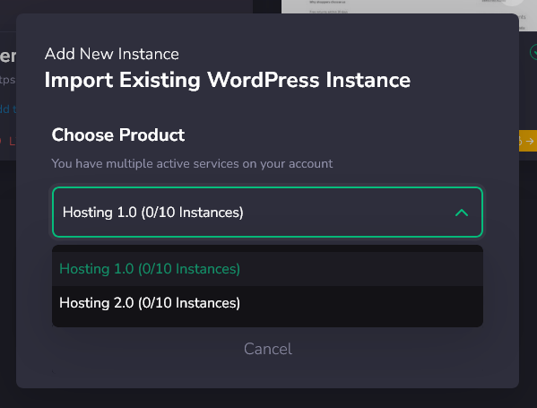
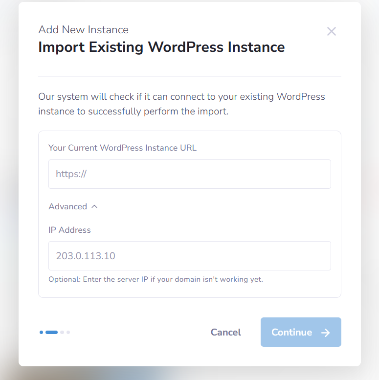
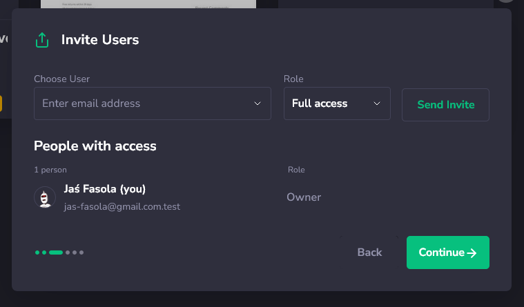
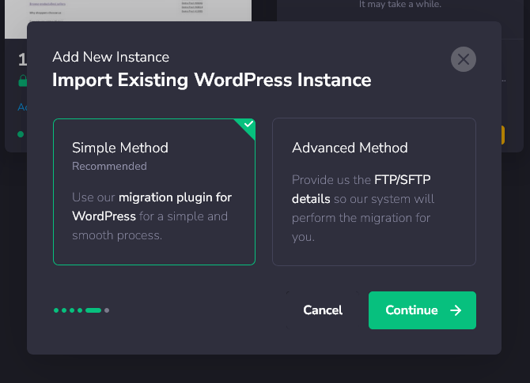
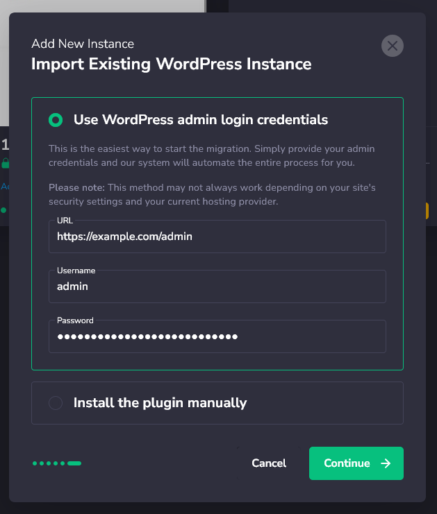
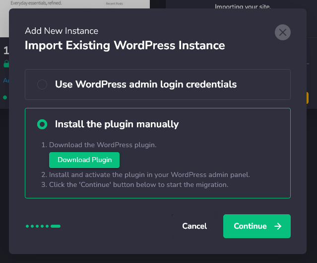
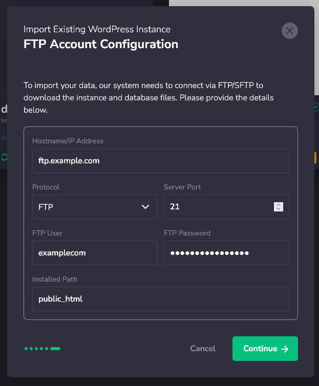
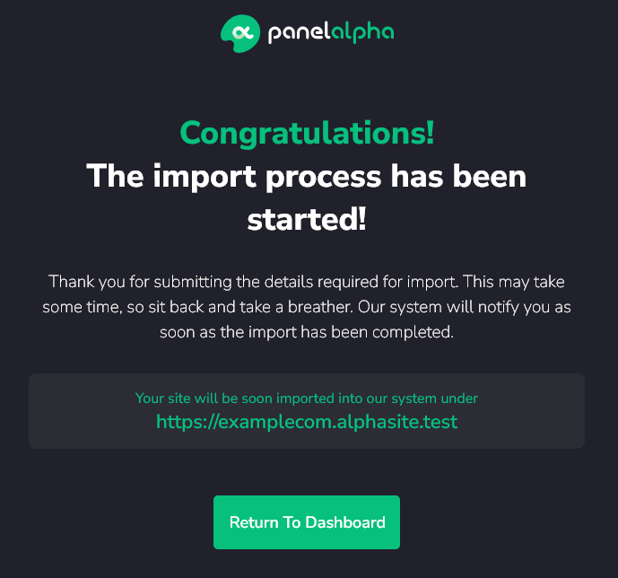
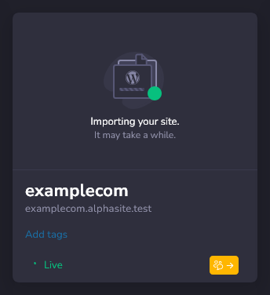
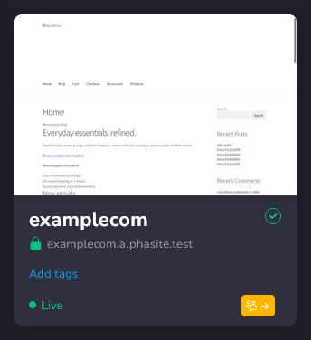

# Importing Existing Instance

PanelAlpha allows you to easily import existing WordPress instances into the system. The import process can be initiated from the Client Area and offers two methods: a simple plugin-based approach (recommended) and an advanced FTP/SFTP method for more complex scenarios.

## Starting the Import Process

1. Navigate to the **My Instances** page in the Client Area.
2. Click **Add New**.

3. Select **Import Existing WordPress Instance**.

## Choosing a Service

Select the service where you want to import your WordPress instance. This service determines the hosting server and plan that will be used for your imported instance.

**Note:** This step only appears if you have multiple services. If you have only one service, the import will proceed with that service automatically.

## Enter WordPress URL

4. **Enter your current WordPress instance URL** (e.g. `https://example.com`).
5. Optionally, expand the **Advanced** section and enter the **IP Address** of the server hosting your WordPress site. This is useful when the domain does not yet resolve through DNS — PanelAlpha will use the provided IP to reach the site directly, similar to adding an entry in `/etc/hosts`.

   The IP mapping applies to:
   - **URL verification** — the site is tested using the IP even if DNS is not yet configured
   - **Import via WP Admin login** — login and plugin installation requests are sent to the provided IP
   - **Import via manual plugin** — communication with the migration plugin uses the provided IP

6. Click **Continue**.

If your service has user-configurable options (e.g. geo affinity), you will be prompted to configure them at this step.

## Sharing Access (Optional)

If you want to grant access to other users, you can add their email addresses. These users will be able to access and manage the imported instance according to the permissions granted.

**Note:** If you are a reseller, you can grant access to your end customers or team members. Permissions can be customized to control what actions they can perform on the instance.

## Choosing Import Method

PanelAlpha offers two import methods to accommodate different scenarios and technical requirements:

### Method 1: Simple Method (Recommended)

The simple method uses a PanelAlpha migration plugin to automate the entire import process. This is the recommended approach for most users.

**Advantages:**

- Fully automated migration process
- No need for FTP credentials
- Handles file and database migration automatically
- Works even if your hosting provider has FTP restrictions
- Real-time progress monitoring

**Two options are available:**

#### Option A: WordPress Admin Login Details

Provide your WordPress admin credentials, and PanelAlpha will automatically:

1. Log into your WordPress admin panel
2. Install the migration plugin
3. Initiate and complete the migration
4. Clean up after itself

**Required fields:**

- **Login URL:** your WordPress login page URL (e.g. `https://example.com/wp-login.php`)
- **Username:** WordPress admin username
- **Password:** WordPress admin password

**Note:** Your credentials are used only during the migration process and are not stored permanently.

#### Option B: Manual Plugin Installation

If you prefer not to provide admin credentials, you can install the migration plugin manually:

1. **Download the plugin:** click the download button to get the PanelAlpha WordPress Migrator plugin
2. **Install the plugin:** upload and activate it in your WordPress admin area (`Plugins → Add New → Upload Plugin`)
3. **Run the migration:** the plugin will automatically connect to PanelAlpha and initiate the migration
4. **Monitor progress:** you will be able to track the migration status in real time

### Method 2: Advanced Method (FTP/SFTP)

The advanced method uses FTP/SFTP to download your WordPress files and database directly from your hosting server.

**When to use:**

- You don't have WordPress admin access
- The plugin method fails or is incompatible
- You need more control over the migration process
- Your WordPress installation has been compromised and you want to migrate files directly

**Required information:**

- **Protocol:** FTP, SFTP, or FTPS
- **FTP Host:** your FTP server address (e.g. `ftp.example.com`)
- **FTP Port:** port number (default: 21 for FTP, 22 for SFTP)
- **FTP Username:** your FTP account username
- **FTP Password:** your FTP account password
- **Path:** path to your WordPress installation (e.g. `/public_html`, `/`, or `/blog`)

**Notes:**

- If you don't specify a path, PanelAlpha will automatically search common locations (`/`, `/public_html`, `/public`, `/htdocs`, `/httpdocs`)
- PanelAlpha will verify that WordPress is found at the specified location before proceeding

## Domain Configuration

After providing connection details, PanelAlpha will create a domain for your imported instance:

- If your original domain name is available, it will be used
- If your domain is already in use or is an IP address, a temporary subdomain will be created automatically
- You can change the domain later using the [Changing Domain](changing-domain.md) feature

## Import Progress

The import process will run in the background. You can monitor the progress directly from your **My Instances** page, where the instance will appear with a progress indicator showing the migration status.

## Import Completion

Once the import completes successfully, your instance will appear in the **My Instances** page with full functionality. You can now manage your WordPress instance directly through PanelAlpha, including access to all standard features like backups, updates, security tools, and performance monitoring.

**Post-import verification:**

1. Visit your instance URL to verify the site loads correctly
2. Log into WordPress admin to confirm access
3. Check that plugins and themes are functioning properly
4. Verify that media files and uploads are accessible
5. Test any custom functionality or integrations

## Monitoring Your Import

All client-initiated imports can be monitored from the Admin Area under the **[Migrations](../admin-area/migrations.md)** section, where you'll find:

- **In Progress:** currently running migrations with real-time status
- **Failed:** migrations that encountered errors, with detailed error messages and retry options
- **Successful:** completed migrations with full details and logs

Administrators can:

- Monitor migration progress
- View detailed logs
- Retry failed migrations
- Mark migrations as successful (if issues were resolved manually)
- Stop ongoing migrations if needed
