# Instance Details

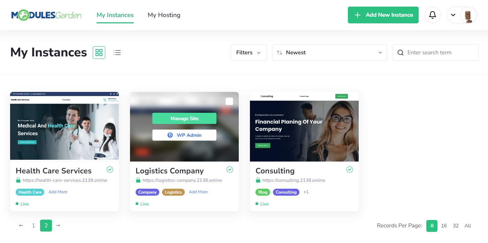

Once your instance has been added and installed, you can open its details page. Click the name in the list view or the "manage site" button on the tiles view.

Each instance's details page provides a wealth of up-to-date information and functions. Here you will find everything you need to effectively manage your site. Let us focus on each feature one by one.

## Live / Staging Instances

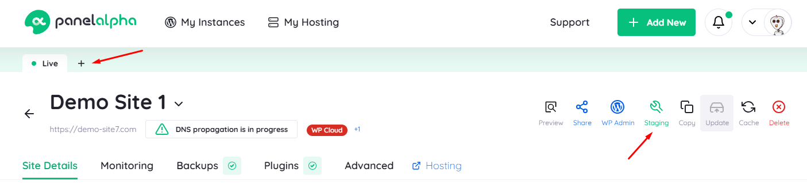

At the top left of the page, you can switch between **Live** and **Staging** environments. If staging does not exist yet, a **"+"** button is displayed. After staging is created, it is shown as a dedicated **Staging** tab / button.

PanelAlpha supports **one staging instance per live instance**.

### Create Staging

To create staging, click the **"+"** (or the staging action in the top action menu).

The modal includes the **Domain** field. Its behavior depends on the plan configuration for staging domains:

- **Site Domain Subdomain:** PanelAlpha prepares the staging domain as a subdomain of the live site domain (for example `staging.example.com`)
- **Fixed Subdomain:** PanelAlpha prepares staging under an admin-defined fixed domain
- **Any domain allowed:** the domain can be entered manually

In setups where staging is created on the same hosting account, PanelAlpha performs a pre-check and displays:

- WordPress disk usage
- `wp-content/uploads` usage
- Available disk space

In the same modal, you can use **Skip uploads directory** to speed up cloning and reduce disk usage. If available disk space is too low, this option is enforced automatically.

If your hosting / server setup marks staging as billable, the modal shows an additional warning about extra charges.

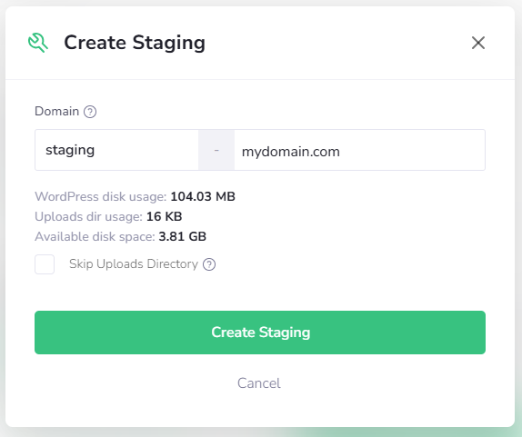

After confirmation, staging is created asynchronously and appears in the staging tab once finished.

PanelAlpha also shows a **Live** or **Staging** label in WordPress admin and in the Control Panel bar, so the customer can see which environment they are editing. The label is updated when staging is created and after a push with the database.

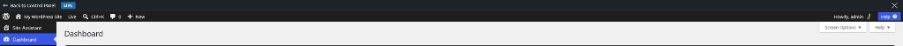

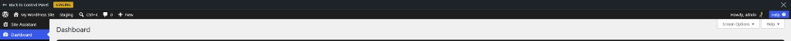

### Retry or Cancel Failed Staging

If staging creation fails, you can:

- **Try:** rerun staging creation for that failed staging entry
- **Cancel:** remove the failed staging entry (including files / database cleanup request)

### Push to Live

When you are on a **staging** instance, you can use **Push to Live**.

Before showing the final form, PanelAlpha compares database changes between staging and live. The push modal allows you to choose:

- Overwrite files
- Push full database
- Push structure changes in tables
- Push tables with changed data

The push runs as an async operation, and status is tracked for both environments.

### Push to Staging

When you are on a **live** instance with an active staging environment, you can use **Push to Staging**.

This action is useful when quick changes were made directly on live and you want to sync them back to staging.

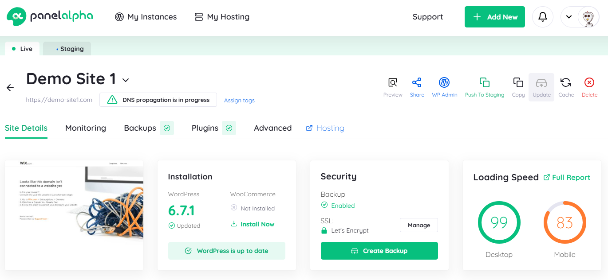

The same push scope options are available:

- Overwrite files
- Push full database
- Push structure changes in tables
- Push single tables with changed data

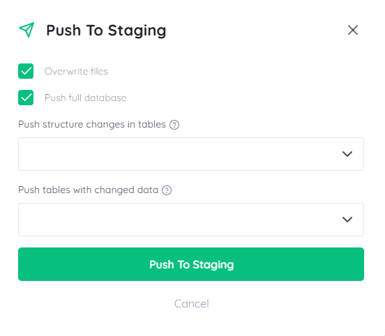

## Domain

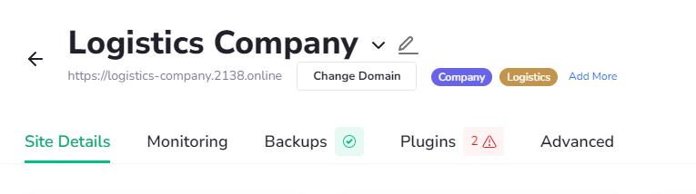

Directly below the Live / Staging buttons you will find the name of your instance, which you can change by clicking the **"edit"** button next to it. Tap the **downward arrow** by the name to open a list of your instances and easily move to another without going back to the list of your instances.

A step lower, the full **domain** of your website is located. It is interactive, so you can click it to open your page in a new tab.

Next, to the right, you will find the [**"Change Domain"**](changing-domain.md) function and any tags assigned to the instance. You can always "Add More" tags.

### Actions

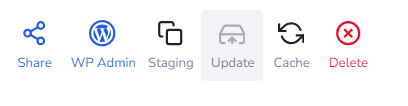

The same actions that can be performed directly from the list of instances are all placed in the top right corner. These include:

- [Share Instance](sharing-instances.md)
- WP Admin Access - uses Single Sign-On (SSO) for secure direct login to WordPress admin, enabled by the Control Panel Connection must-use plugin
- Staging - opens staging actions (Create Staging, Push to Live, Push to Staging depending on current environment)
- Update
- Clear Cache — clears object cache (for example Redis) and common page caches such as WP Super Cache when present on the site
- Delete Instance. Files and the database that another instance on the same hosting account also uses are not deleted.

### Menu

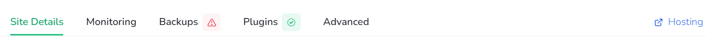

The instance details are grouped into sections. Each section can be accessed by clicking its corresponding button. The sections are:

- [Site Details](instance-details.md#site-details)
- [Monitoring](monitoring.md)
- [Backups](backups.md)
- [Plugins](plugins.md)
- [Advanced](advanced-settings.md)

To the far right, you will find a button that will take you to your **hosting area**.

### Site Details

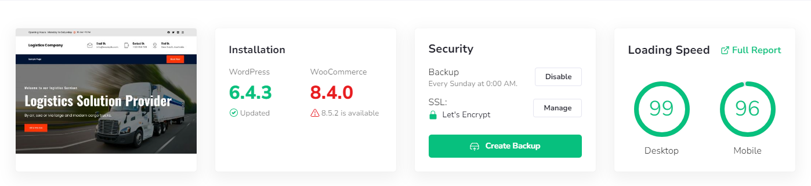

The landing section, opened by default, is **Site Details**. This is where you can:

- See the **site preview** screenshot. On hovering over the preview, you can:
  - Use the **"Visit Website"** button
  - Manually **"Refresh Thumbnail"**
- Check the installation details:
  - **WordPress** version
  - **WooCommerce** version

  Both are checked automatically, so you can easily see if they are up to date. If they are not, you can **update** them with just **one click** here.
- See **Security** details:
  - Check the **backup schedule**, and **create backups** if needed
  - Set the **SSL Certificate** for your domain
- **Loading Speed** - see **how fast your website loads** on desktop and mobile platforms

### Instance Analytics

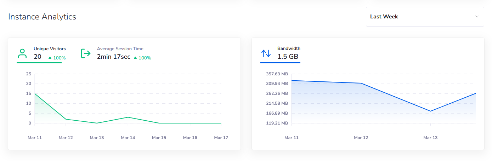

At the bottom of the page, you will find **graphs** that provide detailed insights into your website's performance. The analytics include:

- **Traffic data:** visualizes the number of visits to your website over time
- **Unique Visitors:** shows the count of individual users who have accessed your site, filtering out repeated visits from the same user
- **Average Session Time:** displays how long visitors typically spend on your website, helping you understand user engagement levels
- **Bandwidth usage:** monitors how much data is being transferred to and from your website, which is crucial for resource planning

These metrics are presented as interactive graphs that allow you to identify trends and patterns in user behavior. You can easily adjust the time frame by selecting from three scope options: "Last Week," "Last Month," and "Last Year."
