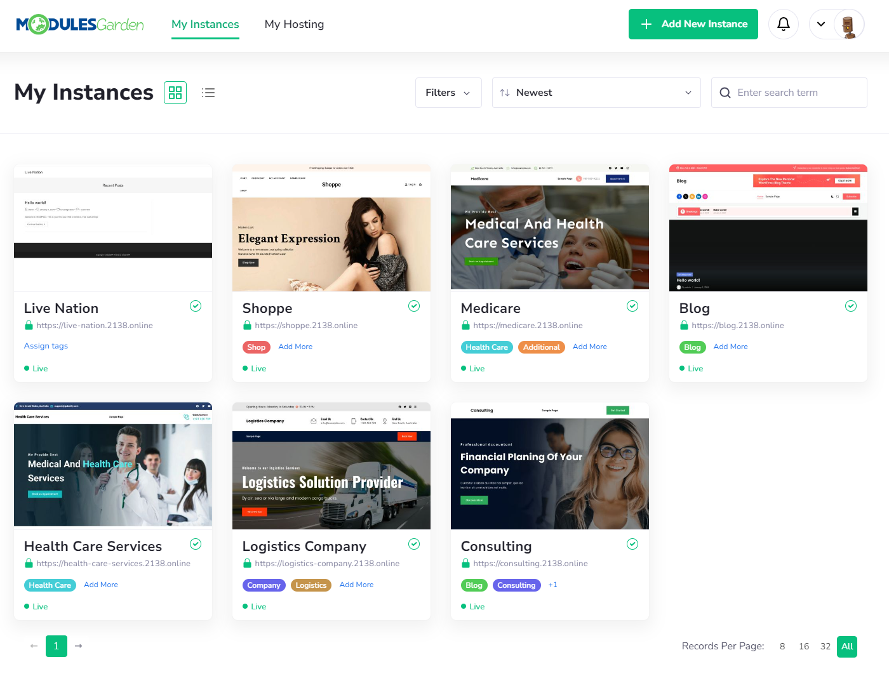

# List Of Instances

After logging into the client area of PanelAlpha, clients are presented with a dashboard containing all their instances if they have already installed at least one.

The **My Instances** section encompasses all existing instances, including the installed ones, as well as those currently being installed or experiencing installation failures.

### My Instances

1. **View modes** - change the view mode to display instances in list format or showcase them in tiles with a clear preview of the website.
2. **Select instances** - mark one or more instances to perform the following actions:
   - Clear cache (object cache and common page caches such as WP Super Cache, when present)
   - Share instances
   - Remove selected instances
3. **Filtering options** - filter instances **by tag**. You can also click a tag directly to enable automatic filtering.
4. **Sort** instances based on your preferences:
   - By title
   - By visitors (unique visitors in the last 30 days)
   - By bandwidth
   - By storage
   - From the newest

### Tags

Users have the flexibility to create their own customized set of tags, enhancing the functionality of their client area and facilitating the efficient filtering of numerous instances dedicated to completely different fields.

To begin creating tags, click **Assign Tags**. Press **Add New** to create a new tag. Enter the tag name, choose a color for association, and click the **Create & Assign** button to automatically generate a new tag and assign it to the instance. You can later remove the tag from this instance if needed.

Once your set of tags is prepared, feel free to assign them to your instances. This can be done even after the instance is installed and visible on the dashboard.
