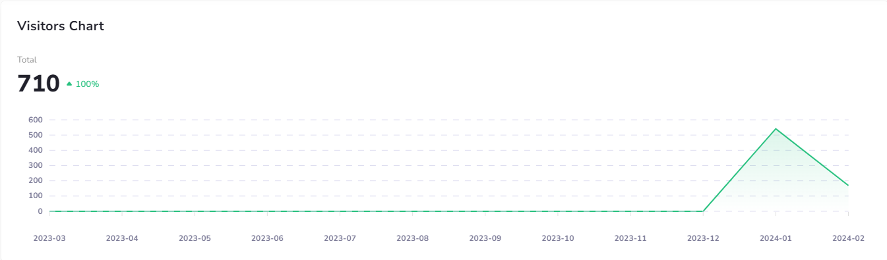
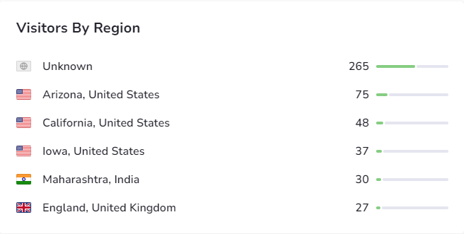
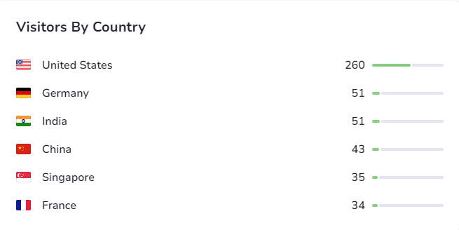
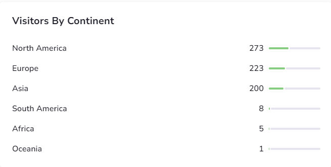
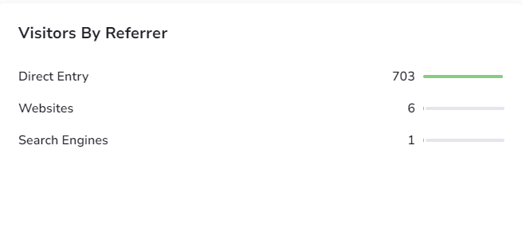
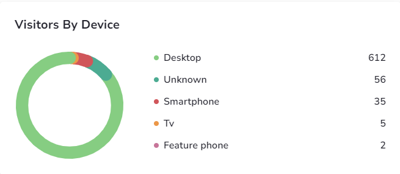
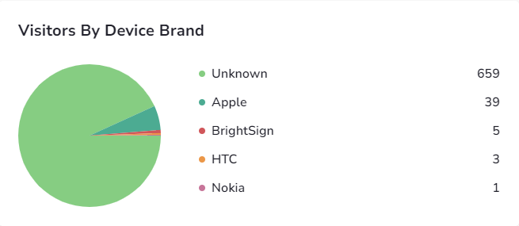
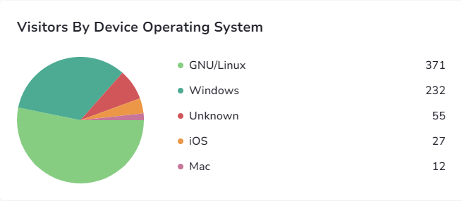
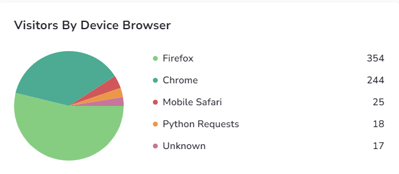
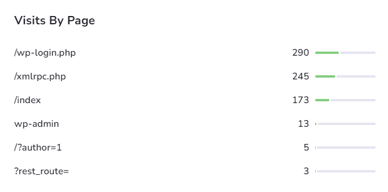

# Monitoring

In this section of the instance details you will find detailed information on the people that visit your site. Website visitor data provides valuable insights into user behavior and preferences, enabling your business to make informed decisions. By leveraging the charts generated for you in this section, you can optimize your marketing strategies, improve conversion rates, and enhance the overall user experience.

See example charts below.

### Visitors Chart

### Visitors By Region

### Visitors By Country

### Visitors By Continent

### Visitors By Referrer

### Visitors By Device

### Visitors By Device Brand

### Visitors By Device Operating System

### Visitors By Device Browser

### Visits By Page

