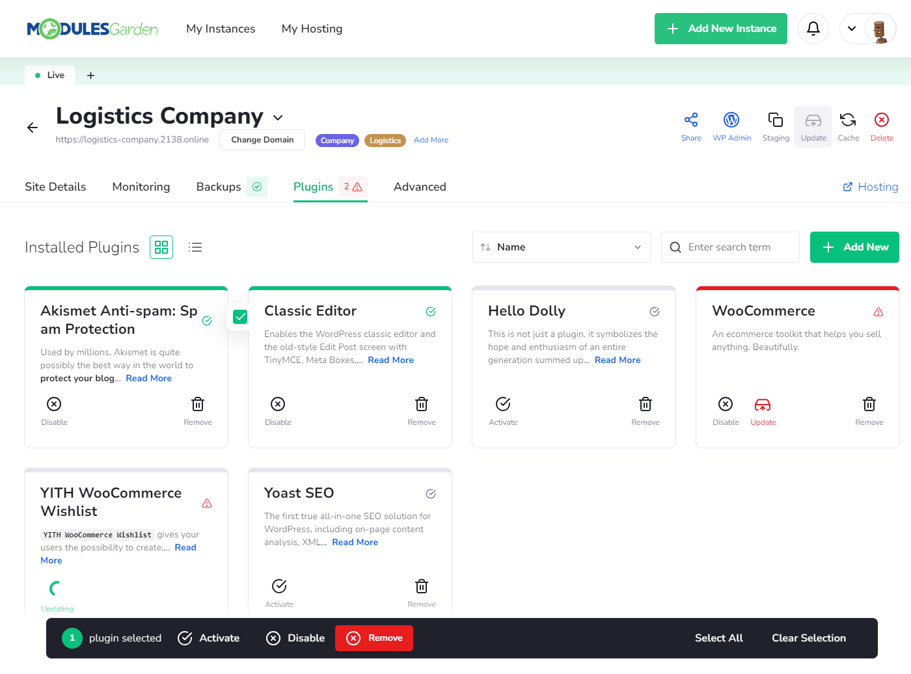
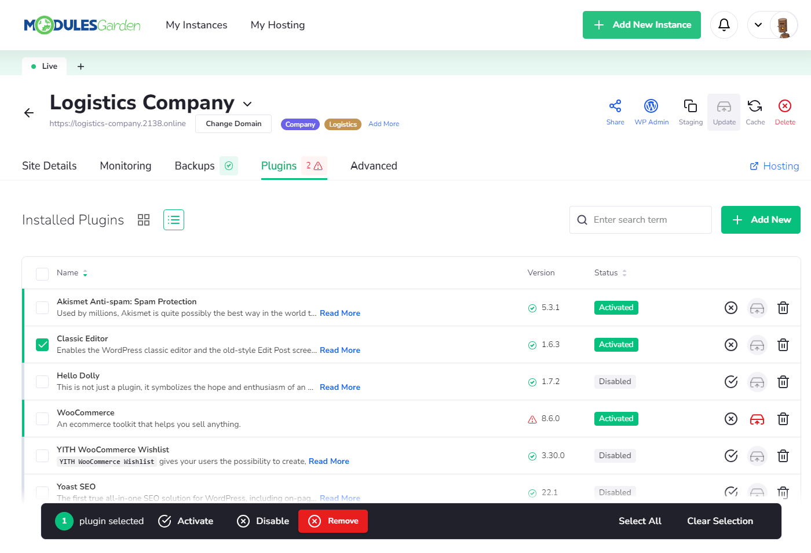
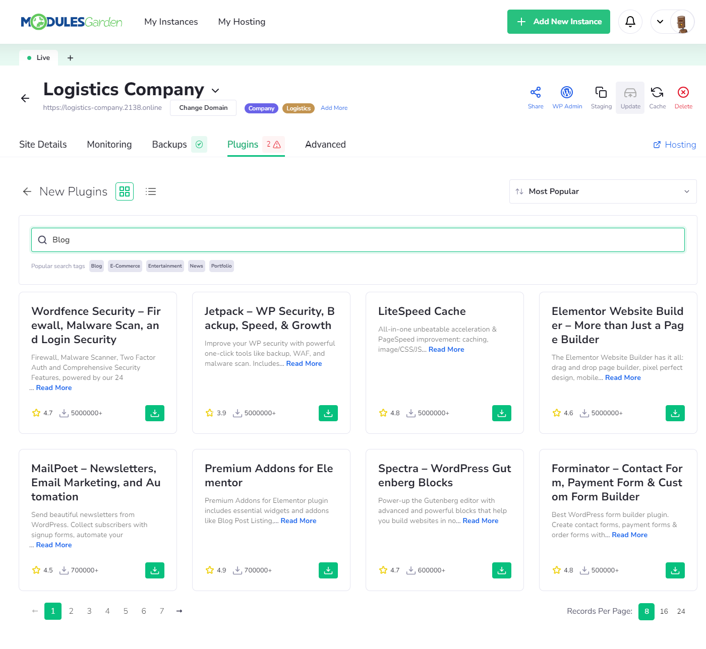
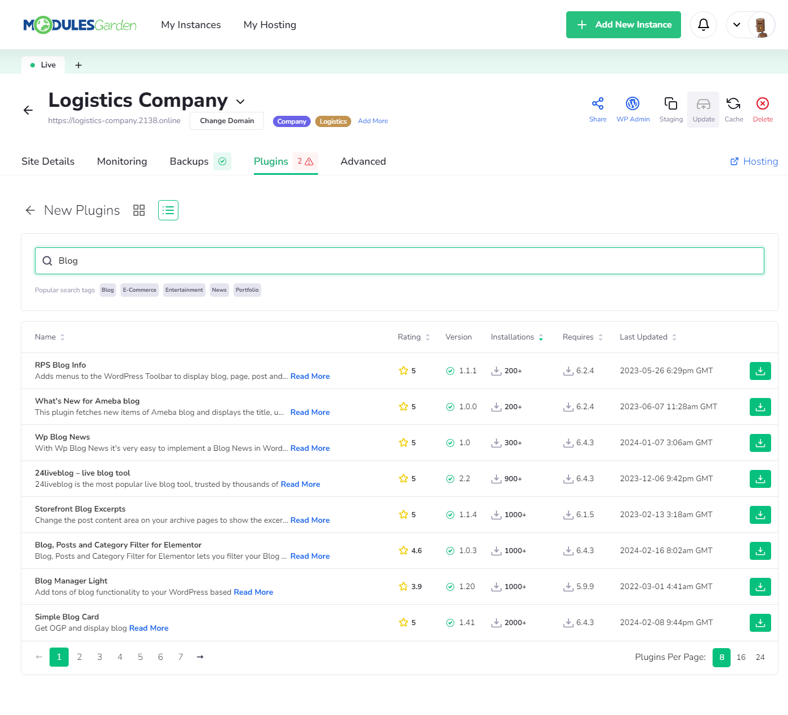

# Plugins

Customize your experience further by utilizing **plugins**. Add new features and optimize your performance in the easiest way possible. Depending on your plan's configuration, a new instance might come with plugins handpicked by your administrator.

In the "Plugins" section of the instance details, you will find a list of plugins already installed. If there are no plugins installed, you will see the **New Plugins** section instead, which you can browse to find your first plugins. Both sections can be displayed as a **list view** or a **tile view**. Make sure to use the **search function** if needed.

### Installed Plugins

The plugins that came pre-installed with your instance and the ones you have installed yourself can be found here. The list view and the tile view provide the same information and options in different layouts.

#### Tile View

- Each tile includes the **name** and a short **description** of the plugin. Clicking **Read More** will display the full description.
- The symbol next to the name indicates if the plugin is **up to date**.
- The **status** is indicated by colored or gray highlight atop each tile.
- You can **deactivate**, **activate**, or **remove** installed plugins by clicking their respective action button at the bottom of a tile.
- Perform actions in bulk by **selecting multiple** or **all** plugins at once. Checkboxes appear to the left of each plugin while your cursor is within the tile's borders. The option to **select all** appears on the bar at the bottom of your screen after you select at least one plugin.
- You can **sort** the list by Name or Status using the **dropdown menu** next to the search function above the tiles.

#### List View

- The **name** and a short **description** of the plugin can be seen on the left. Clicking **Read More** will display the full description.
- One step to the right you will find the installed **version** of the plugin. The symbol next to the version number indicates if the plugin is **up to date**.
- The **status** is indicated by "Activated" and "Disabled" markers in the "Status" column, as well as by the green or gray highlight on the **edge of the list**.
- You can **deactivate / activate**, **update**, or **delete** installed plugins by clicking their respective action button on the far right.
- Perform actions in bulk by **selecting multiple** or **all** plugins at once. Checkboxes are on the far left; the checkbox in the header selects all plugins.
- You can **sort** the list by clicking Name or Status in the header.

### New Plugins

To install a completely new plugin, click the **Add New** button to the right of the search bar.

Use the **search bar** to find your desired plugins or pick one of the **popular search tags**. The search results can be **sorted** by popularity, rating, or recency.

If you cannot find a specific plugin, it may have been **blacklisted** by your administrator. Blacklisted plugins are automatically filtered from search results and cannot be installed, even from a ZIP file. If a plugin is already installed but blacklisted, the activation action will be disabled with a tooltip explaining why.

#### Tile View

- Each tile includes the **name** of the plugin and a short **description**. You can click **Read More** to view the full description.
- The **average rating** of the plugin can be seen next to the star symbol in the bottom left corner of the tile.
- The **number of installations** is located right next to the rating.
- **Download** the plugin by clicking the download button in the bottom right corner of the tile.

#### List View

- The first column includes the **name** and **description** of the plugins. Click **Read More** to view the full description.
- The **average rating** of the plugin can be seen next to the star symbol.
- Next you will find the current **version** of the plugin.
- The **number of installations**.
- Required **WordPress version**.
- Time of the **last update**.
- **Download** the plugin by clicking the green button on the far right.

