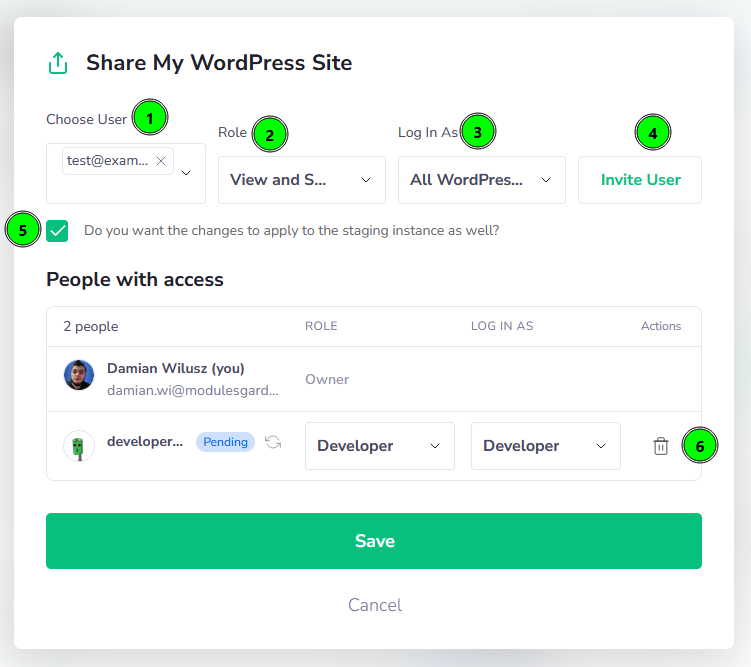
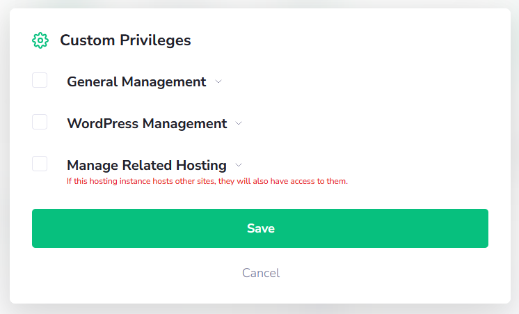

# Sharing Instances

You can give full or limited access to your instance to other users. To start, open your instance details and find the **Share** button in the top right corner.

### Share an Instance

The modal shows all sharing options in one place:

1. **Choose User** — Enter the email address of the person you want to invite. A dropdown will suggest matching users if they already exist in the system.
2. **Role** — Select a role from the dropdown. Hover over each role to see a tooltip explaining its permissions.
3. **Log In As** — Available when the chosen role includes the **WP Admin SSO** privilege (or a custom role with it selected). Choose **All WordPress users** to let the invited person log in as any WordPress user via SSO, or pick a **specific WordPress user** so they are always logged in as that account.
4. **Invite User** — Click to send the invitation email. The invited person will appear in the **People with access** list below with a **Pending** status. You can resend the invitation later by clicking the refresh icon next to the status.
5. **Apply to Staging** — Check this box to automatically give the staging environment the same permissions as the main instance. You can also share staging instances directly by assigning appropriate permissions. When a **Developer** role is assigned, a notification with the created FTP/SFTP account details is sent to the provided email address.
6. **People with access** — Lists everyone who has access to the instance. For each person you can change their role, update the **Log In As** setting, or remove their access entirely by clicking the trash icon.

When you return to **My Instances**, a **new icon** will appear on your shared instance's tile and under **Shares** in the list view. Clicking it will take you back to the share instance window.

### Custom Privileges

If you choose **Custom**, you will be able to specify in detail which privileges you want to assign to each user. Clicking the checkmark by each category will tick all privileges in it.

- General Management
  - Change label
  - Refresh Thumbnail
  - Set Domain
  - Create Staging
  - Push to Live
  - Push to Staging
  - View Logs
  - View Reports
  - Copy Instance
  - Preview Instance
  - **Delete Instance**
  - Manage Shared Access
- WordPress Management
  - WP Admin SSO
  - Update WordPress
  - Manage Auto Update
  - Manage Backups
  - Manage Automatic Backup
  - Update Site Name
  - Clear Cache
  - Set Maintenance Mode
  - Set Debug Mode
  - Manage Themes
  - Manage Plugins
  - Manage WordPress Config
  - Manage WordPress Users
  - Manage Edge Cache
  - Manage Search Engine Indexing
  - Manage Cloudflare
- Manage Related Hosting
  - Manage Email Accounts
  - Manage DNS
  - Manage Domains
  - Manage SSL Certificates
  - Manage FTP Accounts
  - Manage SFTP Accounts
  - Manage MySQL Databases
  - Manage File Manager
  - Manage Cron Jobs
  - phpMyAdmin SSO

Take notice of the **Delete Instance** option while adding privileges. Also note that the **Log In As** option is only available when the **WP Admin SSO** privilege is selected.

The privileges within the **Manage Related Hosting** category will be in effect for every site on the related hosting.
