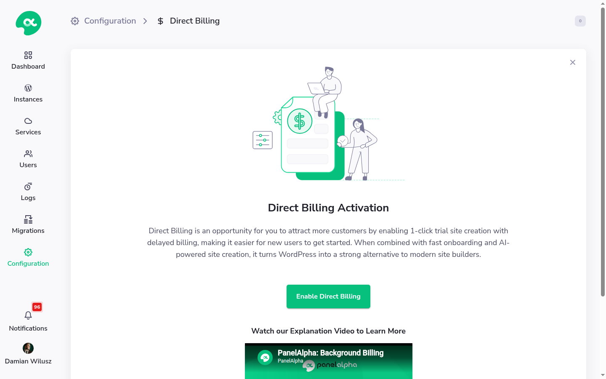
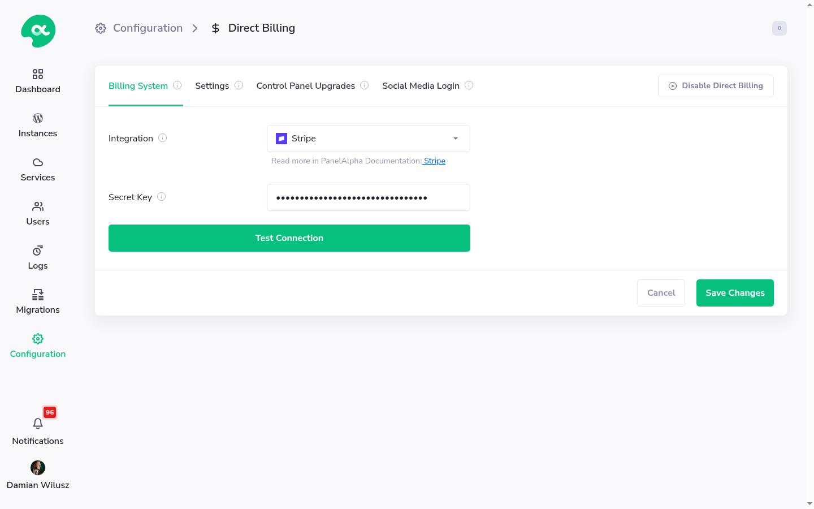
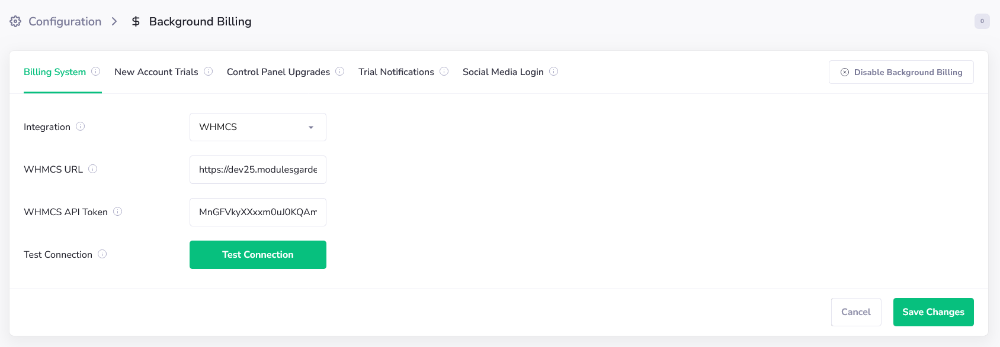
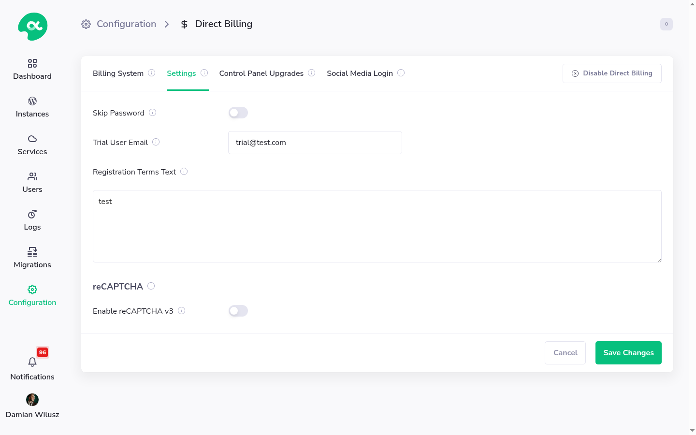
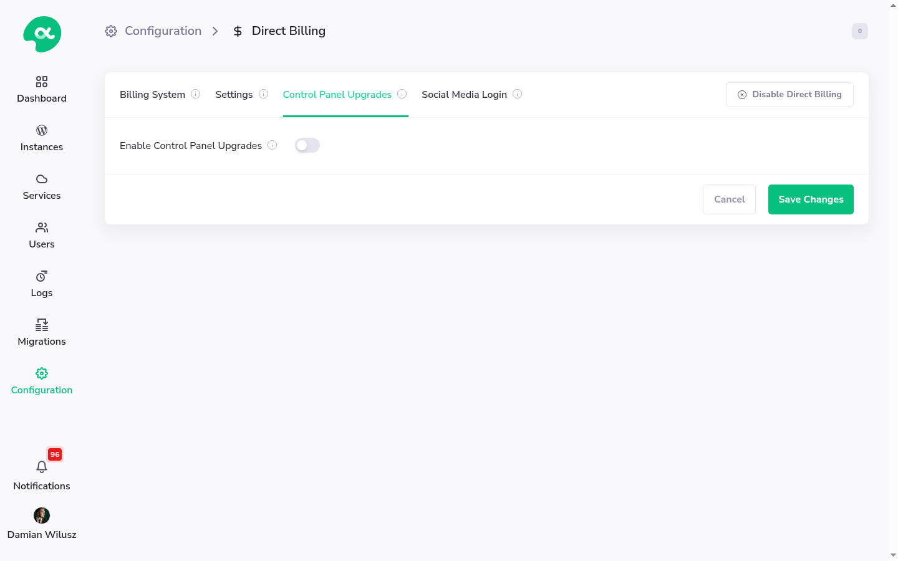
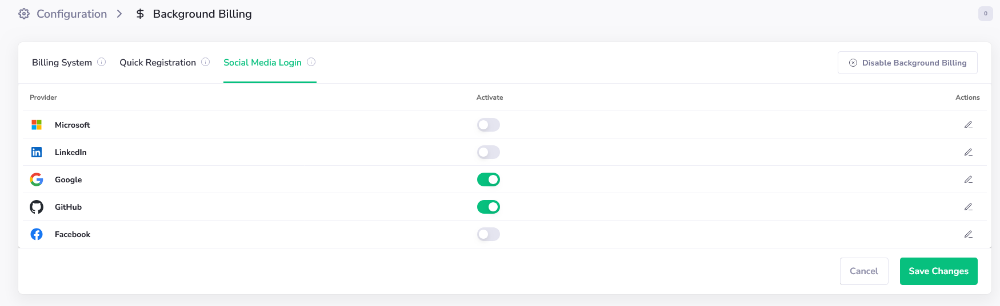
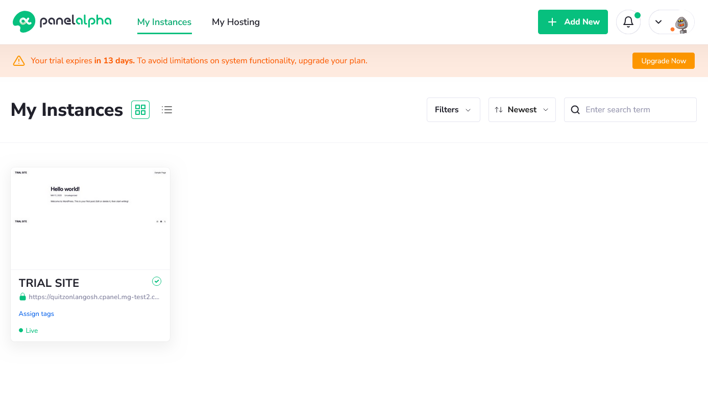
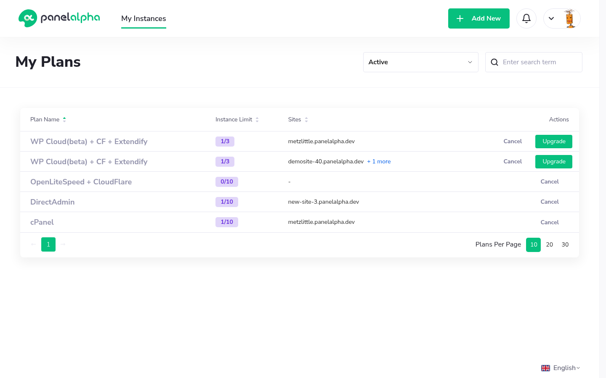
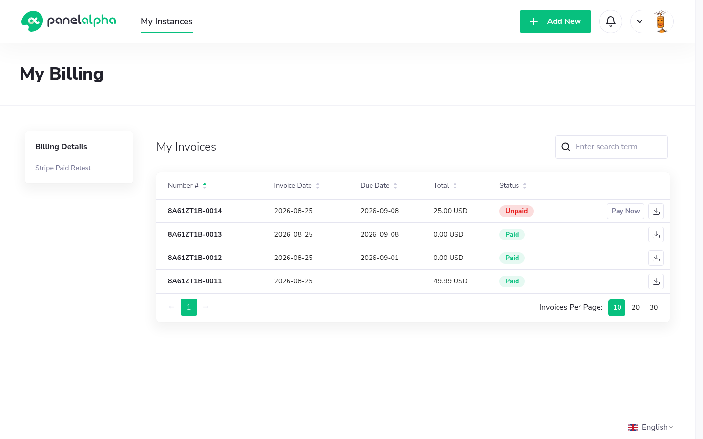

# Direct Billing

From PanelAlpha **v1.9.8**, Background Billing is named **Direct Billing**. The menu path is **Configuration → Direct Billing**.

Direct Billing lets customers start a trial, pay for a plan, and manage invoices from the Client Area. Checkout and the upgrade page stay on your website. PanelAlpha provisions the account after payment.

Choose a billing integration:

- **[Stripe](stripe.md)** — trial and paid plans, invoices, Pay Now, and subscription cancel in the Client Area. Available on Multi Server and on Single Server **Pro**.
- **[WHMCS](../billing-systems-integrations/whmcs.md#direct-billing)** — usage-based billing and SSO through the WHMCS module.

PanelAlpha does not replace your order form. For Stripe, you keep the payment page (Payment Link or Pricing Table). See [Stripe Integration](stripe.md).

## Enable Direct Billing

1. Log in to the Admin Area.
2. Go to **Configuration → Direct Billing**.
3. Enable Direct Billing.

After it is enabled, select Stripe or WHMCS, then configure **Settings**. Trial length, trial links, and paid product mapping live on each [plan Billing tab](../system-configuration/plans.md#billing).

## Billing system

### Stripe

1. Select **Stripe**.
2. Enter the Stripe **Secret Key** (use a test key first).
3. Run **Test Connection**.
4. Copy the **webhook URL** shown in the panel into Stripe (**Developers → Webhooks**). PanelAlpha creates the webhook when the PanelAlpha URL is publicly reachable.

Open [Stripe Integration](stripe.md) for the trial, paid, and upgrade workflows.

### WHMCS

1. Select **WHMCS**.
2. Enter your WHMCS URL.
3. Enter the WHMCS API token from **Setup → Addon Modules → PanelAlpha WordPress Hosting For WHMCS**.
4. Click **Test Connection**.

Details: [WHMCS Integration Guide](../billing-systems-integrations/whmcs.md#direct-billing).

**Control Panel Upgrades** stay available for WHMCS only. They are disabled when Stripe is selected.

## Settings

**Configuration → Direct Billing → Settings** holds registration copy, not trial length. Trial days, pre-created accounts, and trial links are per plan.

### Skip Password

- **Disabled:** the user sets a password and confirms email with a verification code.
- **Enabled:** the user sets a password. Email verification happens on the second login.

After Quick Registration, PanelAlpha sends **Welcome User**. The message does not include a plaintext password. It links to `/login?email=...`. Customize the template under **Configuration → Notifications → Welcome User**.

Registration is available when at least one trial plan exists. Trial links are per plan (see [How to offer trials](stripe.md#how-to-offer-trials)).

### Registration Terms Text

Text shown on the register page under "By registering, you accept Terms of Service".

### reCAPTCHA

Configure reCAPTCHA on the same Settings tab if you want it on the registration form.

## Control Panel Upgrades

WHMCS only. Pick the trial plan used when a customer upgrades from a connected control panel. Skip password and registration terms come from **Settings**. Trial length and links come from that plan's Billing tab.

Connector setup is unchanged: API URL, API token from **Configuration → Admins**, and **Don't Show Again Expiration**.

## Social Media Login

Social login stays on Direct Billing.

Providers: Microsoft, LinkedIn, Google, GitHub, Facebook.

Social registration skips email verification.

## Client Area

### Trial banner

Trial users see days remaining and a link to upgrade (the plan **Upgrade URL**).

### My Plans

Customers view active and expired plans and open the upgrade URL.

With Stripe, **Cancel** opens the Stripe Customer Portal.

### My Billing

Invoice history, download, and **Pay Now** for unpaid Stripe invoices.

