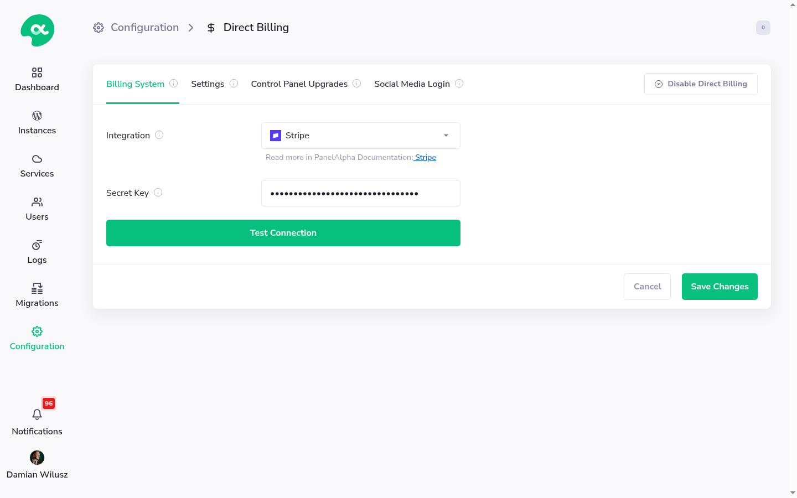
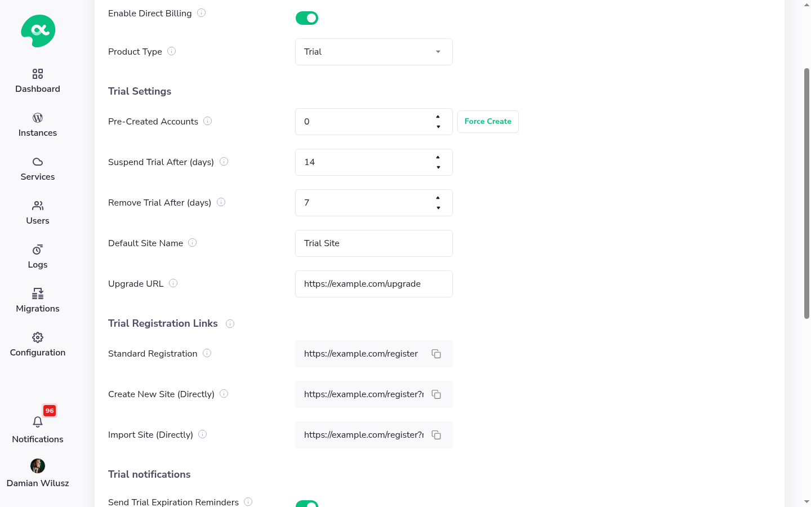
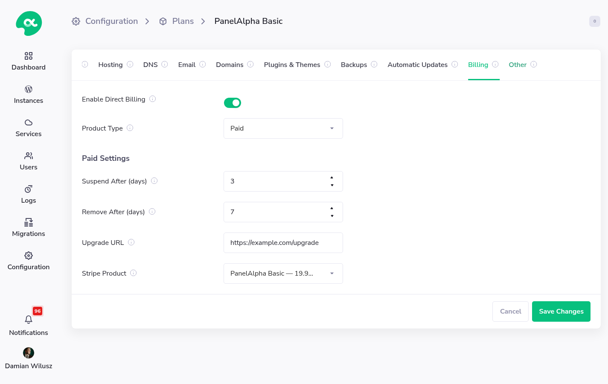
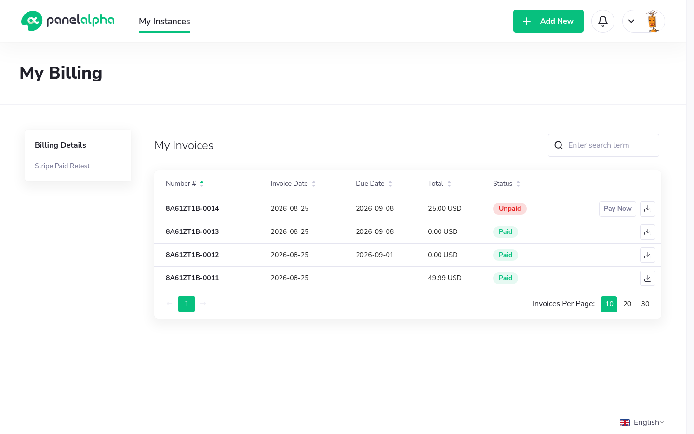
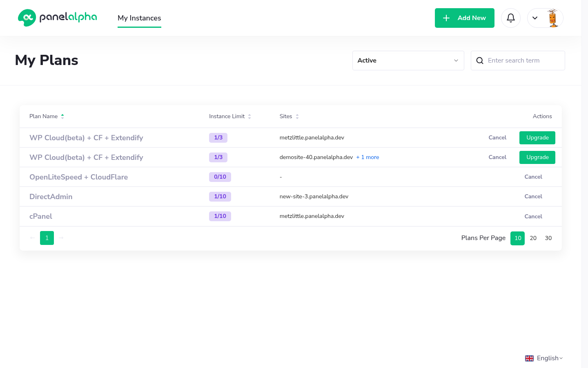

# Stripe Integration

Stripe in PanelAlpha **Direct Billing** (v1.9.8) covers these use cases:

- Offer a **trial** plan
- Offer a **paid** plan
- Upgrade **trial → paid**
- Upgrade **paid → paid**
- Show **invoices** in the Client Area and let the customer **pay in Stripe**
- Let the customer **cancel** a subscription in Stripe

PanelAlpha does **not** host the order form or the upgrade checkout. You keep that page (Stripe Payment Link or Pricing Table). After Stripe records the payment, a webhook tells PanelAlpha to create the user, attach the plan, or upgrade the service.

On Single Server, Stripe is available on the **Pro** license. Multi Server has no extra license gate.

WHMCS remains a separate Direct Billing integration. See [Direct Billing](index.md) and [WHMCS](../billing-systems-integrations/whmcs.md).

## Connect Stripe

### Workflow

1. You enable Direct Billing and select Stripe.
2. PanelAlpha talks to Stripe with your secret key.
3. Stripe sends payment and subscription events to the PanelAlpha webhook.
4. PanelAlpha creates or upgrades the service and sends admin notifications on success or failure.

### Configuration

1. Create a Stripe account and a **Secret Key**. Use test keys until the flows work.
2. In PanelAlpha go to **Configuration → Direct Billing**, enable it, and select **Stripe**.
3. Paste the secret key and run **Test Connection**.
4. Copy the webhook URL from the panel (typically `https://YOUR_PANEL_URL/api/webhook/billing`) into Stripe **Developers → Webhooks**.
5. The PanelAlpha application URL must be reachable from the internet. Stripe cannot deliver webhooks to localhost.
6. Create Stripe **Products** and **Prices** for each paid plan you will sell.
7. Open each PanelAlpha plan → **Billing** and map the plan as described below.



The Billing tab on a plan is available only while Direct Billing is enabled.

---

## How to offer trials

### Workflow

1. The customer opens a trial registration URL for that plan.
2. They register in the Client Area (validation, password, optional reCAPTCHA), the same way Direct Billing registration already worked.
3. PanelAlpha creates a trial service for **X** days, sends trial emails, and can attach a pre-created WordPress instance.
4. Nothing is created in Stripe at this step. Stripe starts when they upgrade.

### Configuration

1. Complete [Connect Stripe](#connect-stripe).
2. Open **Configuration → Plans** → the trial plan → **Billing**.
3. Set **Enable Billing** to Yes.
4. Set **Product Type** to **Trial**.

**Trial settings**

| Option | What it does |
|--------|----------------|
| Pre-created Accounts | How many WordPress instances to keep ready for new trials |
| Suspend Trial After (days) | When an unpaid trial is suspended |
| Remove Trial After (days) | When a leftover trial is removed |
| Trial User Email | Optional default mailbox used on the trial site |
| Default Project Name | Default site name |
| Upgrade URL | Your page that starts the paid checkout |

**Trial links** (shown on the same tab)

- Standard registration
- Create new project (opens instance creation after register)
- Import site (WordPress plans)

Use those URLs on your marketing site. Example:

```
<form method="get" action="https://example.com/register">
  <input type="hidden" name="new-site" />
  <input type="email" name="email" placeholder="Enter your email" required />
  <button type="submit">Start your trial</button>
</form>
```

Replace `https://example.com/register` with the trial link from the plan.



**Trial notifications** on the plan replace the old global Direct Billing notification list (reminders before expiry, on expiry, and after).

Registration copy (**Skip Password**, **Registration Terms**) is global: **Configuration → Direct Billing → Settings**.

---

## How to offer paid plans

### Workflow

1. The customer pays in Stripe (your Payment Link, Pricing Table, or Checkout).
2. Stripe sends the event to the PanelAlpha webhook.
3. PanelAlpha matches the Stripe product/price to a PanelAlpha plan with **Product Type = Paid**.
4. PanelAlpha creates the user (if needed) and the service, then sends the welcome email.
5. If mapping fails, the customer is not provisioned. The admin gets an error notification.

### Configuration

1. In Stripe, create a Product and Price (for example "Basic — 19.99 USD / month").
2. In PanelAlpha, open the paid plan → **Billing**.
3. Set **Enable Billing** to Yes and **Product Type** to **Paid**.
4. Select the **Stripe Product** (price) from the dropdown.
5. Set **Suspend After (days)** and **Remove After (days)** for overdue paid services.
6. Set **Upgrade URL** if this plan can move to a higher paid plan.



Do not reuse the same Stripe price on two PanelAlpha plans. The webhook uses that mapping to pick the plan.

Unmapped prices do not create accounts.

---

## How to upgrade from trial to paid

### Workflow

1. The trial customer clicks **Upgrade**. PanelAlpha sends them to the plan **Upgrade URL** and appends query parameters (documented below).
2. Your page reads those parameters and starts Stripe Checkout or a Pricing Table. Put the PanelAlpha service id in Stripe `client_reference_id` and prefill the email.
3. The customer pays in Stripe.
4. The webhook upgrades the existing trial service to the paid plan (`is_trial` is cleared). The admin is notified on success or failure.
5. The customer keeps the same PanelAlpha user and service. The plan changes.

### Configuration

1. On the **trial** plan Billing tab, set **Upgrade URL** to your landing page (not a raw Stripe URL unless that URL already accepts the query string).
2. On each **paid** plan, map the Stripe price as in [How to offer paid plans](#how-to-offer-paid-plans).
3. On the landing page, pass Stripe:

- `client_reference_id` = `trial_service_id`
- customer email = `trial_email`

PanelAlpha appends these parameters to the trial upgrade URL:

| Parameter | Meaning |
|-----------|---------|
| `trial_service_id` | PanelAlpha service id to upgrade |
| `trial_email` | Customer email |
| `trial_instance_count` | Number of active instances on that service |

You do not have to use every parameter. `trial_service_id` is the one PanelAlpha needs in `client_reference_id`.

Example Pricing Table snippet (replace ids and the values from the query string):

```html
<script async src="https://js.stripe.com/v3/pricing-table.js"></script>
<stripe-pricing-table
  pricing-table-id="prctbl_xxx"
  publishable-key="pk_xxx"
  client-reference-id="SERVICE_ID_FROM_QUERY"
  customer-email="EMAIL_FROM_QUERY"
>
</stripe-pricing-table>
```

A Payment Link with `client_reference_id` and `prefilled_email` is the same contract if you do not use a Pricing Table.

If the email in Stripe does not match the trial service, PanelAlpha leaves the trial unchanged.

---

## How to upgrade from paid to paid

### Workflow

1. The customer clicks upgrade on a paid service. PanelAlpha opens the plan **Upgrade URL** with `paupgradeserviceid`.
2. Your page starts Stripe Checkout for the new price and sets `client_reference_id` to that service id.
3. After payment, the webhook changes the PanelAlpha plan to the one mapped to the new Stripe price.
4. The admin is notified on success or failure.

### Configuration

1. Set **Upgrade URL** on the current paid plan.
2. Map each target plan to its Stripe price.
3. On the landing page, read `paupgradeserviceid` and pass it as `client_reference_id`.

| Parameter | Meaning |
|-----------|---------|
| `paupgradeserviceid` | PanelAlpha service id to change |

Existing query parameters on a trial Upgrade URL are kept only for trials. Paid upgrades send `paupgradeserviceid`.

---

## Invoices and subscriptions in the Client Area

### Workflow

1. Stripe remains the source of invoices and subscriptions.
2. In **My Billing**, the customer sees invoice history, downloads a PDF, and uses **Pay Now** on unpaid invoices (Stripe hosted invoice).
3. In **My Plans**, **Cancel** opens the Stripe Customer Portal.





### Configuration

No extra PanelAlpha fields. Connect Stripe and map paid plans. Customers see billing after the first successful paid webhook.

---

## Automatic suspend and terminate

### Workflow

1. A paid subscription goes past due in Stripe.
2. After **Suspend After (days)** on the paid plan, PanelAlpha suspends the service.
3. After **Remove After (days)**, PanelAlpha terminates the service (soft-delete).
4. The customer and the admin can receive email for these events.

Trial suspend/remove uses the trial plan fields **Suspend Trial After** and **Remove Trial After**.

### Configuration

Set the day counts on each plan **Billing** tab. Keep Stripe collection enabled so `past_due` events arrive.

---

## Related pages

- [Direct Billing](index.md)
- [Plans — Billing](../system-configuration/plans.md#billing)
- [Free Trial Period](../billing-scenarios/free-trial-period.md)
- [WHMCS](../billing-systems-integrations/whmcs.md)
