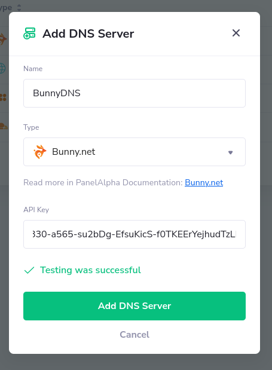
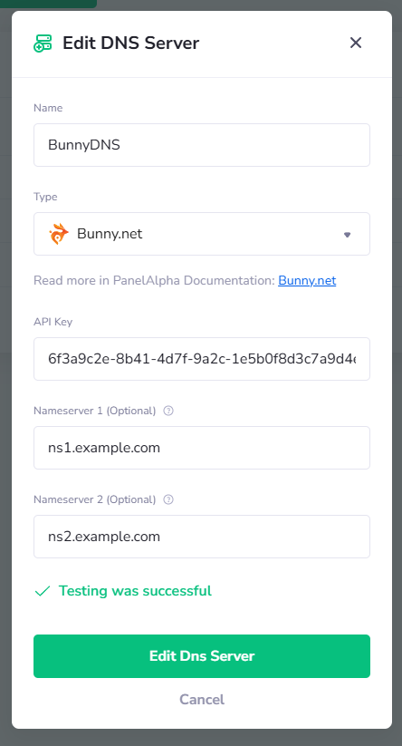

# Bunny.net

PanelAlpha users can manage DNS zones and records from the client area using the **DNS Zone Editor**. To enable this, configure a DNS server in your plan.

If your plan uses cPanel, DirectAdmin, or Plesk as DNS, you can keep that setup. If you use PanelAlpha Engine without an internal DNS role, configure an external DNS provider such as Bunny.net.

## Server Configuration

To configure Bunny.net, go to **Admin Area → Configuration → Servers → DNS Servers** and click **Add DNS Server**.

Set:

- **Server Name** — Internal label used in PanelAlpha
- **Type** — `Bunny.net`
- **API Key** — Bunny API key used to authenticate requests
- **Nameserver 1 / Nameserver 2 (Optional)** — Custom nameservers displayed to users during domain onboarding. Leave empty to fall back to Bunny's default nameservers

Use **Test Connection**, then click **Add DNS Server**.

## Custom Nameservers

The **Nameserver 1** and **Nameserver 2** fields accept the custom nameservers displayed to users during domain onboarding. Leave them empty to fall back to Bunny's default nameservers. Enter fully qualified domain names, for example: `ns1.yourbrand.com` and `ns2.yourbrand.com`. PanelAlpha still reads the authoritative nameservers from Bunny zone data (`Nameserver1` and `Nameserver2`) regardless of what is set here.

## Bunny Support Scope

PanelAlpha supports the following with Bunny.net:

- Zone synchronization/import (with server-side zone search)
- Zone create/delete
- DNS record create/update/delete
- Proxy toggle for `A`, `AAAA`, and `CNAME` records
- Record types: `A`, `AAAA`, `CAA`, `CNAME`, `MX`, `NS`, `PTR`, `SRV`, `TXT`

PanelAlpha reads nameservers from Bunny zone data (`Nameserver1` and `Nameserver2`).

Bunny-native record types such as `RDR (Redirect)`, `Flatten`, `PZ`, and `SCR` are not exposed in the PanelAlpha DNS editor.

## Plan Configuration

Bunny.net is now ready. Set it as the DNS server per plan under **PanelAlpha admin area → Configuration → Plans → Edit Plan → DNS**.

For troubleshooting Bunny.net-related issues, see the [Troubleshooting Center](../../troubleshooting-center/index.md).
