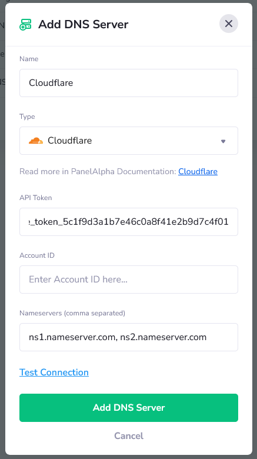

# Cloudflare

PanelAlpha users can manage DNS zones and records using the **DNS Zone Editor** in the client area. To enable this, set up a DNS server in the plan.

If cPanel, DirectAdmin, or Plesk is set up as a DNS server, you do not need a separate DNS server, as these can function as the hosting, email, and DNS server simultaneously.

If **PanelAlpha Engine** is the hosting server, configuring Cloudflare (or another external DNS server) is mandatory.

## Server Configuration

To configure Cloudflare, go to **Admin Panel → Configuration → Servers → DNS Servers**.

Press **Add DNS Server**, and a short form will appear.

Enter the DNS server name and select **Cloudflare**. Fill out:

- **API Token** — Learn how to create the token [here](https://developers.cloudflare.com/fundamentals/api/get-started/create-token/). Recommended minimum permissions: Account Settings → Read; Zone Settings → Edit; Zone → Edit; Cache Purge → Purge; DNS → Edit.
- **Account ID** — Manually add the account ID from *Cloudflare → Zone → Account ID* (bottom right corner). Optional, as PanelAlpha fetches it from the API token.
- **Nameservers (comma separated)** — Optional custom nameservers displayed to users during domain onboarding.

Test the connection and press **Add DNS Server**.

**Important:** Subdomains are not supported.

## Plan Configuration

Cloudflare is now ready. Set it as the DNS server per plan under **PanelAlpha admin area → Configuration → Plans → Edit Plan → DNS**.

For troubleshooting Cloudflare-specific issues, see the [Troubleshooting Center](../../troubleshooting-center/index.md).
