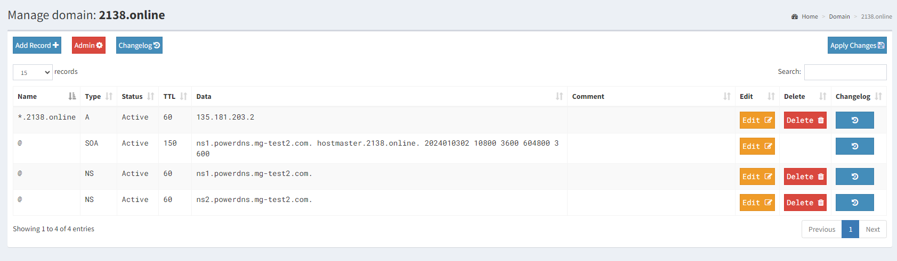

# PowerDNS

PanelAlpha users can manage DNS zones and records using the **DNS Zone Editor** in the client area. To enable this, set up a DNS server in the plan.

If cPanel, DirectAdmin, or Plesk is set up as a DNS server, you do not need a separate DNS server, as these can function as the hosting, email, and DNS server simultaneously.

If **PanelAlpha Engine** is the hosting server, configuring PowerDNS (or another external DNS server) is mandatory.

## Server Configuration

To configure PowerDNS, go to **Admin Panel → Configuration → Servers → DNS Servers**.

Press **Add DNS Server**, and a short form will appear.

Enter the DNS server name and select **PowerDNS** from the type dropdown. Then provide:

- **API URL** — Default: `http://POWERDNS_SERVER_HOSTNAME:8081/api/v1`
- **API Token** — Use the token from `pddns.conf`
- **Server** — The same as used in PowerDNS; by default this is `localhost`

### Plan Configuration

PowerDNS is now ready. Set it as the DNS server per plan under **PanelAlpha admin area → Configuration → Plans → Edit Plan → DNS**.

**Important:** If you use PowerDNS with the [Quick Onboarding](../onboarding-methods/quick-onboarding.md) method, you must first add a zone for the domain assigned to Quick Onboarding and set up a wildcard within PowerDNS.

Example:
- Admin creates a Plan using Quick Onboarding
- Domain for instance installation: `2138.online`
- The admin must create a zone in PowerDNS for `2138.online` and set up a wildcard
- Zones for subdomains created with installations will be created automatically

