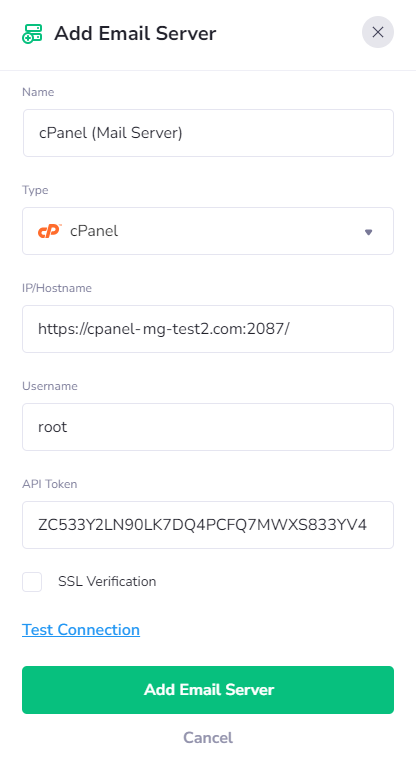

# cPanel

PanelAlpha users can manage email addresses and email forwarders directly from the client area. To enable these features, set up an email server in the plan.

If cPanel or DirectAdmin is the hosting server, you do not need a separate email server, as cPanel, DirectAdmin, and Plesk can function as the hosting, email, and DNS server simultaneously.

If **PanelAlpha Engine** is the hosting server, configuring a separate email server is mandatory.

You may also **set up cPanel as a separate webmail server**, independent of the hosting server.

## Configuration

To configure cPanel as a separate webmail server, go to **Admin Panel → Configuration → Servers → Email Servers**.

Press **Add Email Server**, and a short form will appear.

Provide:

- **Name** — Enter the server name
- **Type** — Select cPanel
- **IP/Hostname** — Enter the server IP address or hostname
- **Username** — Enter the username for which the token has been generated
- **API Token** — Previously generated [API token](https://support.cpanel.net/hc/en-us/articles/1500011416602-How-to-create-an-API-token-for-a-cPanel-user)
- **SSL Verification** — Select if you want to connect via SSL
- **Test Connection** — Check if the connection is successful

## Plan Configuration

Assign the email server to a plan so that clients can manage mailboxes and forwarders from the Client Area.

1. Go to **Admin Area → Configuration → Plans**, then open an existing plan or create a new one.
2. Open the **Email** tab.
3. In **Server Type**, select **cPanel**. If cPanel is already your hosting server, you can also select **Internal** to use its built-in email server.
4. In **Server**, select the cPanel email server instance you configured above.
5. (Optional) Configure **Email Account Config** to define mailbox defaults for the plan.
6. (Optional) Expand **Advanced Configuration** to enable:
   - **Auto set up SPF & DKIM records** — automatically add SPF and DKIM DNS records for email domains.
   - **Display SPF & DKIM configuration** — show SPF/DKIM details to clients.
   - **Auto delete email domains** — remove email domains from the email server when the service is deleted (external servers only).
7. Save the plan.

Email domain synchronization is a separate action performed from **Configuration → Servers → Email Servers** (Synchronize Domains), not from the plan.
