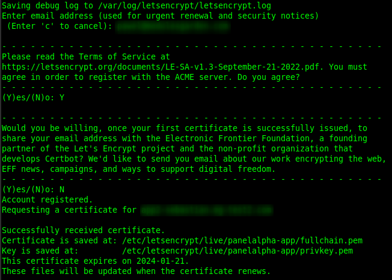
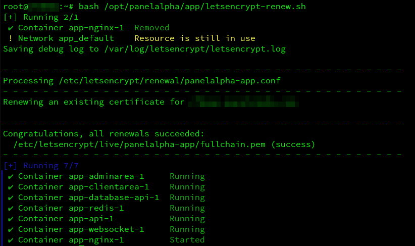

# SSL Configuration

This guide walks you through configuring SSL certificates for your PanelAlpha installation.

## Overview

PanelAlpha can operate using either a domain name or an IP address. When using a domain name, you can configure SSL certificates to secure HTTPS connections. This guide covers two methods:

- **Let's Encrypt certificates** — Free SSL certificates with automatic renewal
- **Custom certificates** — Use your own SSL certificates from any certificate authority

**Downtime note:** Requesting or swapping certificates requires stopping PanelAlpha containers briefly to free up port 80. Plan a short maintenance window.

## Prerequisites

Before configuring SSL certificates, ensure you have:

1. **Root access** to your server via SSH
2. **Domain name** properly configured (if using domain-based SSL)
3. **DNS resolution** pointing to your server's IP address
4. **Firewall configuration** allowing ports 80 and 443

## Let's Encrypt SSL Certificate

Let's Encrypt provides free SSL certificates with automatic renewal. This is the recommended option for most users.

### Installation Process

1. **Access your server** via SSH with root privileges:
   ```bash
   ssh root@your-server-ip
   ```

2. **Verify DNS resolution**:
   ```bash
   nslookup your-domain.com
   ```

3. **Check firewall settings** — Ensure ports 80 and 443 are not blocked.

4. **Stop PanelAlpha temporarily** (the UI and API will be unavailable until restarted):
   ```bash
   docker compose -f /opt/panelalpha/app/docker-compose.yml down
   ```

5. **Request the SSL certificate** using certbot:
   ```bash
   docker run -it --rm --name certbot \
   -v "/etc/letsencrypt:/etc/letsencrypt" \
   -v "/var/lib/letsencrypt:/var/lib/letsencrypt" \
   -p 80:80 \
   certbot/certbot certonly --standalone \
   --cert-name panelalpha-app \
   -d YOUR_DOMAIN
   ```

   **Important:** Replace `YOUR_DOMAIN` with your actual domain name.

6. **Complete the certificate request** by following the terminal prompts:
   - Enter your email address
   - Accept the Terms of Service

   

7. **Configure PanelAlpha to use the certificates**:
   ```bash
   sed -i~ '/^SSL_CERT_FULLCHAIN=/s#=.*#=/etc/letsencrypt/live/panelalpha-app/fullchain.pem#' /opt/panelalpha/app/.env
   ```
   ```bash
   sed -i~ '/^SSL_CERT_PRIVKEY=/s#=.*#=/etc/letsencrypt/live/panelalpha-app/privkey.pem#' /opt/panelalpha/app/.env
   ```

8. **Restart PanelAlpha**:
   ```bash
   docker compose -f /opt/panelalpha/app/docker-compose.yml up -d
   ```

### Certificate Renewal

Let's Encrypt certificates expire every 90 days. PanelAlpha provides an automated renewal script.

**To renew your certificate:**

```bash
bash /opt/panelalpha/app/letsencrypt-renew.sh
```

Wait for the confirmation message.



**Automated Renewal Setup:**

Add to crontab to check for renewal twice daily:
```bash
0 12,0 * * * /opt/panelalpha/app/letsencrypt-renew.sh >/dev/null 2>&1
```

## Custom SSL Certificate

If you have an SSL certificate from a commercial certificate authority, follow these steps:

### Installation Process

1. **Access your server** via SSH with root privileges:
   ```bash
   ssh root@your-server-ip
   ```

2. **Prepare your certificate files**:
   - **Full chain certificate file** (includes your certificate and intermediate certificates)
   - **Private key file**

3. **Stop PanelAlpha temporarily**:
   ```bash
   docker compose -f /opt/panelalpha/app/docker-compose.yml down
   ```

4. **Configure PanelAlpha to use your certificates**:
   ```bash
   sed -i~ '/^SSL_CERT_FULLCHAIN=/s#=.*#=/path/to/fullchain#' /opt/panelalpha/app/.env
   ```
   ```bash
   sed -i~ '/^SSL_CERT_PRIVKEY=/s#=.*#=/path/to/privatekey#' /opt/panelalpha/app/.env
   ```

   **Important:** Replace `/path/to/fullchain` and `/path/to/privatekey` with actual paths.

5. **Restart PanelAlpha**:
   ```bash
   docker compose -f /opt/panelalpha/app/docker-compose.yml up -d
   ```

### Certificate Renewal

Custom certificates need manual renewal:

1. Obtain new certificates from your certificate authority
2. Update the certificate files on your server
3. Follow the installation process above with the new certificate paths

## Post-Installation Configuration

### Update PanelAlpha URLs

After installing SSL certificates, update your PanelAlpha configuration to use HTTPS URLs:

1. **Access the PanelAlpha admin panel**
2. **Navigate to System Configuration → General Configuration**
3. **Update the following settings:**
   - **Application URL** — Change to `https://your-domain.com`
   - **Admin URL** — Change to `https://your-domain.com:8443`

For detailed instructions, see [General Configuration](../system-configuration/general-configuration.md).

### Verify SSL Installation

After completing SSL configuration:

1. **Test HTTPS access** by visiting `https://your-domain.com`
2. **Check certificate validity** using online SSL checker tools
3. **Verify automatic HTTP to HTTPS redirection**
4. **Test admin panel access** via HTTPS

## Common Problems

If you encounter issues, refer to the [Troubleshooting Center](../../troubleshooting-center/index.md) for common problems and solutions.

For additional support, contact our [support team](https://manage.panelalpha.com/submitticket.php?step=2&deptid=1).
