# Translations

This guide walks you through configuring PanelAlpha in multiple languages. While PanelAlpha defaults to English, the client area can be fully customized and translated.

## Overview

PanelAlpha supports multilingual configurations through language files controlling:

- **Client area interface** — All user-facing text and menus
- **Email templates** — Automated notifications and communications
- **Admin area messages** — System messages and notifications

The system automatically detects RTL (right-to-left) languages and adjusts the interface accordingly.

## Language File Structure

Language files are stored in `/opt/panelalpha/app/packages/api/resources/lang`. Each language has its own subdirectory containing:

- **api** — API message translations
- **clientarea/translation.json** — Client area interface translations
- **email-templates** — Email template files
- **auth.php, pagination.php, passwords.php, validation.php** — System files

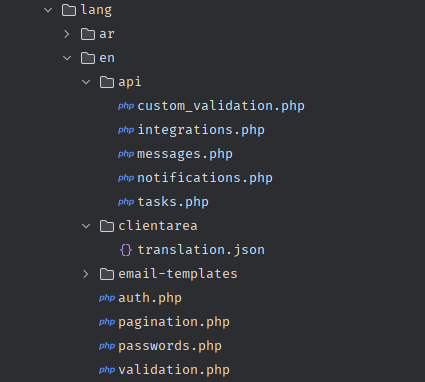

### Directory Permissions

**Important:** Ensure proper permissions:

```bash
chmod 755 /opt/panelalpha/app/packages/api/resources/lang/{language_code}
chmod 755 /opt/panelalpha/app/packages/api/resources/lang/{language_code}/api
chmod 755 /opt/panelalpha/app/packages/api/resources/lang/{language_code}/clientarea
chmod 755 /opt/panelalpha/app/packages/api/resources/lang/{language_code}/email-templates
```

Replace `{language_code}` with your target language code (for example `de`, `es`, `fr`).

## Available Translations

Ready-made translations are available from the [PanelAlpha GitHub repository](https://github.com/panelalpha/PanelAlpha-Translations). Currently supported:

- **German (de)** — Deutsche Übersetzung
- **Spanish (es)** — Traducción en español
- **French (fr)** — Traduction française
- **Italian (it)** — Traduzione italiana
- **Brazilian Portuguese (pt_BR)** — Tradução em português brasileiro

Each package contains client area translations, email template translations, and a README with installation instructions.

**Important:** These translations were prepared using automated tools. Review them before production use and contribute improvements.

### Installation

**Automatic Installation**

1. Download the script:
   ```bash
   curl -sL -o /opt/panelalpha/sync-translations.sh https://raw.githubusercontent.com/panelalpha/PanelAlpha-Translations/refs/heads/main/scripts/sync-translations.sh
   ```

2. Run the script with the desired language:
   ```bash
   bash /opt/panelalpha/sync-translations.sh --lang "{language_code}"
   ```
   Replace `{language_code}` with `de`, `es`, `fr`, `it`, or `pt_BR`.

**Manual Installation**

1. Download the language files from the repository.
2. Copy files to your server's language directory.
3. Set permissions:
   ```bash
   chmod -R 755 /opt/panelalpha/app/packages/api/resources/lang/<language_code>
   ```
4. Synchronize notifications:
   ```bash
   docker compose -f /opt/panelalpha/app/docker-compose.yml exec -T api php artisan notifications:sync
   ```
5. Configure the client area language (see [Changing the Client Area Language](translations.md#changing-the-client-area-language)).

### Contributing

Contribute updates or new translations via the [PanelAlpha Translations Repository](https://github.com/panelalpha/PanelAlpha-Translations/).

**Editing Existing Translations:**

1. Fork the repository.

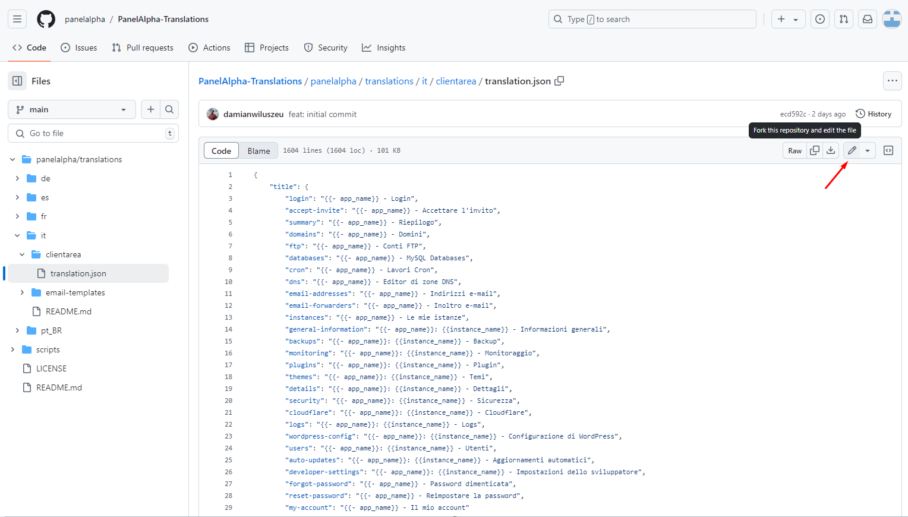

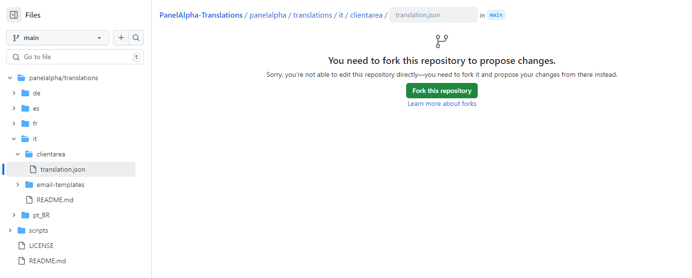

2. Edit the translation files in your forked repository.
3. Commit the changes.

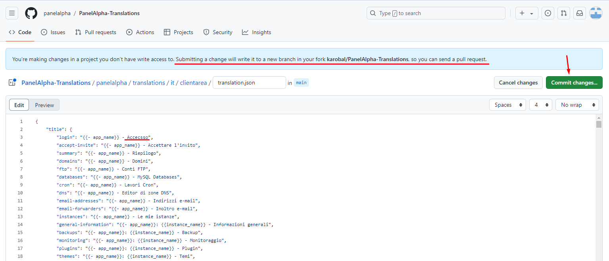

4. Describe your changes and press **Propose Changes**.

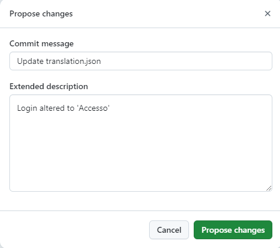

5. Submit a pull request.

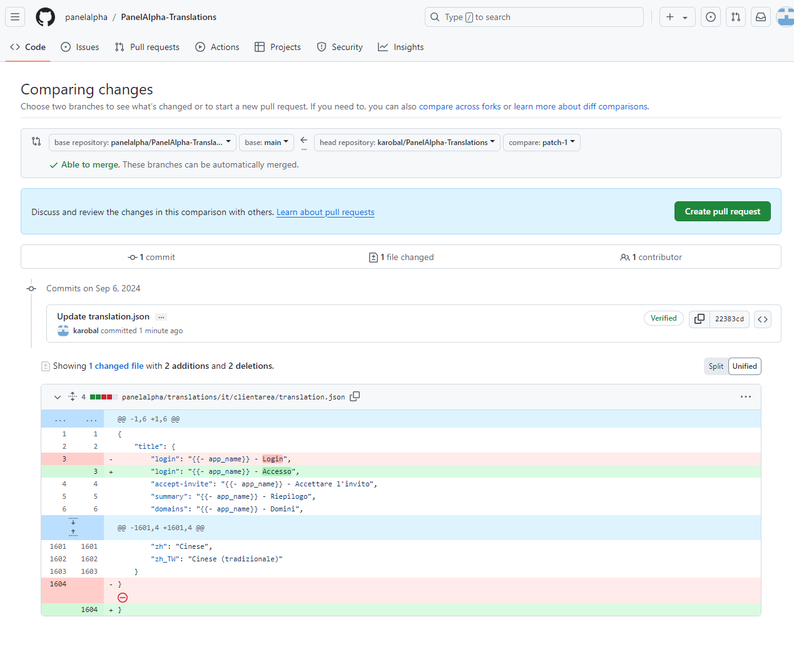

**Adding a Translation for an Unavailable Language:**

1. Fork the repository and create a new file.

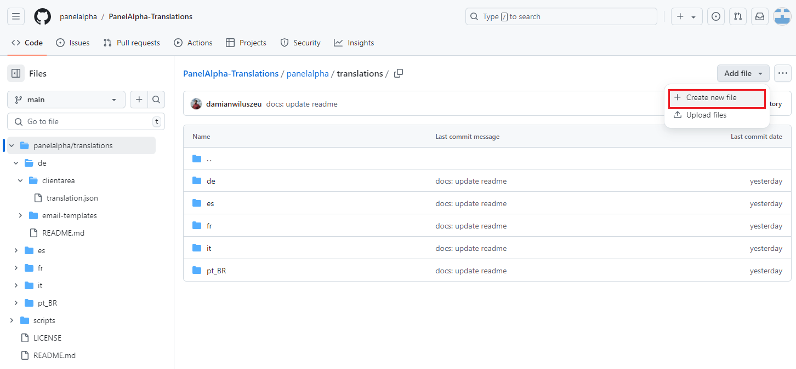

2. Create the language path using the appropriate language code.

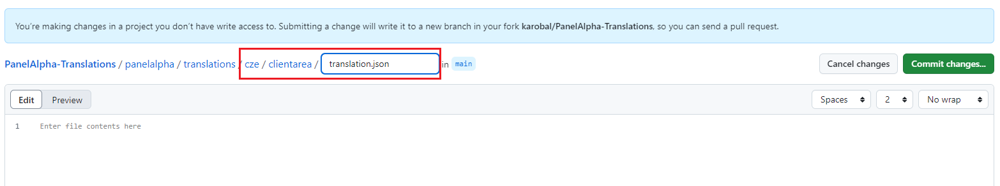

3. Provide translations using original files as reference. Only modify the right side of the `=` sign.

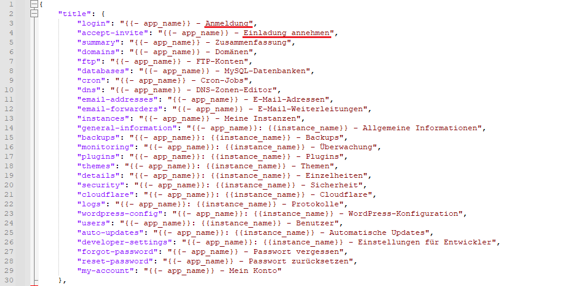

4. Commit the changes and press **Propose Changes**.
5. Submit a pull request.

## Language Configuration

### Admin Area Configuration

Set the default language for all clients:

1. Navigate to **Configuration → General → Client Area**
2. Select **Default Language** from the dropdown
3. Save the configuration

This language applies to all new client registrations and serves as the fallback.

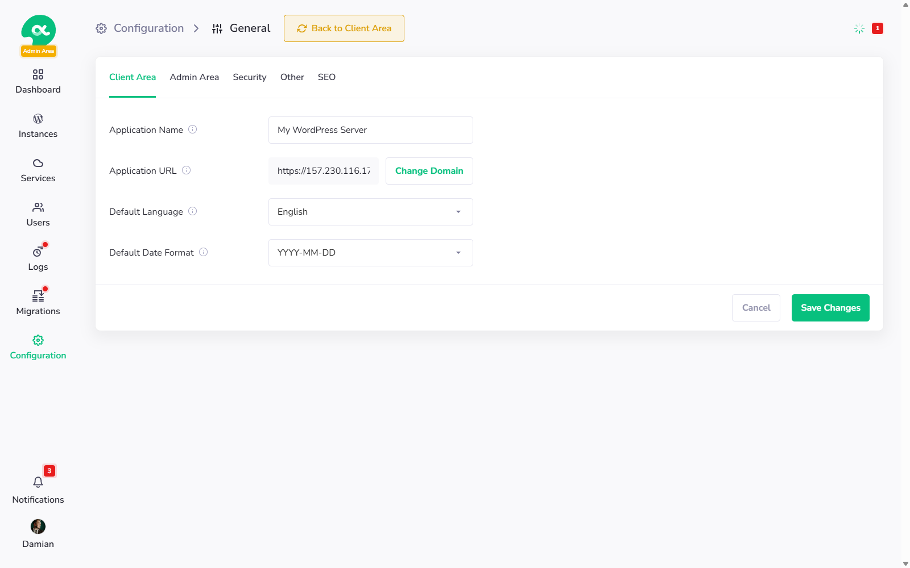

### Client Area Language Selection

Clients can choose their preferred language in several ways:

#### Login Page Selection

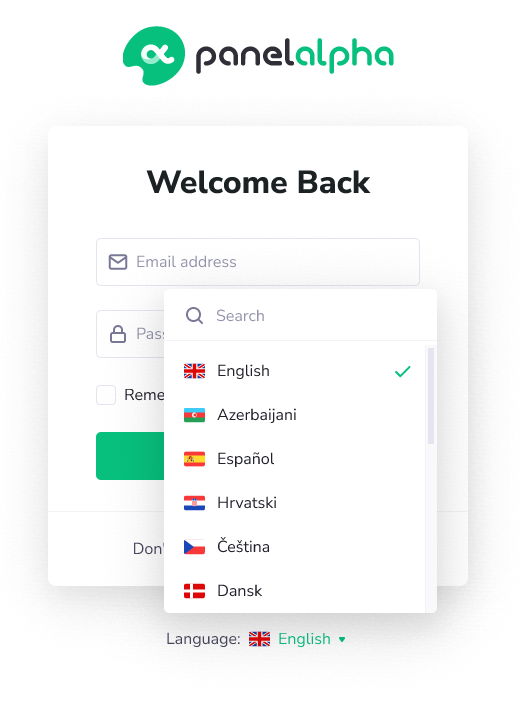

#### Footer Language Selector

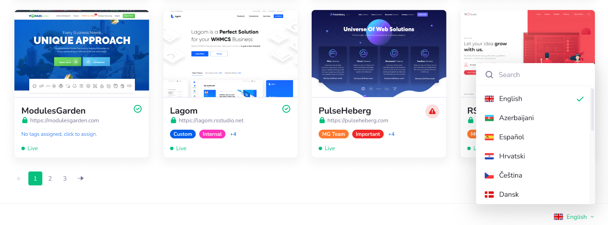

#### Account Settings

1. Navigate to **Account Details → Personal Information**
2. Select **Language** from the dropdown
3. Save changes

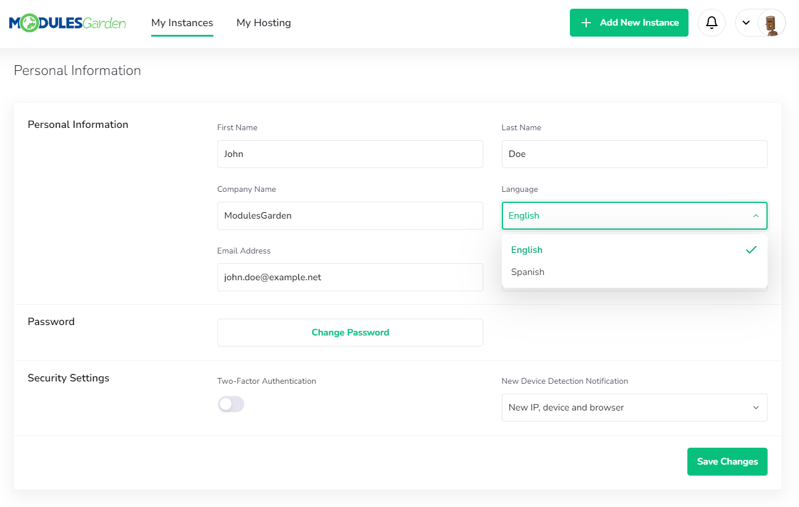

**Note:** When a client changes their language preference, it affects both the client area interface and email notifications.

## Troubleshooting

### Common Issues

#### Permissions Errors
**Problem:** Translation files not loading
**Solution:** Verify directory permissions are set to 755:
```bash
chmod -R 755 /opt/panelalpha/app/packages/api/resources/lang/{language_code}
```

#### Missing Translations
**Problem:** Some text still appears in English
**Solution:** Check for missing keys in translation files and ensure all required files are present.

#### Notifications Not Translated
**Problem:** Email notifications still in default language
**Solution:** Run the notifications sync command:
```bash
docker compose -f /opt/panelalpha/app/docker-compose.yml exec -T api php artisan notifications:sync
```

#### Language Not Appearing in Dropdown
**Problem:** New language doesn't show in selection
**Solution:**
1. Verify proper directory structure
2. Check file permissions
3. Restart PanelAlpha containers if necessary

### Getting Help

If you encounter translation issues:

1. Check the [Troubleshooting Center](../../troubleshooting-center/index.md)
2. Review file permissions and directory structure
3. Verify all required translation files are present
4. Contact our [support team](https://manage.panelalpha.com/submitticket.php?step=2&deptid=1)
