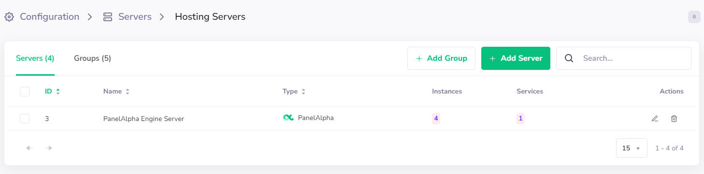
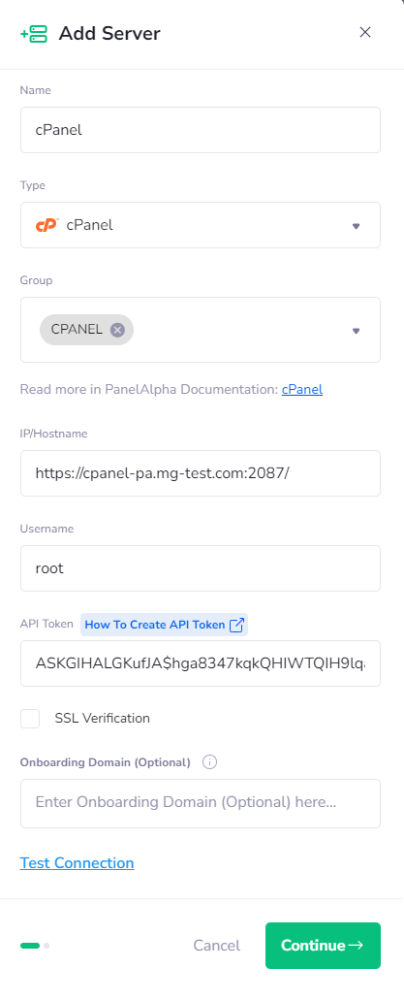
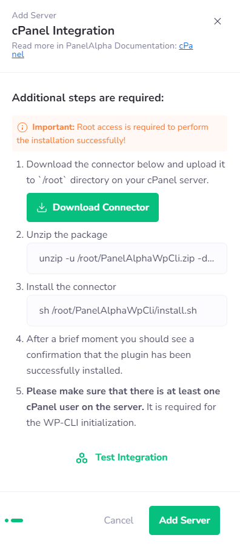

# cPanel

## Overview

PanelAlpha offers integration with cPanel, commonly used for shared hosting environments.

## Prerequisites

- cPanel/WHM server reachable from PanelAlpha
- A cPanel user API token (generated for the username provided)
- Root SSH access to the server (required to install the connector)

## Configure in PanelAlpha

Navigate to **Configuration → Servers → Hosting Services → Add Server**.



Fill out the form:

- **Name** — Enter the server name
- **Type** — Select cPanel
- **Group** — Choose an existing group or create a new one
- **IP/Hostname** — Enter the server IP address or hostname
- **Username** — Enter the username for which the token has been generated
- **API Token** — Previously generated [API token](https://support.cpanel.net/hc/en-us/articles/1500011416602-How-to-create-an-API-token-for-a-cPanel-user)
- **SSL Verification** — Select if you want to connect via SSL
- **Onboarding Domain (Optional)** — If entered, used for instance creation instead of the plan domain with Quick or Super Quick onboarding
- **Test Connection** — Check if the connection is successful



**Important:** Refer to the cPanel official documentation to learn how to generate the API token. Read [this article](https://support.cpanel.net/hc/en-us/articles/1500011416602-How-to-create-an-API-token-for-a-cPanel-user).

## Verify the Connection

Use **Test Connection**. If the test succeeds, you can proceed.

## Install the Connector (WP-CLI)

After a successful connection test, install the connector on the cPanel server:

1. Download the connector.
2. Unzip the package:
   ```bash
   unzip -u /root/PanelAlpha.zip -d /root
   ```
3. Run the connector installation:
   ```bash
   sh /root/PanelAlpha/install.sh
   ```
4. Shortly after, you should receive confirmation of successful installation.
5. Ensure there is at least one cPanel user on the server for WP-CLI initialization.
6. Verify the integration test is successful. Press **Add Server**.



## Plan Configuration

When creating a plan, go to the [Hosting](../system-configuration/plans.md#hosting-server) step. After choosing **cPanel** and selecting a server group, additional configuration appears:

- **WHM Package** — The hosting package name used when provisioning accounts

## Troubleshooting

To allow customers to create a subdomain on another user's domain, enable **Allow cPanel users to create subdomains across accounts** in *cPanel → Tweak Settings*.

1. Log into WHM and proceed to **Tweak Settings**.
2. Find **Allow cPanel users to create subdomains across accounts** and set it to **On**.
3. Press **Save**.

Please be aware that cPanel does not recommend enabling this option as it may result in serious security issues.

For more information, refer to the cPanel [documentation](https://support.cpanel.net/hc/en-us/articles/360063525253-How-to-allow-users-to-create-subdomains-for-a-domain-owned-by-another-cPanel-account).
