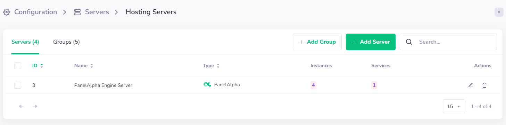
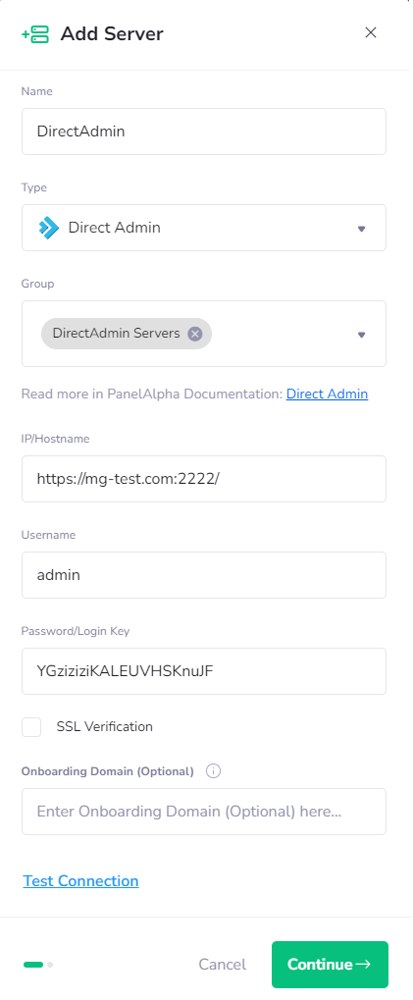
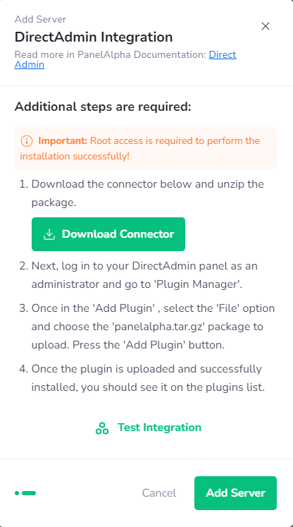

# DirectAdmin

## Overview

PanelAlpha can connect to DirectAdmin to provision and manage WordPress hosting on shared hosting environments.

## Prerequisites

- DirectAdmin server reachable from PanelAlpha
- DirectAdmin **administrator** credentials (password or Login Key)
- Ability to upload/install a DirectAdmin plugin (the connector)
- The target DirectAdmin user/package must have plugin usage enabled

## Configure in PanelAlpha

Log into your PanelAlpha admin area and navigate to **Configuration → Servers → Hosting Services**.

1. **Name** — Enter the server name
2. **Type** — Select DirectAdmin
3. **Group** — Select a server group or create a new one
4. **IP/Hostname** — Enter the server IP address or hostname
5. **Username** — Enter the username for which the token has been generated
6. **Password/Login Key** — Use your password or the previously generated [Login Key](https://docs.directadmin.com/directadmin/general-usage/securing-da-panel.html#creating-a-login-key)
7. **SSL Verification** — Keep disabled for successful test connection results
8. **Onboarding Domain (Optional)** — If entered, used for instance creation instead of the plan domain with Quick or Super Quick onboarding
9. **Test Connection** — Check if the connection is successful

**Note:** The credentials must be for the DirectAdmin administrator account, not a reseller account.

**Important:** Refer to the DirectAdmin official documentation to learn how to generate the Login Key. Read [this article](https://docs.directadmin.com/directadmin/general-usage/securing-da-panel.html#creating-a-login-key), section "Creating a Login Key".

## Verify the Connection

Use **Test Connection**. If the test succeeds, you can proceed.

## Install the Connector (WP-CLI)

After a successful connection test, install the connector in DirectAdmin:

1. Download the connector.
2. Log in to your DirectAdmin panel as an administrator and navigate to the **Plugin Manager**.
3. In the **Add Plugin** section, choose **File** and select the `panelalpha.tar.gz` package for upload. Click **Add Plugin**.
4. Upon successful upload and installation, the plugin appears in the list.
5. Verify the integration test is successful. Click **Add Server**.

## Plan Configuration

When creating a plan, go to the [Hosting](../system-configuration/plans.md#hosting-server) step. After choosing **DirectAdmin** and selecting a server group, additional configuration appears:

- **Package** — The DirectAdmin package for new accounts
- **IP Address** — The IP address assigned to the new account
