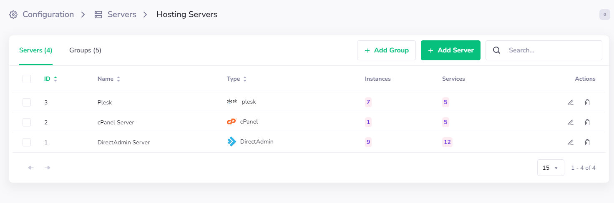
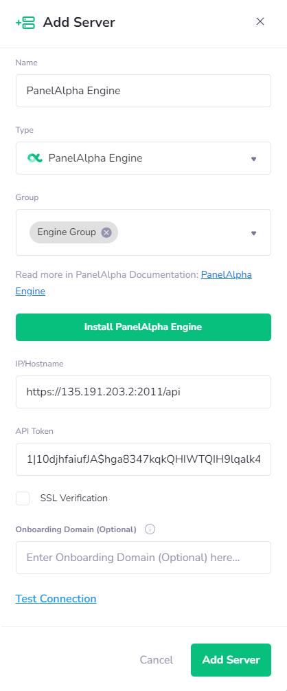
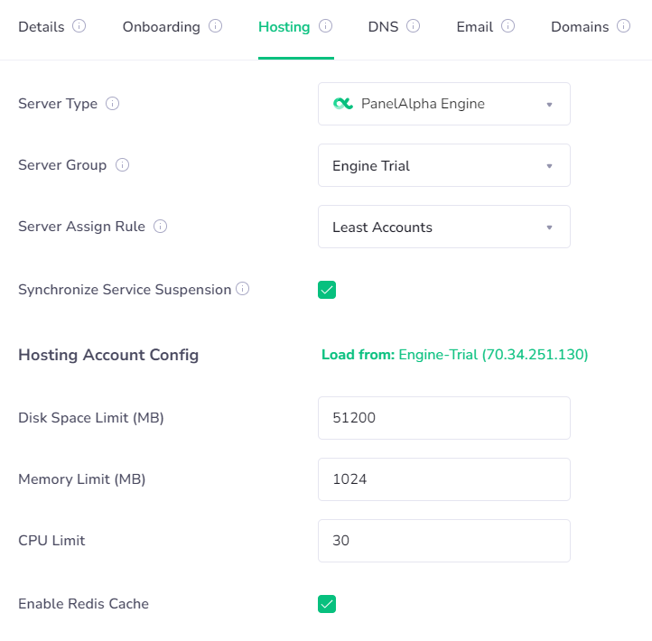

# PanelAlpha Engine

## Overview

PanelAlpha Engine runs each hosting service as a separate Docker container on a server. This isolates customer data and makes it easier to scale resources per service.

## Prerequisites

- PanelAlpha Engine 1.x installed on its own server. See [Installation](../../panelalpha-engine/v1/installation-updates/installation.md).
- The **API URL** and **API Token** that the Engine installer printed.
- Port 2011 on the Engine server reachable from the PanelAlpha server.

## Configure in PanelAlpha

Go to **Configuration → Servers → Hosting Servers** and click **Add Server**. Fill in the form:

- **Name**: a name for the server.
- **Type**: select **PanelAlpha Engine**.
- **Group**: choose an existing group or create a new one.
- **API URL**: the API URL from the installer output, for example `https://203.0.113.10:2011/api`.
- **API Token**: the API token from the installer output.
- **Onboarding Domain (Optional)**: if set, used for instance creation instead of the onboarding domain from the plan (Quick or Super Quick onboarding). Useful when one server group has several servers.

Click **Test Connection**. When it shows **Finished**, click **Add Server**.

If the token is lost, create a new one on the Engine server. See [Artisan Commands](../../panelalpha-engine/v1/command-reference.md#api-tokens). If the connection fails, see [Troubleshooting](../../panelalpha-engine/v1/troubleshooting.md#panelalpha-cannot-connect-to-the-engine).

When the server is added, use it as the hosting server in your [Plans](../system-configuration/plans.md).

## Server Management

To manage the server, click **Manage** next to it in **Configuration → Servers → Hosting Servers**. The tabs (details and updates, IP addresses, CSF firewall, ModSecurity, outgoing mail and alerts) are the same in PanelAlpha Single Server and Multi Server. They are described in the Engine v1 documentation: [Server Management](../../panelalpha-engine/v1/server-management/index.md).

## Plan Configuration

When creating a plan, go to the [Hosting](../system-configuration/plans.md#hosting-server) step. After choosing **PanelAlpha** and selecting a server group, additional configuration appears:

- **Disk Space Limit (MB)** — Maximum disk space for the service
- **Memory Limit (MB)** — Memory limit for sites. The value must be provided as an integer in megabytes (MB) only, without any suffixes (for example: `512`, `1024`).
- **CPU Limit** — CPU limit for the service
- **Read Rate Limit (Bytes Per Second)** — Disk read bandwidth limit
- **Write Rate Limit (Bytes Per Second)** — Disk write bandwidth limit
- **Bandwidth Limit (MB Per Month)** — Monthly transfer limit
- **MySQL Databases Limit** — Maximum number of MySQL databases
- **FTP Accounts Limit** — Maximum number of FTP accounts
- **SFTP Accounts Limit** — Maximum number of SFTP accounts
- **Addon Domains Limit** — Maximum number of addon domains
- **Subdomains Limit** — Maximum number of subdomains
- **Inodes Limit** — Inode limit
- **Enable Redis Cache** — Enables Redis object caching
- **Redis Config** — Advanced Redis configuration options, available when **Enable Redis Cache** is turned on. Allows fine-tuning Redis behavior at the plan level.
- **Enable LiteSpeed Cache** — Enables LiteSpeed cache support
- **PHP-FPM Pool Settings** — Advanced PHP-FPM pool configuration
- **LSPHP Settings** — Advanced LSPHP configuration
- **Dedicated IPv4** — Assign a dedicated IPv4 (if available)
- **Dedicated IPv6** — Assign a dedicated IPv6 (if available)

## Redis Cache Configuration

- Redis server is automatically installed with each PanelAlpha Engine service
- Navigate to **Admin Area → Configuration → Plans → Plan details → Hosting → Enable Redis Cache**

- Upon enabling, the [Redis Object Caching](https://pl.wordpress.org/plugins/redis-cache/) plugin is automatically installed and configured for WordPress instances.
