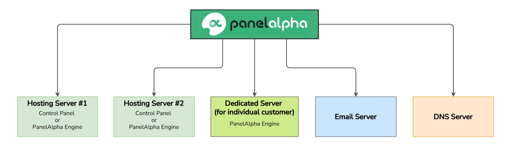

# Hosting Scenarios

PanelAlpha serves as a central hub capable of managing multiple hosting servers, specifically designed for hosting WordPress instances.

The current integrations provide the following schemes:

- **Shared hosting control panel** — Integrated with popular shared hosting control panels such as cPanel, Plesk, and DirectAdmin, PanelAlpha serves as a comprehensive control panel for shared hosting.
- **PanelAlpha Engine** — For advanced functionality, the PanelAlpha Engine can be installed on a dedicated server or VPS. This engine handles multiple instances for individual or multiple customers simultaneously. Each hosting service is isolated within its own Docker container. To fully leverage its capabilities, basic services need to be provided through separate servers:
  - Email Server Connection — PanelAlpha supports integration with [Mailcow](../email-servers/mailcow.md) and [cPanel](../email-servers/cpanel.md) email servers
  - DNS Server Connection — PanelAlpha supports integration with [PowerDNS](../dns-servers/powerdns.md), [Cloudflare](../dns-servers/cloudflare.md), [Bunny.net](../dns-servers/bunny.md), and [cPanel DNS Only](../dns-servers/cpanel-dns-only.md) DNS servers

