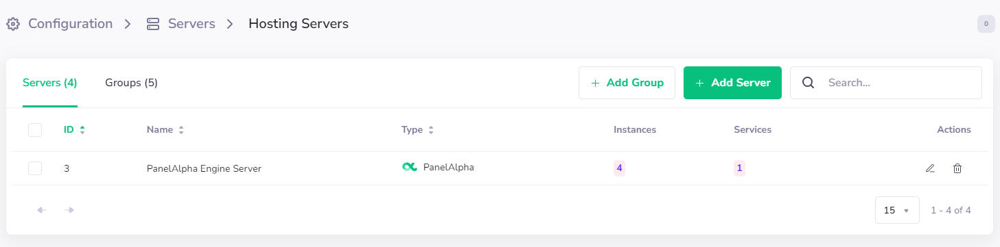
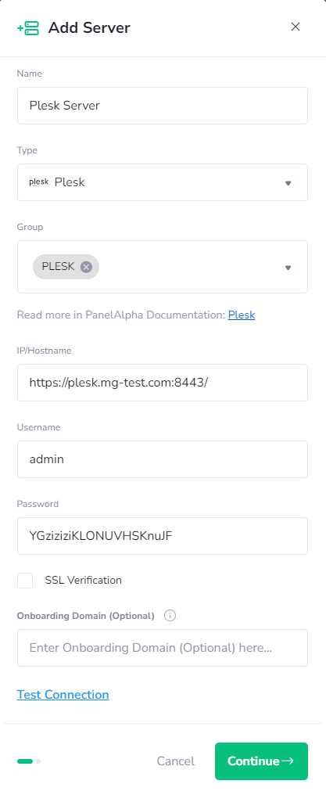
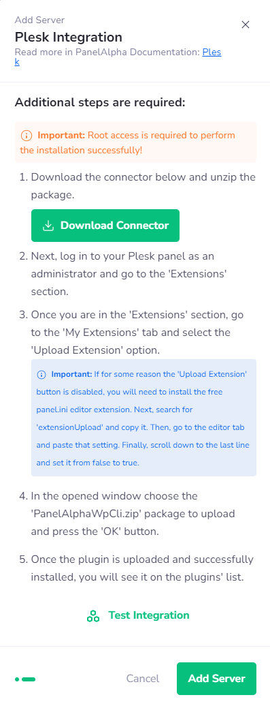
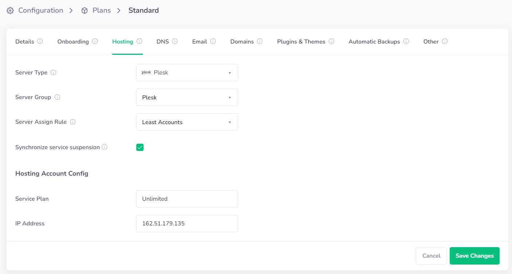
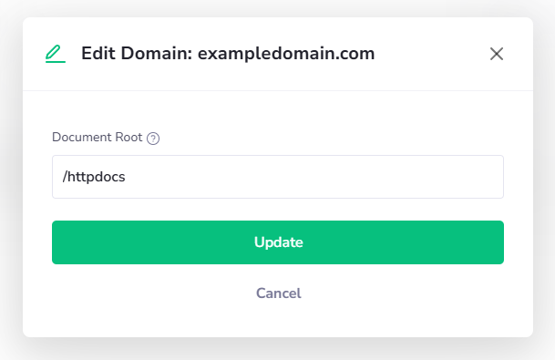

# Plesk

## Overview

PanelAlpha can connect to Plesk to provision and manage WordPress hosting on shared hosting environments.

## Prerequisites

- **Web Pro Edition** — minimum required Plesk Edition to connect with PanelAlpha

## Configure in PanelAlpha

Access your PanelAlpha admin area, then navigate to **Configuration → Servers → Hosting Services**. You will find a list of already installed servers, including the one added during platform installation via the wizard.

Fill out the form:

- **Name** — Enter the server name
- **Type** — Select Plesk
- **Group** — Choose an existing group or create a new one
- **IP/Hostname** — Enter the server IP address or hostname
- **Username** — Enter your account username
- **Password** — Enter your user password
- **SSL Verification** — Keep disabled for successful test connection results
- **Onboarding Domain (Optional)** — If entered, this domain is used for instance creation instead of the domain specified in the plan with Quick or Super Quick onboarding. Useful when multiple servers are assigned to a single group.
- **Test Connection** — Check if the connection is successful

Before continuing, you must test the connection. Only a successful connection allows you to proceed.

## Install the Connector (WP-CLI)

After a successful connection test, install the connector in Plesk:

1. Download the connector.
2. Log in to your Plesk panel as an administrator and navigate to **Extensions**.
3. Go to the **My Extensions** tab and choose **Upload Extension**. If the button is not active, install the free **panel.ini editor** extension:
   - Search for `extensionUpload` and copy it.
   - Go to the editor tab and paste this setting.
   - Scroll to the last line and change it from `false` to `true`.
4. Select the `PanelAlpha.zip` package for upload and click **OK**.
5. After successful upload and installation, the plugin appears in the list.
6. Verify the integration test is successful. Click **Add Server** to finalize.

## Plan Configuration

When creating a plan, go to the [Hosting](../system-configuration/plans.md#hosting-server) step. After choosing Plesk and assigning a server group, additional configuration appears.

Provide necessary information:

- **Hosting Plan** — Select the hosting plan for the subscription
- **IP Address** — Enter the [IP Address](https://docs.plesk.com/en-US/obsidian/administrator-guide/server-administration/ip-addresses-management.59410/) number
- **Reseller Account** — Enable/disable whether a "Choose User" modal appears during instance creation. When enabled, users can select themselves or another user, who will receive full access. A "Choose Hosting Plan" modal also appears.
- **Reseller Plan** — Select the appropriate reseller plan

**Note:** Reseller options are disabled if the connected Plesk server does not support resellers.

## Changing Document Root for Main Domain

**Tip:** Now you can change the main domain's document root directly from the PanelAlpha client area for Plesk servers. This feature is available for subscriptions created after update #LHI-201597-1490.

To change the document root for the main domain:

1. Go to the instance details in the client area.
2. Click the **Change Document Root** button next to the main domain path.
3. Enter the new folder name or path.
4. Confirm the change. The new root will be set in Plesk automatically.

**Note:** This option is only available for the main domain. For addon domains or subdomains, change the root directly in Plesk.
