# WP Cloud

WP Cloud Integration allows you to manage WP Cloud resources directly from the PanelAlpha dashboard.

For your convenience, a **video tutorial** explaining WP Cloud configuration is available below. If you prefer a text-based guide, it follows the video.

::docs-video{src="https://www.youtube.com/embed/muXu1gDMFvw"}
::

## Enabling WP Cloud API on Your Server

To enable WP Cloud integration, **request API access** by contacting [WP Cloud](https://wp.cloud/inquiries/).

When requesting a new API Key, note its purpose, include an **email address associated with the API Key**, and provide the **IP address** that will be used to access it.

## Configuration in Wizard

If you are installing PanelAlpha using the Wizard, add the WP Cloud hosting server during step 3, labeled "Connect Your Server." Provide:

- **Server Details:**
  - **Server Name** — for example "WP Cloud Server"
- **Server Type** — Select "Cloud" (third option)
- **Server Configuration:**
  - **Application Type** — Select **WP Cloud**
  - **Client Identifier** — Enter your unique Client Identifier obtained from WP Cloud
  - **API Key** — Enter the API Key provided by WP Cloud
  - **Test Connection** — Check if the connection is successful

**Important:** To obtain your Client Identifier and API Key, contact WP Cloud directly.

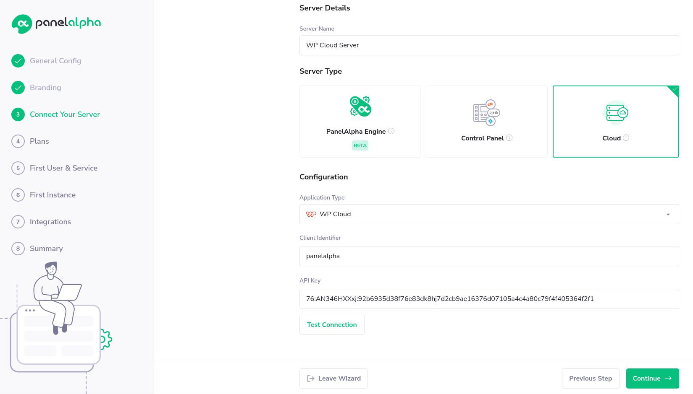

Test the connection. If successful, click **Continue**. The connection to WP Cloud is established automatically once configuration is completed.

## Configuration in Admin Area

If you are already using PanelAlpha, go to **Configuration → Servers → Hosting Servers → Add Server**.

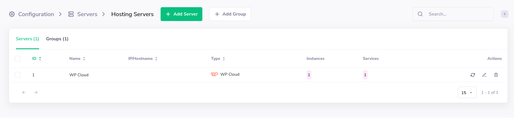

Fill out the form:

- **Server Name** — Enter the server name
- **Server Type** — Select **WP Cloud**
- **Client Identifier** — Enter your unique Client Identifier
- **API Key** — Enter the API Key provided by WP Cloud
- **Test Connection** — Check if the connection is successful

**Important:** To obtain your Client Identifier and API Key, contact WP Cloud directly.

Press **Add Server** to complete.

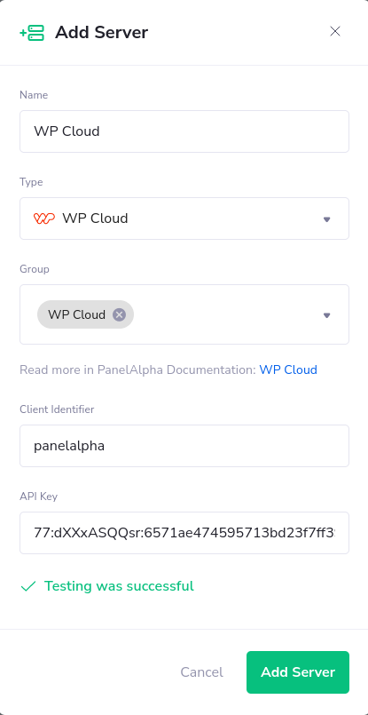

## Plan Configuration

When creating a plan, go to the [Hosting](../system-configuration/plans.md#hosting-server) step. After choosing WP Cloud and assigning a server group, additional configuration appears.

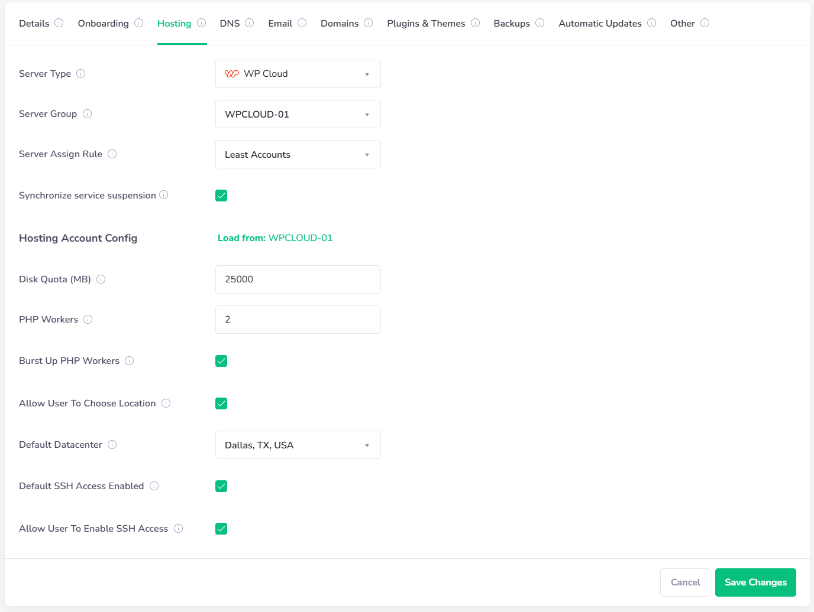

Provide necessary information:

- **Disk Quota** — Desired disk space. Provide in GB using suffix `G`/`GB` (for example `20G`, `20GB`) or in MB using `M`/`MB` (for example `20480M`). Minimum is **1GB**. Leaving empty defaults to **200G**.
- **PHP Workers** — Number of CPU and PHP Workers. Default range is 2–10. For configurations beyond this range, contact WP Cloud. Increasing to 10 enables bursting.
- **PHP Memory Limit** — Per-request PHP memory limit. Options depend on integration configuration (commonly 512 MB, 1024 MB, 1536 MB, 2048 MB).
- **Burst Up PHP Workers** — Enable dynamic scaling of PHP Workers.
- **Allow User To Choose Location** — If selected, end-users choose the site location. Disabled by default uses the default datacenter.
- **Default Datacenter** — Preferred datacenter:
  - Amsterdam, NL
  - Los Angeles, CA, USA
  - Washington, D.C., USA
  - Dallas, TX, USA
- **Default SSH Access Enabled** — Determines whether SSH access is enabled by default.
- **Allow User To Enable SSH Access** — Allows end-users to enable or disable SSH access.
- **Allow WordPress Multisite** - Allows users to convert their WordPress instance into a WordPress Multisite network (subdirectories). Disabled by default. The conversion cannot be undone from the panel. See [WordPress Multisite](../client-area-instances/advanced-settings.md#wordpress-multisite).

## Cron Jobs

PanelAlpha supports **Cron Jobs** for WP Cloud hosting accounts. WP Cloud currently supports only basic schedules:

- **Hourly**
- **Twice Daily**
- **Daily**
- **Weekly**

Custom cron expressions are not available, so PanelAlpha shows only compatible schedule options.

## Troubleshooting

### Staging Instances

WP Cloud offers **one staging instance per billable site**. This staging instance is for development and testing and **must not** be a live/production site. PanelAlpha automatically marks staging sites, and WP Cloud excludes them from billable site counts.

Information on creating staging instances: [Instance Details](../client-area-instances/instance-details.md#live-staging-instances)

### Imports and Migrations

- When you import a site from a source that lives in a subdirectory (for example `example.com/wordpress`), the new instance uses the main domain address of the site, for example `https://example.com`.
- If an import stalls on "downloading files," check that the source host allows custom PHP scripts and outbound FTP/HTTP. For cPanel migrations, ensure source account credentials work outside PanelAlpha first.
- After importing, verify DNS records were created on your DNS provider. If not, reassign the DNS server on the plan, then re-run DNS sync from **Configuration → Servers → DNS Servers → Zones**.
- Very large sites can exceed default PHP upload limits; increase limits on source/target and retry.
- For full onboarding and migration guidance: [WP Cloud Migration](../wp-cloud-migration/index.md)

### Client SSH Management

When WP Cloud is connected, PanelAlpha can automatically prepare an SSH key for Client SSH management and register it via WP Cloud API. This requires outbound network access from PanelAlpha to the WP Cloud Client SSH endpoint (TCP/22). If blocked, Client SSH management may be unavailable.

### Transferring Domains

#### Admin Area

Navigate to **Plan → [Other](../system-configuration/plans.md#other)** and enable **Allow Domain Transfer** to allow end-users to transfer domains already used by other clients.

When disabled, the domain transfer option is blocked, and end-users are informed that installing an instance on the selected domain is not possible.

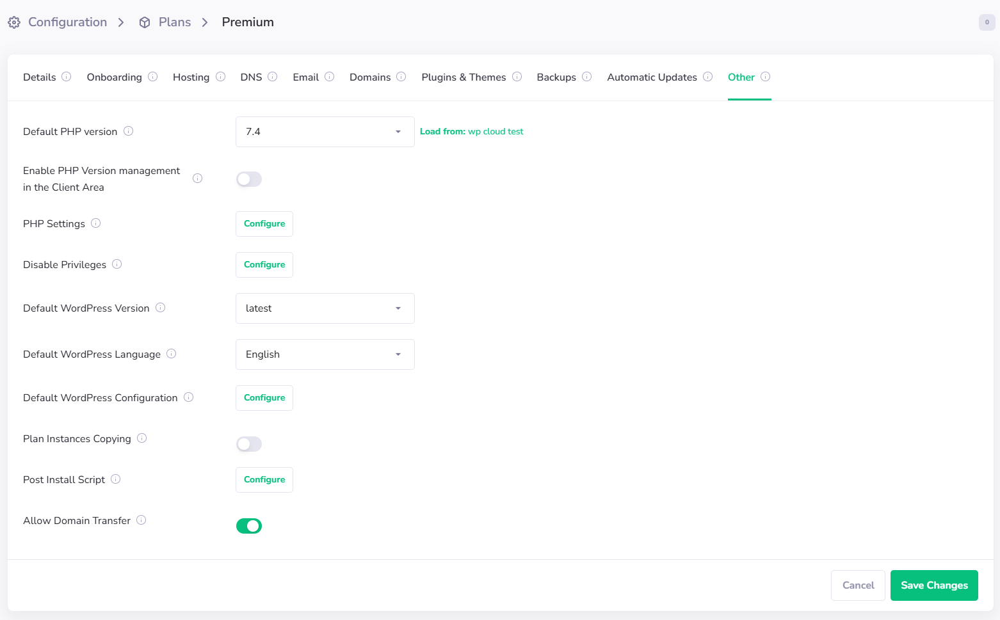

#### Client Area

When an end-user creates a new WordPress installation, the system checks if the domain is already associated with another client. If in use, the user receives a notification: *Domain mydomain.com has already been used in our system.* An option to transfer appears. To complete the transfer:

- Set up the displayed TXT record in the given domain.
- Click **Transfer Now**.

This verification is performed both when **installing new instances** and when **changing the domain** on an existing installation.

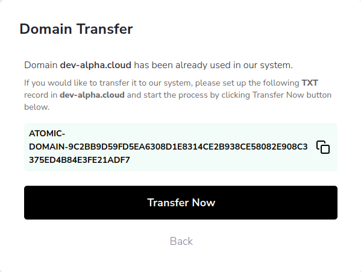

### Site Location

#### Admin Area

Navigate to **Plan → [Hosting](../system-configuration/plans.md#hosting-server)** and ensure **Allow User To Choose Location** is enabled. If not, create a new plan with this option enabled. If disabled, the default datacenter selection is used.

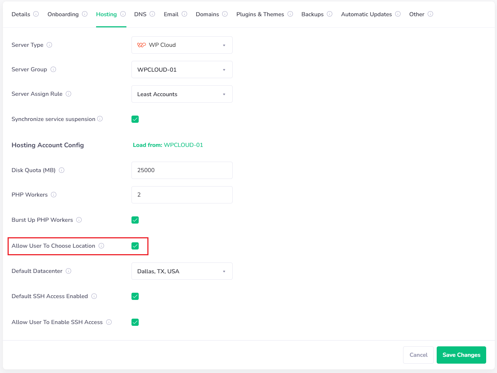

In the admin area, site location selection is visible when:
- Creating a new installation for a user
- Manually migrating an existing installation

#### Client Area

When an end-user creates a new WordPress installation, the system prompts them to select a site location when:
- Importing their installation
- Creating a new instance (standard, quick, and super-quick onboarding)

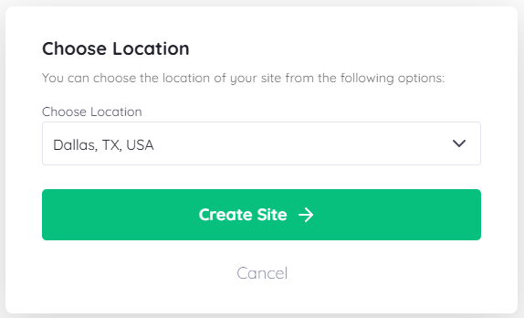

#### WHMCS Module

In the [WHMCS module](../billing-systems-integrations/whmcs.md#product), the **User Can Choose Location** setting is automatically selected when the plan option is enabled. A **Show Location On Order Form** button becomes visible, creating a custom field for site location selection during ordering. If disabled later, remove the custom field accordingly.

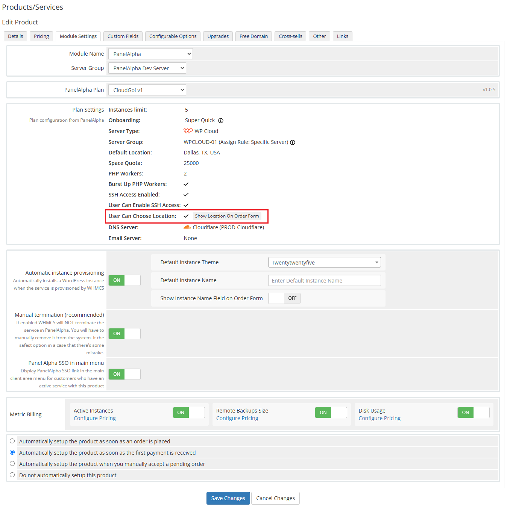

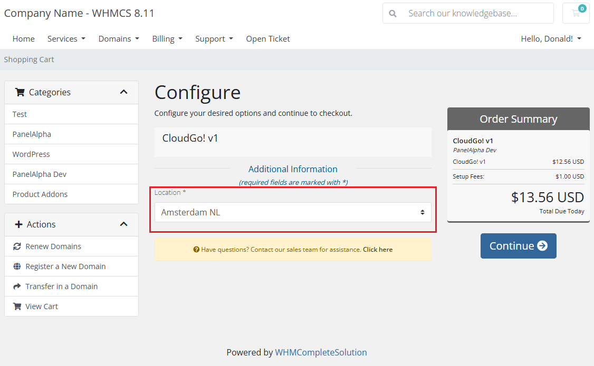

### Primary Domain

By default, the first domain registered by the client is set as primary. To change it, click the star icon next to the chosen domain. All other domains automatically redirect to the newly selected primary domain. The primary domain cannot be deleted.

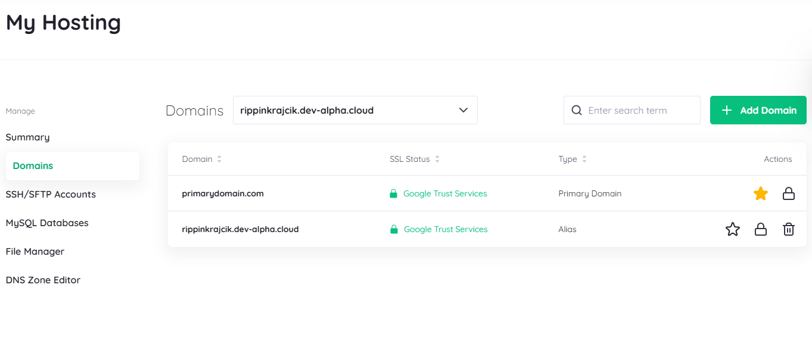

### Site Type

In the Admin Area, you can change the Site Type for each instance:

- **Billable** — Live or production sites
- **Staging** — Site used for testing, not billable
- **Internal** — Site for development and testing only, not billable

To change the Site Type, navigate to instance details and select the desired type.

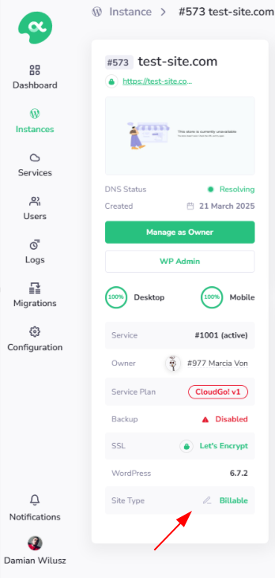

## DNS Configuration via DNS Templates

WP Cloud recommends configuring DNS records for proper email authentication. Automatically apply these records using PanelAlpha's DNS Templates.

Navigate to **Configuration → DNS Servers** and add the following records:

### Recommended DNS Records

#### SPF (Sender Policy Framework)

| Type | Host | Value |
|------|------|-------|
| TXT | @ | `v=spf1 include:_spf.wpcloud.com ~all` |

**Note:** For subdomains, use the subdomain name instead of `@`. If an SPF record already exists, add `include:_spf.wpcloud.com` before the final `~all`.

#### DKIM (DomainKeys Identified Mail)

| Type | Host | Value |
|------|------|-------|
| CNAME | wpcloud1._domainkey | wpcloud1._domainkey.wpcloud.com |
| CNAME | wpcloud2._domainkey | wpcloud2._domainkey.wpcloud.com |

#### DMARC (Domain-based Message Authentication)

| Type | Host | Value |
|------|------|-------|
| TXT | _dmarc | `v=DMARC1; p=none;` |

**Note:** Required if sending more than 5,000 emails per day. Policy options: `p=none` (monitoring), `p=quarantine` (spam folder), `p=reject` (block). Implementing stricter policies requires planning and testing.

By configuring these records in DNS Templates, all new WordPress installations on WP Cloud automatically have proper email authentication.

## Features List

**Admin Area**
- Server Integration:
  - Manage WP Cloud resources through PanelAlpha
  - Add WP Cloud as a server type
  - Set up servers using WP Cloud's Client Identifier and API Key
- Automatic WordPress Site Management:
  - Automatic provisioning when a service is created
  - Set space quotas
  - Select datacenter
- Configuration Per Plan:
  - Assign WP Cloud servers to specific plans
  - Define storage limits per plan
  - Choose between datacenters
  - Allow users to choose location
- Service Testing and Verification:
  - Test WP Cloud server connection

**Client Area**
- Instance Management:
  - View, create, edit, or delete WordPress instances
  - Change WordPress instance domain
  - Create staging instance
  - Move staging to live
  - Access WordPress Admin via SSO
  - Clone WordPress sites
  - Convert a site to WordPress Multisite (if allowed on the plan)
  - Manage site performance settings
  - Change PHP version
- Perform Actions:
  - Clear cache
  - Enable/disable maintenance mode
  - Manage backups and restore from backups
  - Monitor web hosting plan usage (disk space)
- Domain and Access Management:
  - Manage domains
  - Manage SFTP accounts
- Migration and Caching:
  - Handle site migrations
  - Manage edge cache
