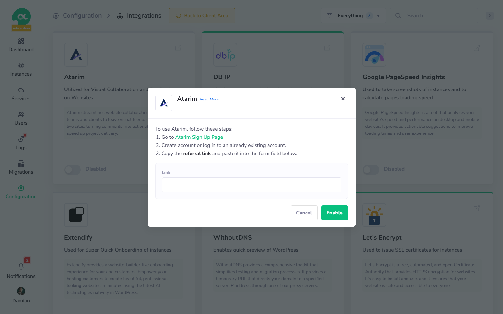
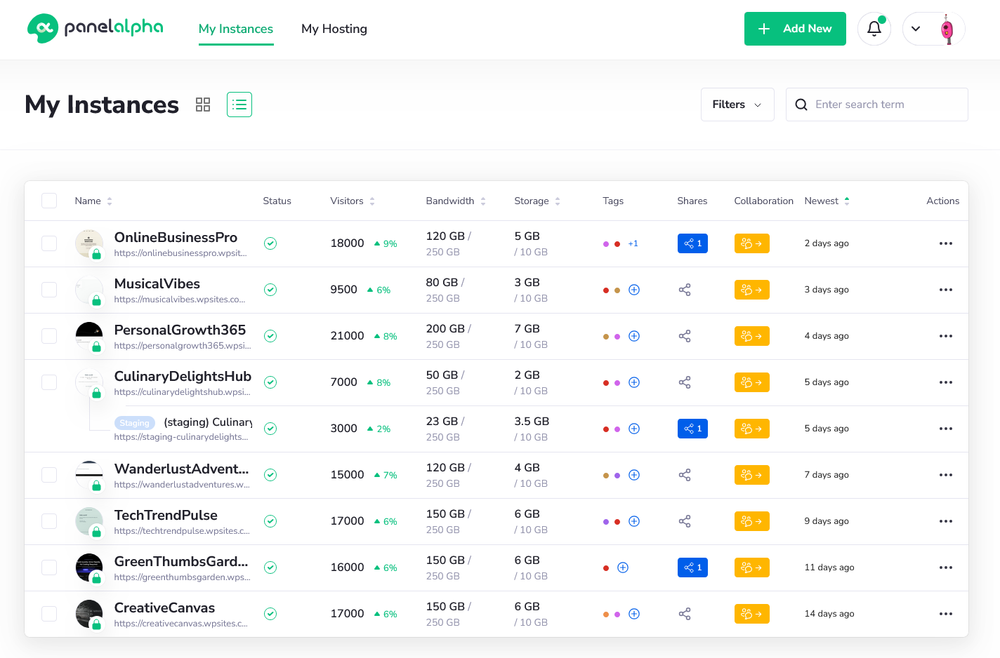
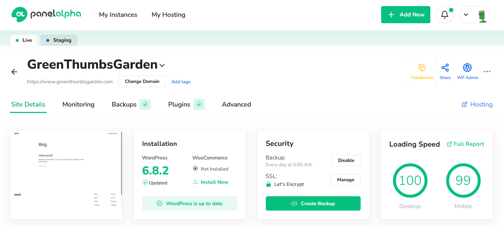

# Atarim Integration

Atarim streamlines website collaboration by allowing teams and clients to leave visual feedback directly on live sites, turning comments into actionable tasks.

## Configuration

To enable the Atarim integration:

1. Click **Configure**.

2. Paste the referral link into the form field.
3. Enable the integration.

## Atarim Referral Link

To obtain your referral link:

1. Go to the [Atarim Sign Up Page](https://atarim.firstpromoter.com/signup/32353)
2. Create an account or log in
3. Copy the referral link from your Atarim FirstPromoter dashboard

## Features

Once enabled, the Atarim integration provides:

- **Visual Feedback**: Clients can leave feedback directly on live WordPress sites
- **Task Management**: Comments are automatically converted into actionable tasks
- **Streamlined Workflow**: Faster project delivery through improved collaboration
- **Real-time Collaboration**: Teams and clients can collaborate effectively

## Benefits

- Improved client communication
- Faster project turnaround times
- Reduced back-and-forth emails
- Centralized feedback management
- Enhanced project visibility

## Client Area

Once enabled, clients see additional collaboration features:

### Instance List View

A new **Collaborate** icon appears for each instance.

### Instance Management

A **Collaborate** button appears in the instance management interface.

The Collaborate feature integrates seamlessly with the PanelAlpha interface.
