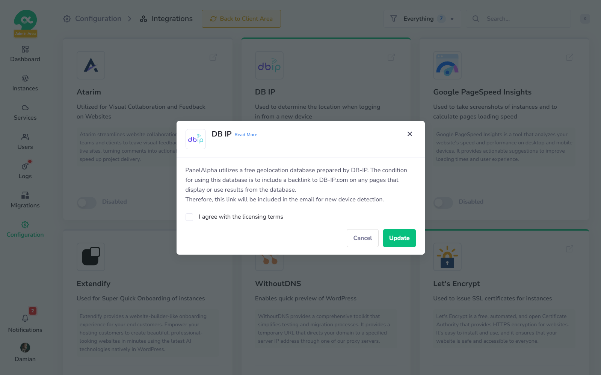

# DB-IP Integration

DB-IP integration is designed to identify logins from new devices.

DB-IP is a geolocation database that links IP addresses to physical locations. It facilitates tailored content and services for different regions, enhances targeted advertising, and improves user satisfaction.

## Installation

The installation is automatic. Simply enable the integration, as only active integrations can be configured.

## Configuration

Click **Configure** to review the DB-IP licensing terms. Indicate your agreement by checking the designated field. Your consent is necessary to proceed.

Licensing terms:

> [!NOTE]
> "PanelAlpha utilizes a free geolocation database prepared by DB-IP. The condition for using this database is to include a backlink to DB-IP.com on any pages that display or use results from the database. Therefore, this link will be included in the email for new device detection."

Press **Update** to confirm.
