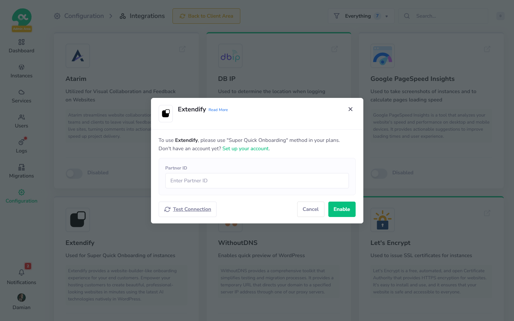
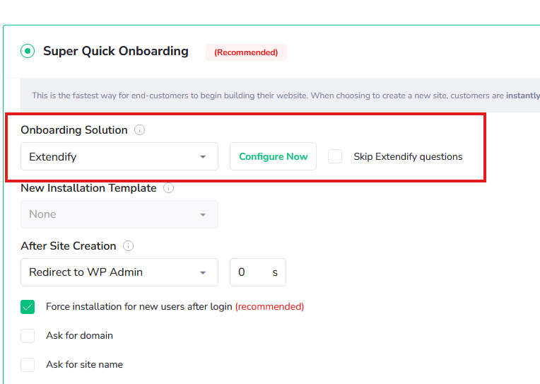

# Extendify

Enable Extendify to utilize the quickest onboarding method for WordPress instances: [Super Quick Onboarding](../onboarding-methods/super-quick-onboarding.md).

[Extendify](https://extendify.com/) offers a seamless onboarding experience similar to popular website builders. Integrate with PanelAlpha to empower hosting clients to effortlessly create professional-looking websites in minutes, leveraging AI technologies within WordPress.

## Installation

The installation is automatic. Enable the integration immediately, as only active integrations can be configured.

## Configuration

1. Enable the integration and click **Configure**.



2. In the configuration form, enter your **Partner ID** to connect with your Extendify account. You receive it from Extendify after creating an account. If you do not have an account, create one at [extendify.com/pricing](https://extendify.com/pricing/).

## Usage in Plans

Once Extendify is configured, utilize it as an onboarding solution when setting up [Super Quick Onboarding](../onboarding-methods/super-quick-onboarding.md) in your plans.

### Skip Extendify Questions

When configuring a plan with **Super Quick Onboarding** and **Extendify**, you can enable **Skip Extendify questions**.



When enabled, end-users bypass the Extendify onboarding questionnaire during site creation. The Extendify library and tools remain available in the WordPress dashboard, but users are not prompted with initial setup questions.

**Note:** This setting is configured per plan in **Configuration → Plans → Onboarding** when Super Quick Onboarding is selected.

## One-Step Website Creation with Direct Billing

When **Direct Billing** is enabled and the assigned trial plan uses **Super Quick Onboarding** with **Extendify**, you can use a one-step registration link that immediately starts website creation.

Example:

```
/register/email@example.com?new-site&description=this+is+a+website+about+a+great+bakery+in+kielce
```

How it works:

- PanelAlpha automatically creates the user account, service, hosting account, and WordPress instance.
- The `description` parameter is passed to the site creation flow as the website prompt.
- Extendify uses that description to generate the website based on the provided idea.

This is useful for trial flows and landing pages where you want the end-user to go from registration directly to an AI-generated website with minimal steps.
