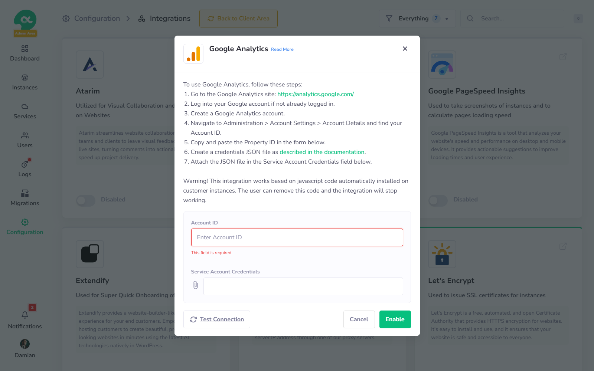
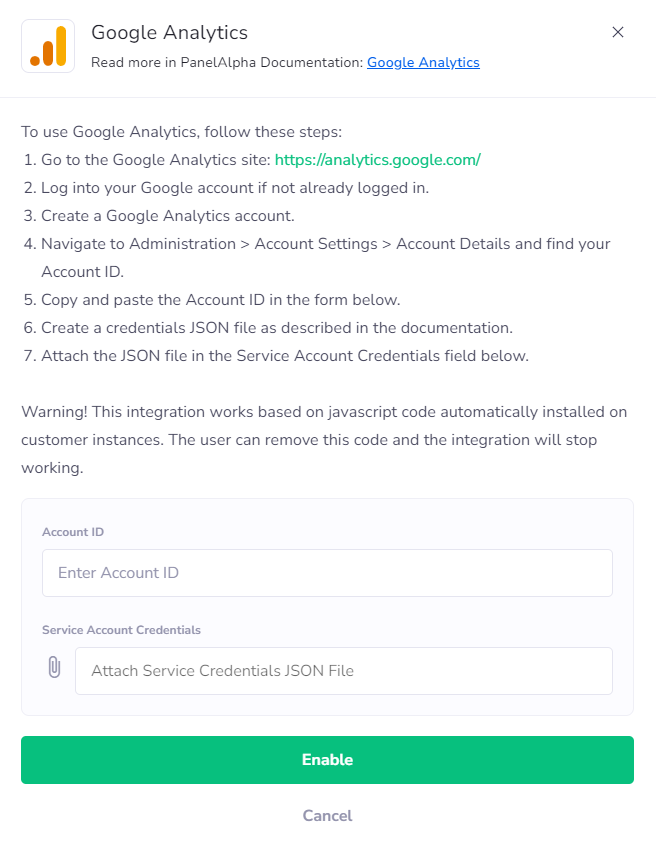
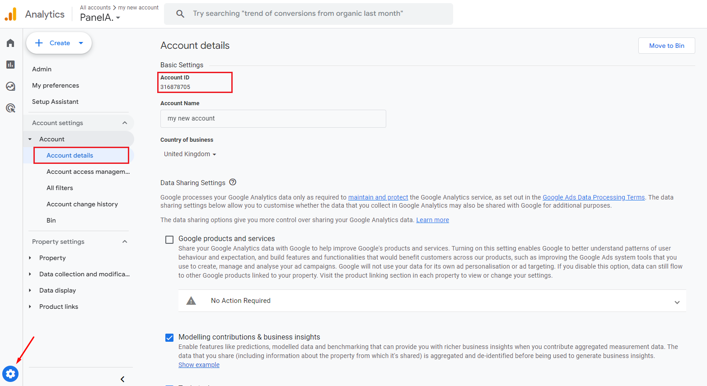
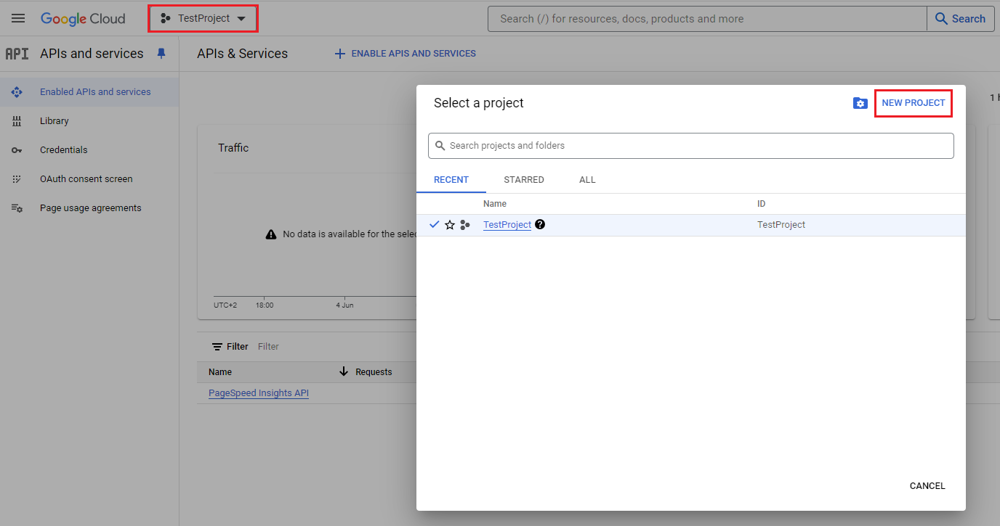
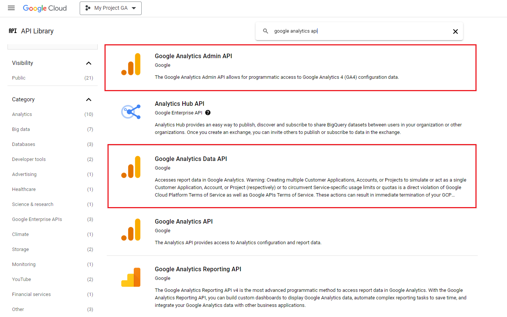
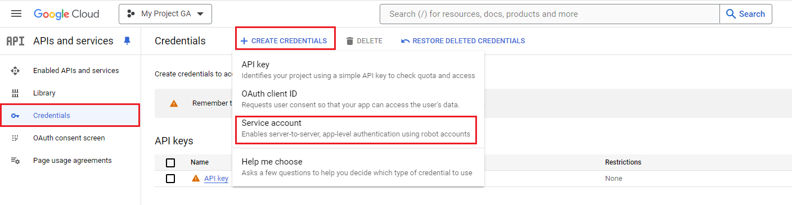
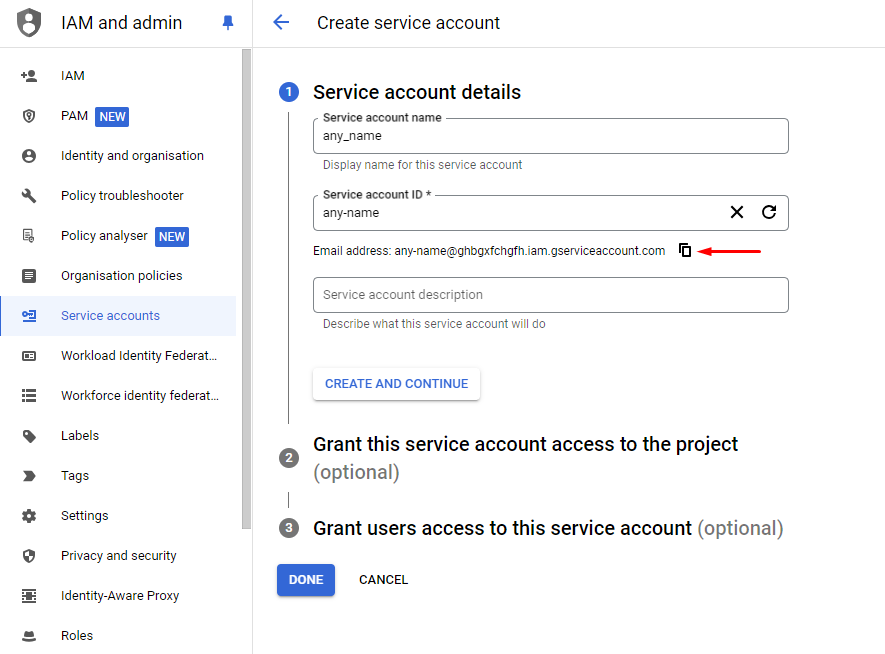
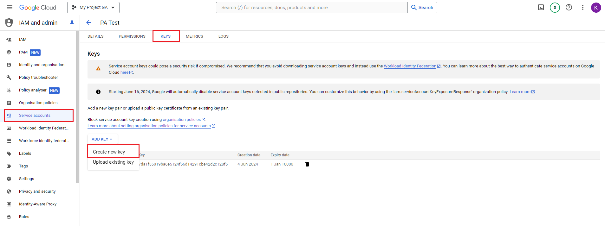
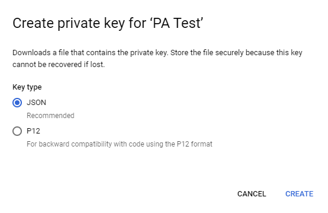
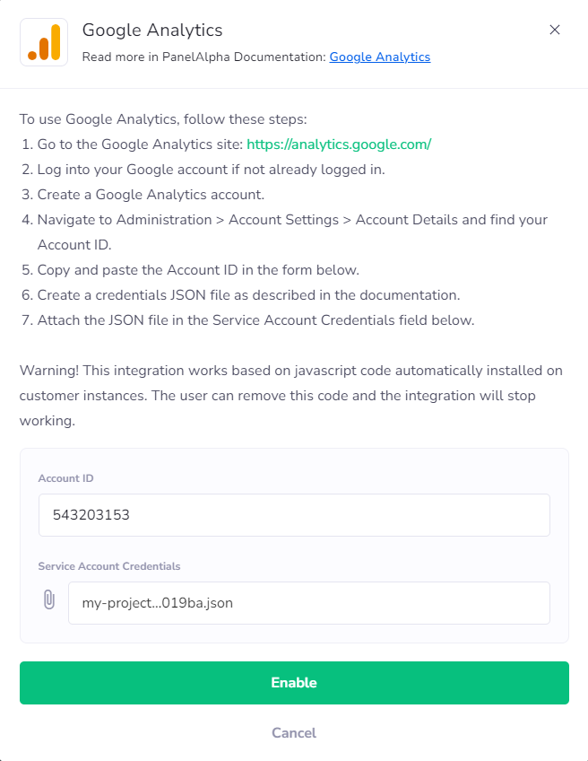

# Google Analytics

Integration with Google Analytics gathers and assesses data regarding website traffic.

Google Analytics tracks and reports website traffic, providing insights into user behavior to help you understand how visitors interact with WordPress websites and make data-driven decisions.

## Configuration

Google Analytics requires no installation. Proceed directly to configuration. Navigate to **Configuration → Integrations**, find Google Analytics under **Site Statistics**, and enable it. You will be taken to the configuration form immediately.

To complete the required information (Account ID and Service Account Credentials), follow the steps below.

## Google Analytics Account ID

1. Go to [Google Analytics](https://analytics.google.com/).
2. Log into your Google account if not already logged in.
3. Create a Google Analytics account. You may skip step 5 regarding data collection configuration.
4. Once ready, navigate to **Admin → Account Settings → Account Details** and find your **Account ID**.

Once your Account ID is configured, follow the steps below to configure the JSON file.

### Google Analytics JSON File

5. Navigate to [Google Cloud APIs](https://console.cloud.google.com/apis).
6. Create a new project by clicking **New Project**.

7. Open the newly created project and go to **APIs & Services → Library**.
8. Search for **Google Analytics Data API** and **Google Analytics Admin API**. Open each one and click **Enable**.

9. Navigate to **Credentials** and select **Create Credentials → Service Account**.

10. When filling out the service account details, **copy the email address** from the **Service Account ID** field.

11. Open your newly created service account, proceed to the **Keys** tab, and click **Add Key → Create new key**.

12. Select **JSON** as the key type and click **Create** to download the JSON file.

13. Go back to [Google Analytics](https://analytics.google.com/analytics/web/provision/#/provision) to grant permissions.
14. Navigate to **Admin → Property Access Management**. Click the **Plus** sign to add a new user.
15. Enter the saved email address (refer to step 10) and assign the role of **Administrator**.

### PanelAlpha Configuration

16. Go to **PanelAlpha admin area → Configuration → Integrations → Google Analytics**. Paste the **Account ID** (refer to step 4) and upload the saved **JSON file** into the **Service Account Credentials** field.

