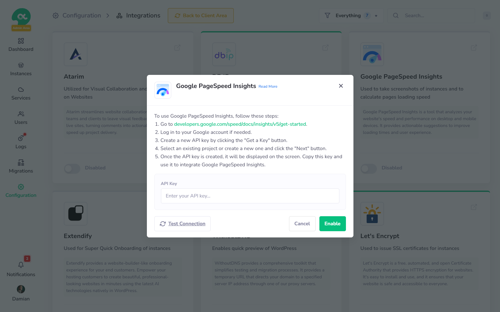

# Google PageSpeed Insights

Google PageSpeed Insights captures screenshots of instances and measures webpage loading speed.

It examines website speed and performance on desktop and mobile devices, offering practical recommendations to enhance loading times and user experience.

## Installation

The installation is automated and requires no manual intervention. Proceed directly to configuration.

## Configuration

1. Enable the integration and click **Configure**. This redirects you to a form with a URL for Google PageSpeed configuration.

2. Scroll down to the **Acquiring and using an API Key** section and click **Get a Key**. If you are not logged in, log in to your Google account. Choose to create a new project or select an existing one. Click **Next**.

3. Click **Show Key** to reveal the generated key. Copy it.

4. Return to your PanelAlpha platform configuration. Paste the key and click **Update**.
