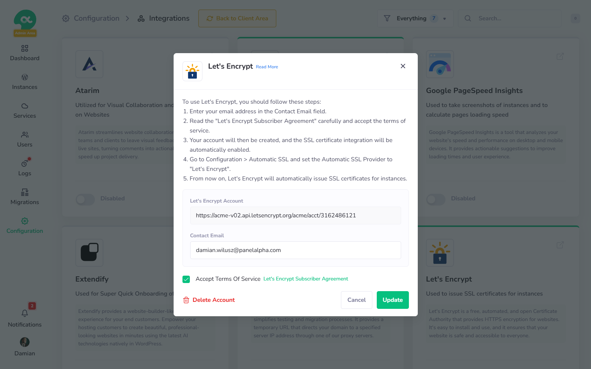

# Let's Encrypt

**Purpose:** Utilized for generating SSL certificates for instances.

Let's Encrypt is a third-party integration that facilitates the issuance of free SSL/TLS certificates for websites. SSL/TLS certificates secure web communications by encrypting data exchanged between a user's browser and a website.

## Installation

The installation of the Let's Encrypt integration is performed automatically. Proceed directly to configuration.

Enable the integration first. Only then can you proceed to configuration. Once active, the **Configure** button appears. Click it to continue.

## Configuration

The configuration form contains two fields:

- **Let's Encrypt Account** — Automatically populated with a link to your account.
- **Contact Email** — Provide an email address for communication.

If you do not have an account, fill in the **Contact Email** field. An account is created automatically.

- **Terms Of Service** — Mandatory. Read and agree to the terms before proceeding.

That's all; no further action is required. All certificates are generated automatically when **Let's Encrypt** is selected as the Automatic SSL provider.

For more information, refer to [Automatic SSL](../system-configuration/automatic-ssl.md).
