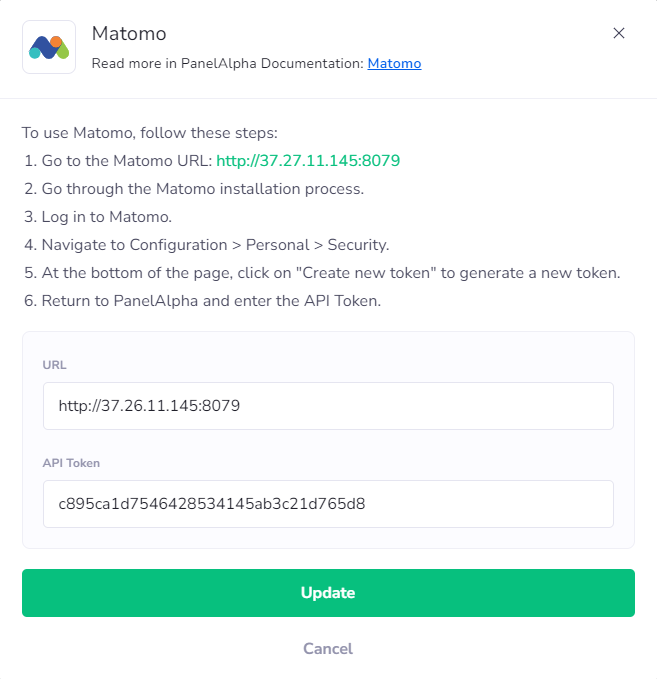

# Matomo

> [!IMPORTANT]
> **Important:** Since version 1.4.1, PanelAlpha no longer needs Matomo for site statistics and uses an internal tool instead. The Matomo integration will be removed in a future release. Disabling this plugin will not cause issues with site statistics.

Integration with Matomo has been introduced to gather and assess data regarding website traffic.

Matomo Analytics is an open-source web analytics solution offering extensive insights into website usage. It is designed to prioritize user privacy and data ownership.

## Configuration

Enable the integration and click **Configure**. You will be directed to a form with a URL to access the Matomo platform. The URL below is an example; the actual URL varies per installation.



Proceed to the provided URL.

## Installation

If Matomo is not installed yet:

1. A "Welcome" page appears. Start the installation by pressing **Next**.
2. Start the installation with the system check. If everything is fine, proceed.
3. Database setup — data are automatically fetched; press **Next** to continue.
4. Creating tables — tables are created automatically; press **Next** to continue.
5. Create a superuser account. The data entered here is used for logging into Matomo.
6. Set up a website — create the first website in Matomo.
7. JavaScript Tracking Code — skip this step.
8. Congratulations, your Matomo installation is ready. Press **Continue To Matomo**. You will be redirected to the login window.

## Log into Matomo

1. Use the superuser credentials to log in (see point 5).
2. Proceed to **Administration → Personal → Security**. Press **Create New Token**, provide a short description, and confirm.
3. Your API Token is generated immediately. Copy it and keep it safe.
4. Go back to **PanelAlpha → Configuration → Integrations → Matomo**. Paste the token in the API Token field and press **Update**.

### Additional Information

1. If you encounter problems accessing the configured Matomo address, modify the following file:
   ```
   /opt/panelalpha/app/packages/matomo/config/global.ini.php
   ```
   - Set the **enable_trusted_host_check** variable to **0**:
     ```
     enable_trusted_host_check = 0
     ```
   - Alternatively, add:
     ```
     trusted_hosts[] = "IP_ADDRESS:PORT"
     ```
   - Replace **IP_ADDRESS** with the server IP and **PORT** with the configured Matomo port (default is 8079).

2. To reset the Matomo password via command line:
   - Access your PanelAlpha server via SSH with root privileges.
   - Use the following command:
     ```
     (PASSWDHASH=`docker compose -f /opt/panelalpha/app/docker-compose.yml exec \
        matomo php -r 'echo password_hash(md5("YOUR_NEW_PASSWORD"), PASSWORD_DEFAULT);'` \
        && docker compose -f /opt/panelalpha/app/docker-compose.yml \
        exec database-matomo mysql -u"matomo" \
        -p"$(grep ^MATOMO_MYSQL_PASSWORD= /opt/panelalpha/app/.env | cut -d '=' -f2-)" \
        matomo -e "UPDATE matomo_user SET password = \
        '`echo $PASSWDHASH`' WHERE email = 'YOUR_EMAIL_ADDRESS'")
     ```
   - Replace **YOUR_NEW_PASSWORD** and **YOUR_EMAIL_ADDRESS** with correct values.
